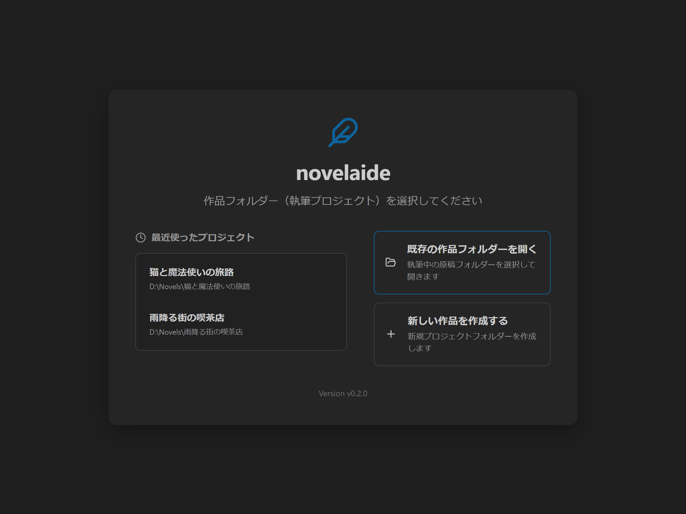

# プロジェクトの選択と新規作成

本ドキュメントでは、小説執筆エディター **`novelaide`** における作品フォルダー（プロジェクト）の開き方、新規作成、履歴からの開き方について説明します。

---

## 1. プロジェクト選択画面（ランチャー）の起動

アプリ起動時、またはステータスバーの「作品: 〇〇」をクリックすると、プロジェクト選択画面が表示されます。

---

## 2. 操作方法

### 2.1 既存の作品フォルダーを開く
1. 画面中央の **「既存の作品フォルダーを開く」** ボタンをクリックします。
2. OSのフォルダー選択ダイアログが表示されるので、小説原稿の入ったフォルダーを選択して「フォルダーの選択」を押します。
3. 自動的に執筆画面へ遷移し、ステータスバーやサイドバーに作品名が表示されます。

### 2.2 新しい作品を作成する
1. **「新しい作品を作成する」** ボタンをクリックします。
2. 保存先フォルダーと、作品タイトル（フォルダー名）を入力します。
3. **「作品を作成して開く」** をクリックすると、新規フォルダーが生成されてエディター画面が開きます。

### 2.3 最近使ったプロジェクトから開く
- 画面左側の **「最近使ったプロジェクト」** 一覧から、目的の作品名をクリックするだけで即座に前回の続きから執筆を再開できます。
- 履歴から削除したい場合は、各項目の右端にあるゴミ箱アイコンをクリックします。

### 2.4 エディターに戻る
- すでに作品を開いた状態でランチャーを表示している場合、右上の「×」ボタンを押すことで、そのまま執筆画面へ復帰できます。
