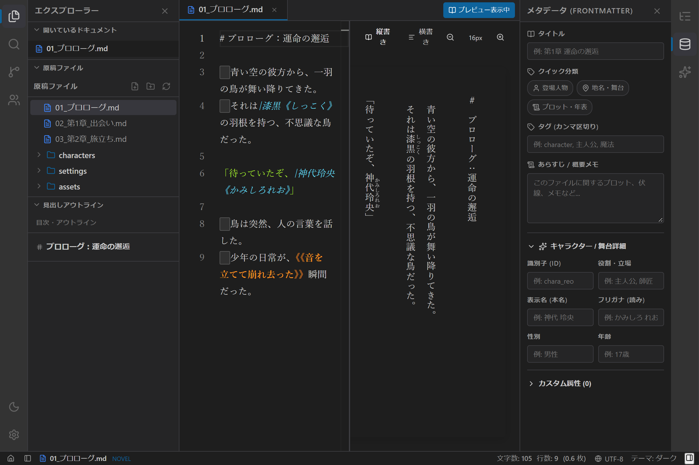

# メタデータと設定資料の使い方

## 1. 概要

`novelaide` では、小説本文ファイル先頭の **YAML Frontmatter** を活用し、登場人物、地名・舞台、プロット、概要メモなどの作品設定をエディター上で快適に管理できます。

本文の執筆画面を邪魔することなく、**右ペインの「メタデータ編集パネル」** で個別ファイルの設定を入力し、**左ペインの「設定資料・登場人物パネル」** からプロジェクト内の全設定をいつでも俯瞰・逆引きできます。

---

## 2. メタデータ編集パネルの使い方（右ペイン）

右アクティビティバーの **メタデータ（データベース）アイコン** をクリックすると、右サイドペインに現在開いているドキュメントのメタデータ編集パネル（`MetadataPanel`）が開きます。

### 2.1 基本情報
- **タイトル (`title`)**:
  - ドキュメントの話数タイトルや正式名称を入力します。
- **クイック分類タグ (`tagGroups`)**:
  - 👤 **登場人物** (`character`): キャラクター設定シートとしてタグ付け
  - 📍 **地名・舞台** (`location`): 国、都市、ダンジョンなどの舞台設定としてタグ付け
  - 📜 **プロット・年表** (`plot`): 全体プロット、構成メモ、タイムラインとしてタグ付け
  - ワンクリックでトグル追加・解除が可能です。
- **タグ (`tags`)**:
  - カンマ区切り（例: `主人公, 魔法, 帝国`）で複数のキーワードを自由に入力できます。
- **あらすじ / 概要メモ (`summary`)**:
  - その章のプロットや伏線、メモなどを複数行で自由に記録できます。

### 2.2 キャラクター / 舞台詳細属性
「キャラクター / 舞台詳細」アコーディオンを展開すると、小説執筆で頻出する属性を構造化して入力できます。
- **識別子 (ID)**: プログラムやAI参照用の固有ID（例: `chara_reo`）
- **役割・立場**: 主人公、ヒロイン、師匠、敵役など
- **表示名 (本名)**: フルネーム（例: `神代 玲央`）
- **フリガナ (読み)**: 読み仮名（例: `かみしろ れお`）
- **性別 / 年齢**: キャラクターの基本プロフィール

### 2.3 カスタム属性の動的追加
作品独自の設定（例: `magic_type: "風魔法"`, `birthday: "4月15日"` 等）を自由にキーと値で追加できます。
- 「新しいフィールド名...」に入力して `追加` を押すと、即座にカスタム属性行が追加されます。
- 不要になった項目は右側のゴミ箱アイコンで簡単に削除できます。

---

## 3. 設定資料パネル群（左ペインの独立パネル）

左アクティビティバーには、設定資料の種類に応じて **4つの独立したパネル** が用意されています。

- 👤 **登場人物パネル (`novelaid.panel.characters`)**:
  - キャラクター設定ファイルの一覧。役割別（主人公・主要人物、サブ、敵対者など）に自動グルーピング表示されます。
- 📍 **地名・施設パネル (`novelaid.panel.locations`)**:
  - 国・都市・ダンジョン・世界観設定ファイルの一覧。
- 📜 **プロット・構成パネル (`novelaid.panel.plots`)**:
  - 各巻・各章のプロットや年表ファイルの一覧。
- 🔖 **設定資料・収集一覧パネル (`novelaid.panel.metadataList`)**:
  - プロジェクト内の全設定資料を横断的に閲覧できる総合パネル。

### 3.1 高機能なフィルターバー
各パネルの上部には、目的の設定を素早く見つけるためのフィルターバーが備わっています。

1. **フリーワード検索**:
   - 名前、読み、メモ、タグをリアルタイムに絞り込み検索します。
2. **シリーズ・巻セレクタ**:
   - 長編作品や連作において、特定の「シリーズ」や「巻・本（1巻、2巻など）」に出現する人物や設定だけをフィルタリングできます。
3. **タグチップス（AND絞り込み）**:
   - 頻出タグチップをクリックして複数選択すると、**選択したすべてのタグを含むファイルのみ（AND条件）** が抽出されます。
4. **ワンクリックでジャンプ**:
   - 設定カードをクリックすると、対象ファイルが中央エディターで瞬時に開きます。

---

## 4. 安全なファイル保存（Rust連携）

入力した内容は `Ctrl + S`（または自動保存）により、Rust バックエンド（`tauri-plugin-novelaid-fs`）の `serde_yaml` を通じてファイル先頭に `---\n...---\n` 形式で安全にシリアライズ保存されます。エディター上には純粋な小説本文のみが表示されるため、原稿用紙換算カウントや縦書き文庫プレビューもメタデータに乱されることなく正確に機能します。
