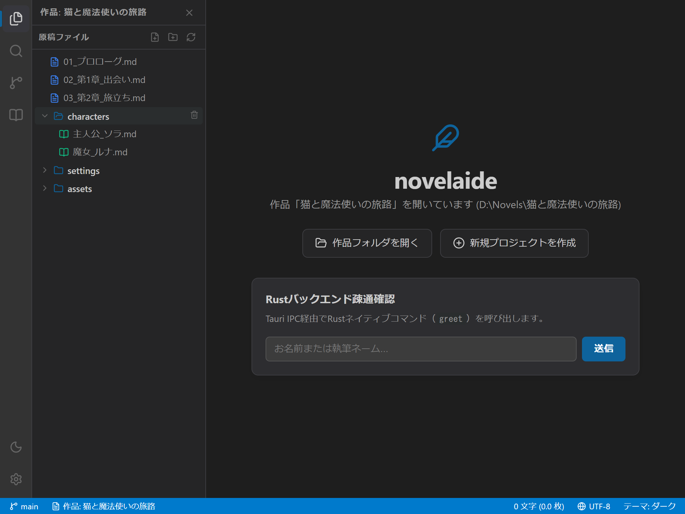

# 原稿ファイルとフォルダーの管理

本ドキュメントでは、小説執筆エディター **`novelaide`** のサイドパネルにある「ファイルエクスプローラー」を使った、原稿ファイルやフォルダーの操作方法について説明します。

---

## 1. ファイルエクスプローラーの見方

作品フォルダーを開くと、左側のサイドパネルにファイルやフォルダーの階層ツリーが表示されます。

### ファイルアイコンの識別
小説執筆に適した分かりやすい色とアイコンでファイル種別を識別できます。

* 📄 **青いドキュメントアイコン**: 小説本文ファイル（`.txt` など）
* 📖 **緑の本アイコン**: プロットや設定資料（`.md` など）
* 🖼️ **ピンクの画像アイコン**: イラストや地図画像（`.png`, `.jpg` など）
* 📁 **フォルダーアイコン**: 原稿の章立てや資料を分類するフォルダー（クリックで開閉）

---

## 2. ファイル・フォルダーの操作

### 2.1 新規ファイルの作成
1. エクスプローラー上部の **「新規ファイル作成」** ボタン（📄＋）をクリックします。
2. 入力欄が表示されるので、ファイル名（例: `04_第3章.md`）を入力して「作成」を押します。

### 2.2 新規フォルダーの作成
1. エクスプローラー上部の **「新規フォルダー作成」** ボタン（📁＋）をクリックします。
2. フォルダ名（例: `settings`）を入力して「作成」を押します。

### 2.3 ファイル一覧の更新
- 外部エディター等でファイルを追加・変更した場合は、ツールバーの **「更新」** ボタン（🔄）を押すと、即座に最新状態が反映されます。

### 2.4 ファイル・フォルダーの削除
- 各行にマウスカーソルを合わせると右端にゴミ箱アイコンが表示されます。クリックして確認ダイアログで「OK」を選択すると削除されます。
