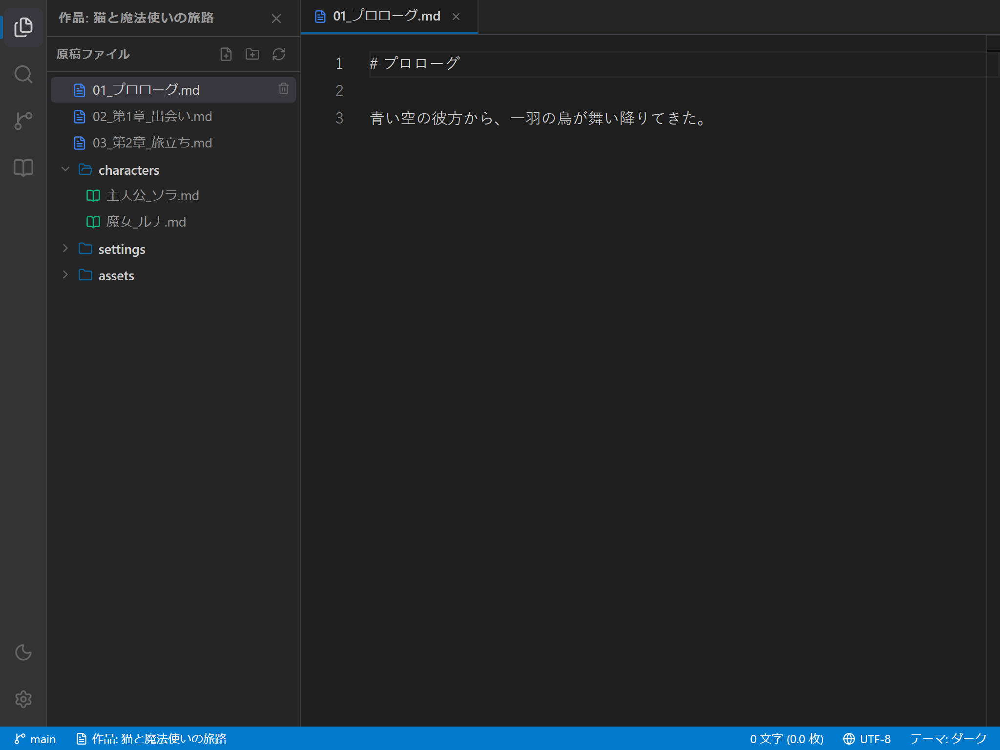

# 小説執筆エディターの使い方マニュアル

本マニュアルでは、**`novelaide`** における **小説本文エディターの基本操作、ルビ・台詞のハイライト、全角スペース表示、保存方法** について説明します。

---

## 1. 画面構成

エディター領域は、以下の要素で構成されています。

1. **エディタータブバー（最上部）**:
   - 開いているファイル一覧が表示されます。
   - **際立つアクティブタブ表示**: アクティブなタブは上端にアクセントカラーのラインが付き、左右の境界線と合わせてエディター本文と自然に一体化します。未保存の変更がある場合は上端ラインが鮮やかな赤色になり、保存状態が一目でわかります。
   - **マウスホイールでの水平スクロール**: タブバー上でホイールを上下に回すだけで、左右に滑らかにスクロールできます。
   - **開いているタブ一覧ボタン（`v`）**: タブバーの左端にある下矢印ボタンをクリックすると、開いている全タブが縦並びリストでポップオーバー表示され、目的のタブへ瞬時にジャンプ＆個別クローズが可能です。
   - **タブの右クリックメニュー**: タブを右クリックすると、「閉じる」「他のタブを閉じる」「右側のタブを閉じる」「すべてのタブを閉じる」「横に分割して開く」「分割プレビューで開く」などの便利な操作メニューが利用できます。
   - **自動スクロールイン**: エクスプローラーやエピソード移動等で画面外のタブが選択された際、自動的に可視範囲へスムーズにスクロールします。
   - **自動分割解除**: 左右分割中、右ペインのタブをすべて閉じると、自動的に分割が解除されて左ペインの単一全幅表示に戻ります。
   - **分割時のスマートボタン表示**: 左右分割中はアクションボタンがアイコンのみのコンパクト表示になり、タブ表示領域を広く保ちます。
2. **ファイルタイトルバー（インラインリネーム対応）**:
   - 現在開いているファイルのタイトル（拡張子なし）が大きく表示されます。
   - **タイトルをクリック（または Enter / Space）するとその場で編集モード**になり、ファイル名を直接変更できます。
   - `Enter` キーまたは枠外クリックで確定、`Escape` キーでキャンセルできます。
3. **本文入力エリア（中央）**:
   - VS Code と同様の強力なエディターエンジン（Monaco Editor）を採用。
   - 日本語小説に特化した「文字サイズ 16px」「ゆったりとした行間」「右端自動折り返し」で快適に執筆できます。
4. **エピソードナビゲーターバー（最下部フッター）**:
   - 同一フォルダ内に存在する前後のエピソード（小説原稿ファイル）への移動リンクが表示されます。
   - 左側に「◀ 前の話: [エピソード名]」、右側に「[エピソード名] : 次の話 ▶」が表示され、クリックするだけで直感的に原稿を前後に読み進めたり書き進めたりできます。
   - タブを増やさずにインプレイスで切り替わり、未保存の変更がある場合は自動的に安全保存されます。

---

## 2. 小説特有の記法ハイライト（`novelaid-ruby` 連携）

現行の `novelaid-editor` と同様に、小説特有の表現を視覚的にわかりやすく色分け表示します。

| 記法 | 入力例 | ハイライト表示 |
|---|---|---|
| **会話文（台詞）** | `「こんにちは」` または `『心の声』` | グリーン系で強調 |
| **ルビ記法（パイプあり）** | `｜魔力《マナ》` または `|魔力《マナ》` | ルビ部分をターコイズ／イタリック表示 |
| **ルビ記法（漢字連続）** | `魔法《まほう》` | 漢字直後の《》をルビとして自動認識 |
| **傍点（圏点）** | `《《ここを強調》》` | オレンジ色／太字で強調 |

---

## 3. 全角スペース（字下げ）の可視化

日本語小説では「段落の冒頭を全角1文字分字下げする」というルールが一般的です。
入力ミスや意図しない連続スペースを防ぐため、**全角スペース（`　`）の箇所には薄い四角い枠線** が自動表示されます。

- **半角スペースとの混同を防止**: 半角スペースと全角スペースが一目で区別できます。
- **印刷や出力時の安心**: 誤って行頭のスペースが抜けている箇所を瞬時に発見できます。

---

## 4. 便利な入力補完（インテリセンス）

エディター内で作家の入力をサポートするスマート補完機能が動作します。

- **三点リーダー（`……`） / ダッシュ（`――`）補完**:
  - 句読点（`。` `、`）や閉じ括弧直後以外の位置で、作法に沿った2倍角の `……` や `――` が補完候補として提示されます。
- **スマート閉じ括弧補完**:
  - `「` や `『`、`（` などの括弧を開いたまま執筆している場合、未閉じの対応括弧（例: `」 を閉じる`）が最優先候補としてサジェストされます。
- **設定資料（メタデータ）連携補完**:
  - プロジェクト内の登場人物設定や場所・地名設定から、キャラクター名や地名が補完候補（`登場人物` / `地名・舞台`）として自動サジェストされます。固有名詞のタイプミスや表記ゆれを防ぎます。

---

## 5. 右クリックコンテキストメニューと執筆支援

エディター上で右クリック、または専用ショートカットキーを使用することで、小説固有の記法をワンタッチで挿入できます。

| 操作メニュー | キーバインド | 動作説明 |
| :--- | :---: | :--- |
| **ルビを振る** | `Ctrl + R` | 選択文字列に対してルビ入力ダイアログを開きます。 ※ **形態素解析（Lindera）自動推測**: 選択漢字の平仮名読みが自動入力されるため、合っていればそのまま `Enter` キーを押すだけで即確定・挿入されます。 |
| **傍点を振る** | `Ctrl + B` | 選択文字列を `《《` と `》》` で囲み、傍点（強調）を振ります（未選択時は記号の間にカーソル）。 |
| **「」を追加** | `Ctrl + [` | 選択文字列を台詞括弧 `「` と `」` で囲みます。 |
| **『』を追加** | `Ctrl + Shift + [` | 選択文字列を二重括弧 `『` と `』` で囲みます。 |
| **―― を追加** | `Alt + -` | カーソル位置に2マスダッシュ（`――`）を挿入します。 |
| **…… を追加** | `Alt + .` | カーソル位置に2マス三点リーダー（`……`）を挿入します。 |

---

## 6. 保存とショートカットキー

- **`Ctrl + S`（Macは `Cmd + S`）**:
  エディター内で `Ctrl + S` を押すと、即座にローカルファイルへ安全に上書き保存されます。
  保存が完了すると、タブの赤色表示および `●` マークが消去され、最下部の**ステータスバーに「保存完了: [ファイル名]」がフラッシュ表示**されます。
- **安心の自動保存**:
  執筆を停止して3秒後、または別アプリへ切り替えた際にも自動保存が動作し、作家の大切な原稿を保護します。

---

## 7. 前後のエピソードへのスムーズな移動（エピソードナビゲーター）

小説原稿（`novel`）を執筆・推敲中、エディター最下部（フッター）に前後のエピソード移動ボタンが自動表示されます。

* **タブを増やさず快適遷移**:
  「◀ 前の話」または「次の話 ▶」をクリックすると、現在のタブが自動的に前後の原稿に切り替わります（エディタータブが無駄に増えて散らかることがありません）。
* **未保存原稿の自動保存**:
  現在の原稿に未保存の変更がある状態で前後のエピソードへ移動した場合でも、内容が失われることなく自動的にディスクへ保存されてから安全に切り替わります。
* **自然な順序での整列**:
  同一フォルダ内の原稿は、`01_プロローグ.md`, `02_第1章.md`, `10_第9章.md` などの数値表記を考慮した自然順序（Natural Sort）で並ぶため、意図した章立て通りに正確に読み書きを繋ぐことができます。

