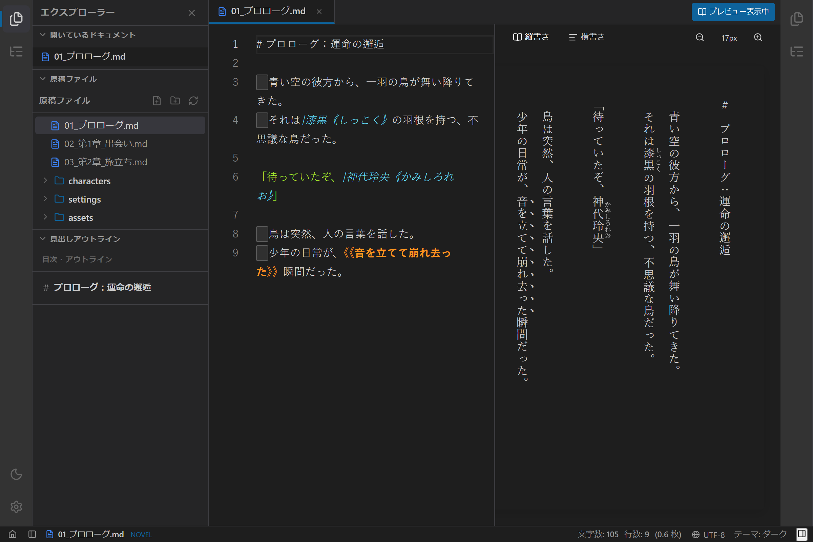

# 汎用エクスプローラーパネルの使い方

## 1. 概要

`novelaide` のエクスプローラーパネルは、単なるファイルツリーにとどまらず、**「開いているドキュメント」「原稿ファイル」「見出しアウトライン」** を折りたたみ可能なアコーディオンセクションとして統合した **汎用エクスプローラー（`ExplorerPanel`）** です。

---

## 2. 組み込みセクション一覧

エクスプローラーパネルは、以下の3つのセクションで構成されています。

### ① 開いているドキュメント (`OpenDocumentsSection`)
- 現在タブで開いている作業中ファイルの一覧をコンパクトに表示します。
- **未保存マーク（`●`）**: 変更が保存されていないファイルが一目でわかります。
- **ワンクリック切り替え**: ファイル名をクリックすると、即座に対象の原稿がエディターに表示されます。
- **閉じるボタン（`×`）**: ホバー時に表示される「閉じる」ボタンで、タブバーまで手を伸ばさずにタブを閉じることができます。

### ② 原稿ファイル (`FileTreeSection`)
- プロジェクトフォルダー配下の全原稿ファイル・設定資料・画像素材の階層ツリーです。
- ファイルやフォルダーの展開／折りたたみ、新規作成、削除などのファイル操作を行えます。

### ③ 見出しアウトライン (`OutlineSection`)
- 現在編集中の原稿に含まれる見出し（Markdownの `#` や、小説の `【第一話】`、`第〇章` 等）を自動抽出し、目次リストとして表示します。
- 右サイドペインを開かなくても、左エクスプローラー内で章節構造を確認しながら執筆できます。

---

## 3. アコーディオンの開閉操作

- **セクションヘッダーのクリック**: 各セクションのヘッダーバー（「開いているドキュメント」「原稿ファイル」「見出しアウトライン」）をクリックすると、展開状態と折りたたみ状態がトグルします。
- **作業フェーズに応じた伸縮**:
  - ファイルの整理に集中したいときは「原稿ファイル」だけを展開。
  - 推敲・構成チェックに集中したいときは「見出しアウトライン」だけを展開。
  - 執筆中の原稿を行き来したいときは「開いているドキュメント」を展開。
