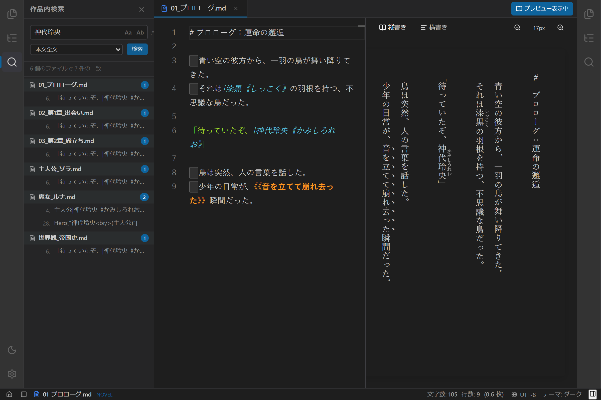

# 汎用検索パネルの使い方

## 1. 概要

`novelaide` の検索パネルは、単一のテキスト検索にとどまらず、**「本文全文検索」「設定・メタデータ検索」「セリフ特化検索」** などの検索ロジックをプロバイダーとして切り替え・統合可能な **汎用検索パネル（`SearchPanel`）** です。

---

## 2. 検索プロバイダーの種類

検索パネル上部のドロップダウンメニューから、目的や文脈に応じた検索対象プロバイダーを選択できます。

| プロバイダー名 | 検索対象 | 主な用途・特徴 |
| :--- | :--- | :--- |
| **全プロバイダー** | すべてのプロバイダー（本文・メタデータ・セリフ） | 小説プロジェクト全体を一度に横断して調べたい場合 |
| **本文全文検索** (`fulltext`) | プロジェクト配下の全原稿（`.txt`, `.md`）本文 | 作中の描写、用語、地名、伏線などを一括検索 |
| **設定・メタデータ検索** (`metadata`) | キャラクター設定、用語集、YAMLフロントマター | 登場人物の属性やタグ、世界観設定の確認 |
| **セリフ特化検索** (`dialogue`) | かぎ括弧（`「……」`、`『……』`）内の会話文のみ | キャラクターの口調・語尾チェック、セリフの表記揺れ防止 |

---

## 3. 検索オプション

検索バー右側の3つのトグルボタンにより、検索条件を細かく制御できます。

- **`Aa`（大文字・小文字の区別）**:
  - オンにすると、アルファベットの大文字・小文字を厳密に区別して一致させます。
- **`Ab`（単語単位で検索）**:
  - オンにすると、前後に単語境界がある場合のみ一致させます（英数字やコードの誤検出を防ぎます）。
- **`.*`（正規表現を使用）**:
  - オンにすると、JavaScript正規表現（例: `第[一二三四五]話`、`玲央.+?瞳`）を用いた柔軟な高度パターン検索が行えます。

---

## 4. 検索結果ツリーと原稿ジャンプ

検索を実行すると、マッチした箇所がファイルごとにグループ化されてツリー形式で表示されます。

- **ファイルヘッダー**: マッチした原稿ファイル名と、そのファイル内でのヒット件数（バッジ）が表示されます。ヘッダーをクリックすると結果の折りたたみ／展開が可能です。
- **行番号とプレビュー**: 各マッチ箇所について、行番号と該当行の前後文脈プレビューが表示されます。
- **ワンクリックでジャンプ**: マッチ項目をクリックすると、対象ファイルが中央エディターで自動的に開かれ、該当の行・位置へ瞬時にカーソルが移動します。
