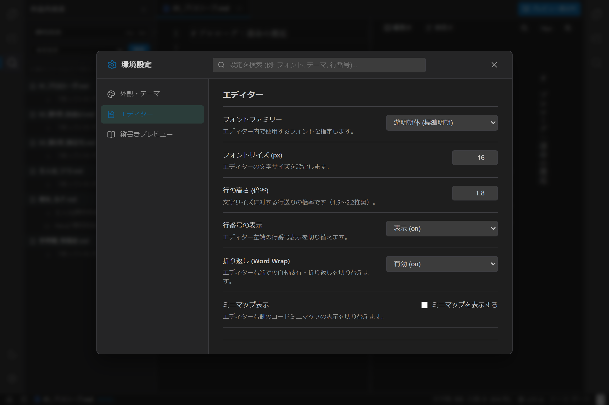

# 環境設定の使い方

## 1. 概要

`novelaide` の環境設定は、エディターフォント、行番号、折り返し、原稿用紙換算、縦書きプレビュー、カラーテーマなど、執筆環境を自分好みに最適化するための設定画面です。

各機能の設定項目は **「設定タブプラグイン」** として独立して登録されており、新機能の追加時にも設定項目が整然と整理されて追加されます。

---

## 2. 環境設定の開き方

以下のいずれかの方法で環境設定モーダルを開くことができます。

1. **左アクティビティバー最下部の歯車アイコン（⚙️）をクリック**:
   - 画面左端の縦型バーの一番下にある歯車ボタンを押します。
2. **ショートカットキー**:
   - `Ctrl + ,`（Macでは `Cmd + ,`）を押すと、即座に設定モーダルが表示されます。

閉じる際は、右上の `×` ボタンをクリックするか、キーボードの `Esc` キー、またはモーダル外側の背景をクリックします。

---

## 3. 設定カテゴリ一覧

### ① 外観・テーマ (`appearance`)
- **カラーテーマ**:
  - **🌙 ダーク**: 目に優しい黒基調の執筆テーマ。
  - **☀️ ライト**: 明るい白基調のクリアなテーマ。
  - **📜 セピア（原稿用紙）**: 懐かしい原稿用紙の紙色を模した柔らかな茶褐色テーマ。

### ② エディター (`editor`)
- **フォントファミリー**: 游明朝体、BIZ UD明朝、游ゴシック体、等幅フォントから選択。
- **フォントサイズ**: 文字サイズ（px）を10〜36pxの間で調整。
- **行の高さ（倍率）**: 文字サイズに対する行送りの倍率（1.2〜3.0）。ゆったりした行間で執筆可能。
- **行番号の表示**: 行番号の表示／非表示／相対行表示。
- **折り返し（Word Wrap）**: エディター端での自動折り返しの有効／無効。
- **ミニマップ表示**: エディター右側のミニマップ表示の切り替え。
- **原稿用紙換算設定**:
  - **1行あたりの文字数**（デフォルト: 20文字）
  - **1ページあたりの行数**（デフォルト: 20行）
  - ※ステータスバーに表示される「原稿用紙換算枚数」の計算基準を自由にカスタマイズできます。

### ③ 縦書きプレビュー (`preview`)
- **デフォルト組版方向**: プレビュー展開時の初期状態（縦書き／横書き）。
- **プレビューフォントサイズ**: 文庫本プレビューの初期文字サイズ。
- **文庫本フォント**: 縦書き組版で使用する明朝フォントファミリー。

---

## 4. 設定の検索・絞り込み

設定モーダル上部の検索バー（「設定を検索...」）にキーワード（例: `フォント`、`テーマ`、`原稿用紙` など）を入力すると、関連するカテゴリタブがリアルタイムに絞り込まれます。
目的の設定を素早く見つける際に活用してください。
