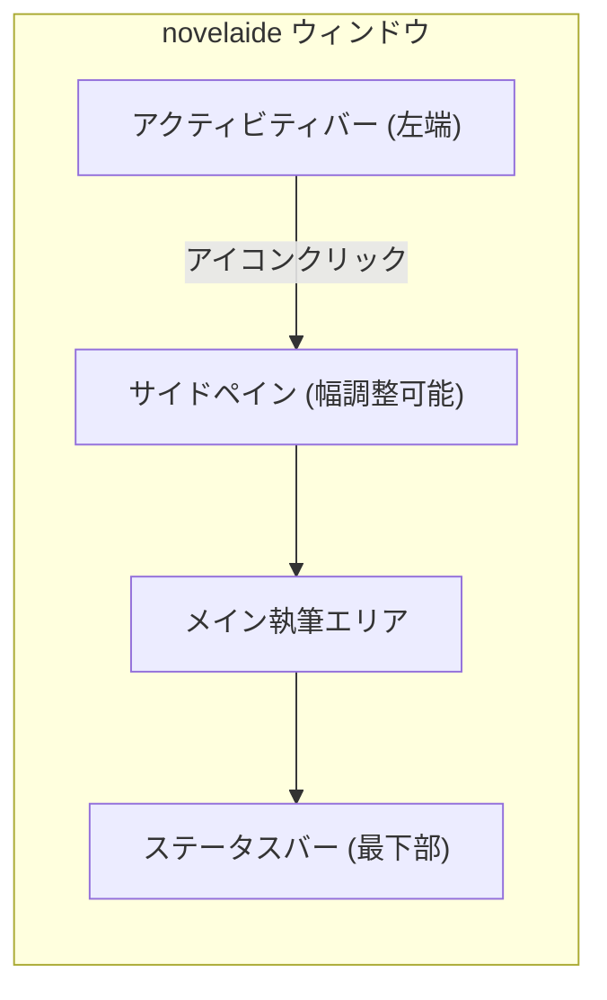
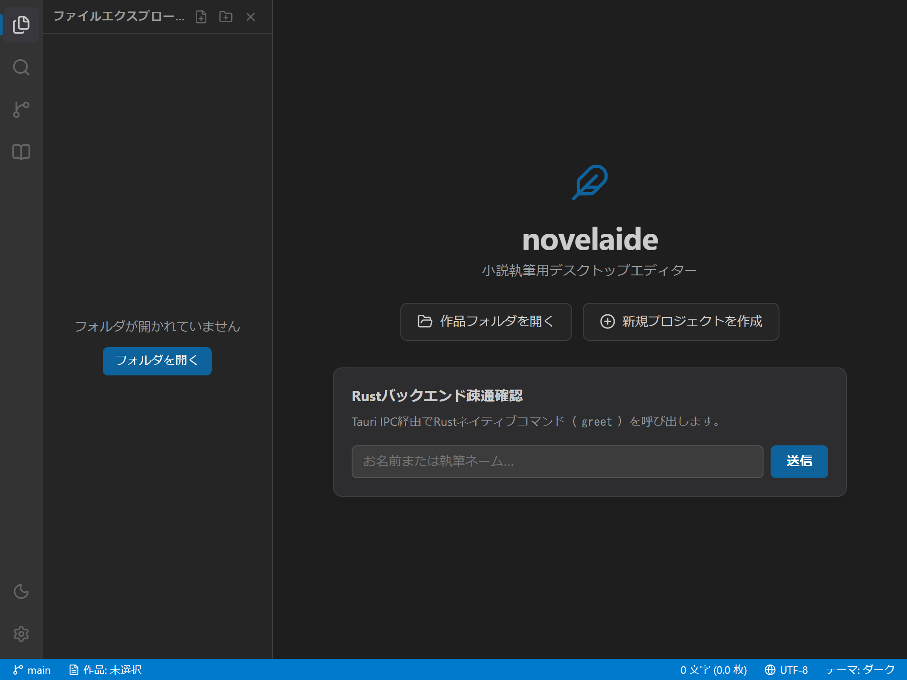
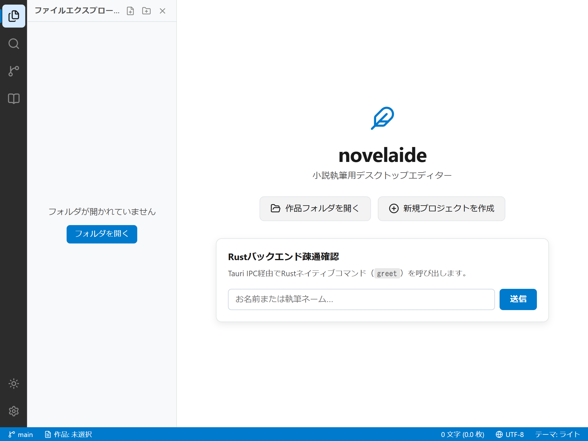
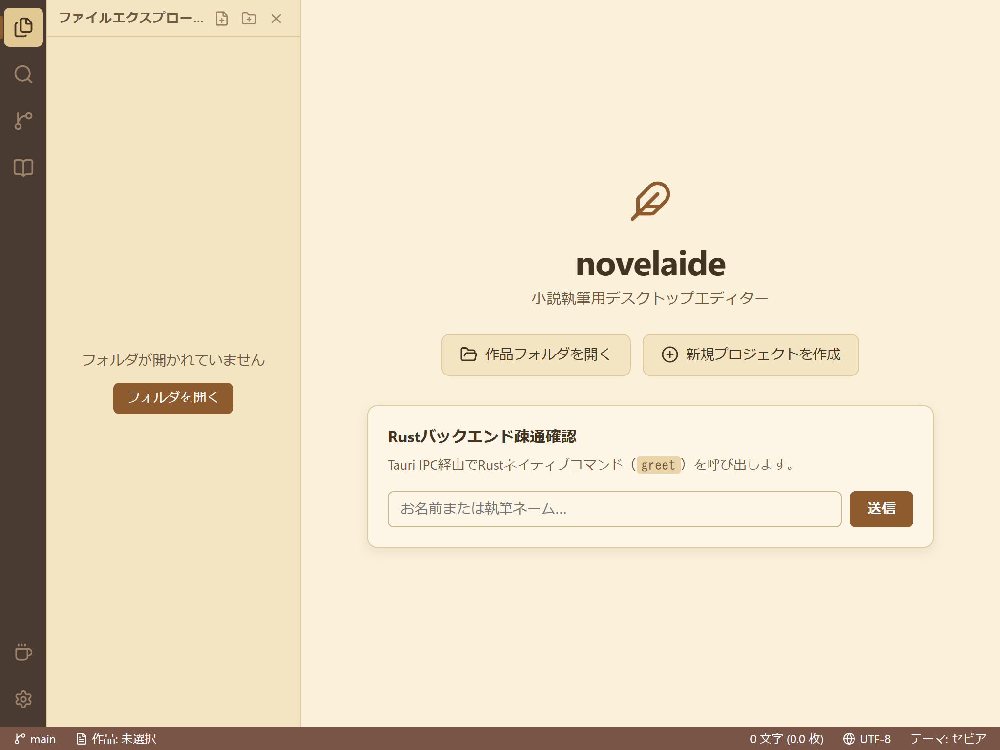

# 画面構成とテーマの切り替え

本ドキュメントでは、小説執筆エディター **`novelaide`** の画面構成と、テーマ（外観モード）の切り替え方法について説明します。

---

## 1. 画面構成の基本

`novelaide` の画面は大きく分けて4つのエリアで構成されています。

1. **アクティビティバー（左端の縦列）**:
   - 作業パネル（ファイル、検索、履歴、設定資料）の切り替えアイコンが並んでいます。
   - アイコンをクリックすると、対応するサイドペインが開きます（開いているアイコンを再度クリックすると閉じます）。
2. **サイドペイン（ファイルや設定の表示領域）**:
   - 原稿ファイル一覧や登場人物の設定などを表示・操作します。
   - ペイン右端の境界線をマウスでドラッグすることで、幅を自由に変更できます。
3. **メイン執筆エリア（中央の広い領域）**:
   - 執筆を行うメイン領域です。
4. **ステータスバー（最下部のバー）**:
   - 執筆文字数、原稿用紙（400字詰）の換算枚数、文字コード、適用中のテーマをリアルタイムで確認できます。

---

## 2. テーマ（外観モード）の切り替え方法

長時間の小説執筆を快適にするため、`novelaide` では好みに合わせたテーマを用意しています。

### 切り替え手順
1. **方法1（アクティビティバー）**: 左端の下部にある「太陽/月/コーヒー」アイコンをクリックします。
2. **方法2（ステータスバー）**: 最下部の右端にある「テーマ: 〇〇」の表示をクリックします。

クリックするごとに以下の順番でテーマが切り替わります：
**ダーク → ライト → セピア → システム追従 → （ダークへ戻る）**

### 画面サンプル

#### 1. ダークテーマ

#### 2. ライトテーマ

#### 3. セピアテーマ（原稿用紙風の温かい配色）

