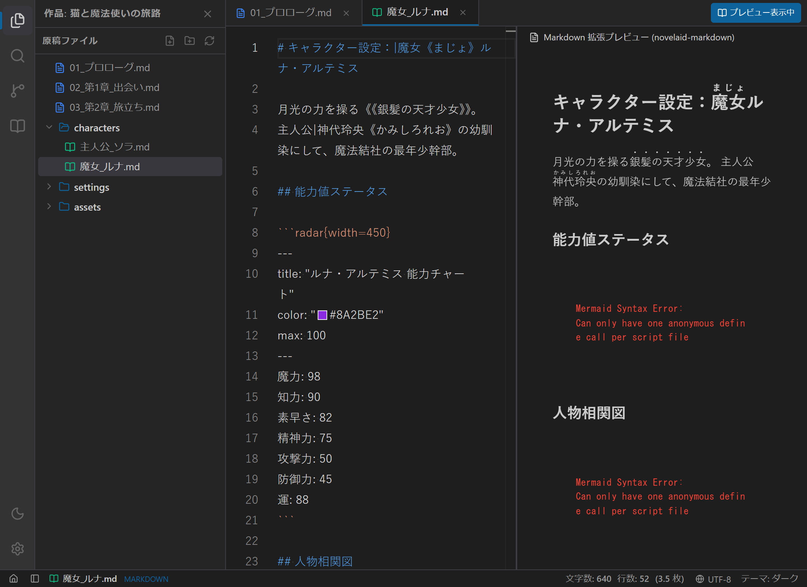
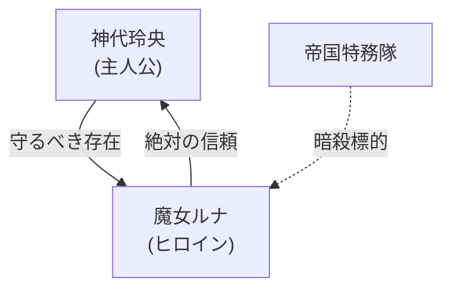

# 設定資料とMarkdown拡張描画の使い方

## 1. 概要

`novelaide` では、設定資料やプロット（`.md`）の表示に専用ライブラリ **`novelaid-markdown`** を採用しています。
一般的な文字装飾（見出し、太字、リスト、表など）に加え、小説執筆・世界観構築を支援する多彩な拡張描画に対応しています。



---

## 2. 利用可能な拡張描画機能

### 2.1 日本語ルビおよび傍点記法
小説本文と同じ直感的な記法で、設定資料内のキャラクター名や専門用語にルビ・傍点を付与できます。

```markdown
主人公|神代玲央《かみしろれお》は、《《銀髪の天才少女》》ルナと出会う。
```

### 2.2 ステータスレーダーチャート (`radar`)
キャラクターの能力値やモンスターのステータスを多角形チャートでグラフィカルに表示できます。

````markdown
```radar{width=450}
---
title: "ルナ・アルテミス 能力チャート"
color: "#8A2BE2"
max: 100
---
魔力: 98
知力: 90
素早さ: 82
精神力: 75
攻撃力: 50
防御力: 45
運: 88
```
````

### 2.3 Mermaid ダイアグラム (`mermaid`)
人物相関図、勢力図、ストーリーフローチャート、時系列チャートをレンダリングできます。

````markdown

````

### 2.4 インタラクティブ・マップ表示 (`map`)
作中世界の舞台地図を埋め込み、重要ポイントにアイコンマーカーと解説ポップアップを設置できます。

````markdown
```map
id: luna-hideout
width: 100%
height: 380px
lat: 35.681236
long: 139.767125
defaultZoom: 13
marker:
  - book, 35.681236, 139.767125, 月影の秘密研究所, "古代の禁呪や調合器具が隠された拠点"
  - school, 35.689506, 139.691701, 王立魔導学園, "ルナが通っていたかつての学園"
  - default, 35.676231, 139.752311, 逢魔が時の辻, "主人公玲央と再会した交差点"
```
````

---

## 3. ドキュメント内リンクのクリック遷移

Markdown内の相対パスリンク（例: `[第1話プロット](./01_plot.md)` や `[世界観設定](../settings/world.md)`）をクリックすると、自動的にエディター内の新しいタブで対象ファイルが開きます。
外部URL（`http://` または `https://`）の場合は、OSの既定ブラウザで安全に外部ページを開きます。
