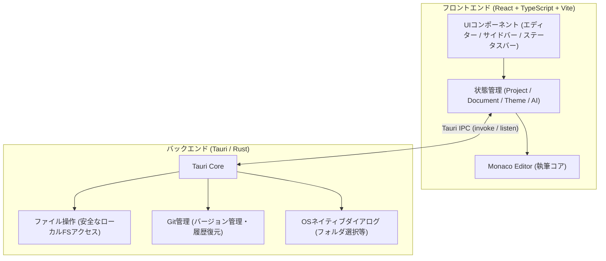

# 第1回：小説執筆エディターを創ろう —— novelaid-editor 再実装計画の策定

こんにちは！ 今回から本格的に始まる小説執筆エディター開発プロジェクト **「novelaide」**（コードネーム: novelaid-e）のメイキング連載です。

前回の [第0回：はじめに](./00_はじめに.md) では、本プロジェクトの立ち上げ背景や参照するリポジトリ群、開発環境について紹介しました。

今回はその第1歩として、**「以前作成した Electron版小説執筆エディター（novelaid-editor）の機能を、どのようにTauriへ移植・再実装していくか」** という全体計画を立てていきます。

本連載の大きな特徴は、**「プログラム初心者の方が記事を読みながら、自分だけの小説執筆アプリを同じように作れること」** を目指している点です。そのため、いきなり難解なコードを大量に書くのではなく、1つひとつの目的や仕組みが実感できるように、とても細かいスモールステップで進めていきます。

---

## 1. 今回の課題と入力したプロンプト

アプリ開発で一番挫折しやすいのは、「作りたい機能がたくさんありすぎて、何から手をつければいいかわからなくなること」です。

現行の `novelaid-editor` は、ファイルツリー管理、Monaco Editor、ルビ表示、文字数カウント、校正機能、Git連携、AI執筆アシスタントなど、非常に多くの機能が詰まっています。これを一気に作ろうとすると、初心者にとっては何が起きているのか分からなくなってしまいます。

そこで、AIエージェントに次のようなプロンプトを投げ、初心者がステップバイステップで理解できる計画の策定を依頼しました。

### 実際に投げたプロンプト
> 本プロジェクトは、小説執筆用エディターを作成するプロジェクトであり、同時にそのシステム構築経過自体も記録・記事化していくものです。  
> また、novelaideは、既存の、novelaid-editor、novelaid-editor-nextを再検討、再実装するとともに、その開発過程を再度記事化することを目的として、一から作成しなおします。
>
> フレームワークとしては、Tauriを使用します。
> アプリの名称としては、`novelaide`とします。
>
> まず、現在のnovelaid-editor相当部分までの移植、再実装計画を立ててください。
> なお、本プロジェクトは作成過程の記事化も目的であり、プログラム初心者が記事を読んで同様に再実装可能とすることも目的としています。
> そのため、段階的に実装の目的や意図が分かるように細かい単位で作業を進めてください。

---

## 2. AIによる設計・実装プロセス

プロンプトを受けたAIは、過去の `novelaid-editor`（Electron版）、`novelaid-editor-next`（Tauriプロトタイプ版）、そしてドキュメント類（`novelaid-editor-docs`）を横断して調査し、全機能を8つのフェーズ、計24以上の小さなステップに分解してくれました。

策定した全体アーキテクチャと各フェーズの流れは以下の通りです。

### 全体アーキテクチャ図



---

### 段階的ロードマップ（全8フェーズ）

初心者の方が「動いた！」という達成感を味わいながら進められるよう、以下の順番で構築していきます。

```
【ロードマップ全体像】
Phase 1: アプリの土台作り（プロジェクト初期化・テーマ・3ペインUI）
   ↓
Phase 2: プロジェクト管理とファイル操作（フォルダを開く・ファイルツリー）
   ↓
Phase 3: 小説執筆エディターの実装（Monaco Editor・タブ・ルビハイライト）
   ↓
Phase 4: 執筆進捗とステータス・プレビュー（文字数/原稿用紙換算・プレビュー）
   ↓
Phase 5: 設定とメタデータ管理（Frontmatter解析・登場人物一覧・設定画面）
   ↓
Phase 6: バージョン管理（小説家向けに分かりやすいGit連携・履歴保存）
   ↓
Phase 7: 校正支援とAI執筆パートナー（日本語校正・AI壁打ちチャット）
   ↓
Phase 8: パッケージングと完成（アイコン設定・デスクトップアプリ配布）
```

#### 各フェーズの狙いと初心者が学べるポイント

1. **Phase 1: アプリの土台作り**
   - **狙い**: まずは真っ新な状態から「デスクトップウィンドウが表示される」「ダークモードが切り替わる」という基本画面を作ります。
   - **学べること**: Tauriの基本構造、Vite + Reactの動かし方、CSS変数を使ったテーマ設計。
2. **Phase 2: プロジェクト管理とファイル操作**
   - **狙い**: 小説の原稿フォルダをアプリで開き、ファイル一覧をツリー形式で表示・作成できるようにします。
   - **学べること**: Tauriのバックエンド（Rust）とフロントエンド（React）がどう通信してローカルファイルを安全に読み書きするか。
3. **Phase 3: 小説執筆エディターの実装**
   - **狙い**: VS Codeのエンジンでもある「Monaco Editor」を組み込み、小説特有のルビ記法などを色分け表示できるようにします。
   - **学べること**: 高機能エディターの組み込みと日本語入力への配慮、タブによる複数ファイル管理。
4. **Phase 4: 執筆進捗とステータス・プレビュー**
   - **狙い**: 「今何文字書いたか」「400字詰原稿用紙で何枚分か」をリアルタイム表示し、Markdownやルビを美しくプレビューします。
   - **学べること**: リアルタイムテキスト解析、エディターとプレビューのスクロール同期。
5. **Phase 5: 設定とメタデータ管理**
   - **狙い**: 各章ファイルの先頭に書くYAML形式のメモ（登場人物やあらすじ）をパースし、一覧表示・編集できるようにします。
6. **Phase 6: バージョン管理（Git）**
   - **狙い**: 小説家にとって大切な原稿が消えないよう、Gitの機能を「履歴保存」「巻き戻し」といった分かりやすい言葉で提供します。
7. **Phase 7: 校正支援とAI執筆パートナー**
   - **狙い**: 助詞の重複やら抜き言葉のチェック、Gemini等のAIと相談できる壁打ちチャットを実装します。
8. **Phase 8: パッケージングと配布**
   - **狙い**: 出来上がったアプリをインストーラー化し、他のパソコンでも使えるようにします。

---

## 3. 作成された仕様書

今回の計画の詳細は、開発仕様書としてリポジトリ内の [docs/dev/novelaid-editor移植・再実装計画.md](../../docs/dev/novelaid-editor移植・再実装計画.md) にまとめられました。

これにより、「次は何を作るべきか」「どのファイルに何を書くのか」が常に明確な状態で、迷わず開発を進められるようになっています。

---

## 4. まとめと次回予告

今回は、小説執筆エディター `novelaide` を一から創り上げるための「移植・再実装計画」を策定しました。

全体の見取り図ができたことで、初心者の方でも「今どこを作っていて、次に何ができるようになるのか」をイメージしながら読み進めていただける準備が整いました。

次回は **「Phase 1: アプリの土台作り —— Tauri 2.x + React環境の構築と起動確認」** に入ります！  
実際にコマンドを実行してデスクトップアプリのウィンドウを表示させるところからスタートします。どうぞお楽しみに！
