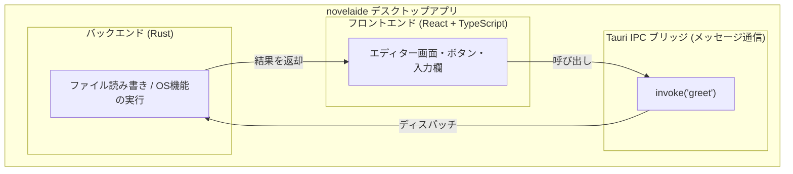

# 第2回：最初の一歩 —— Tauri 2.x + React でデスクトップアプリの土台を創る

こんにちは！ 小説執筆用エディター **「novelaide」**（コードネーム: novelaid-e）のメイキング連載第2回です。

前回 [第1回：小説執筆エディターを創ろう](./01_移植・再実装計画の策定.md) では、旧Electron版の機能をTauriへ移植するためのロードマップを策定しました。

今回はいよいよ実装の第1歩、**「Phase 1: アプリの土台作り（Tauri 2.x + Vite + React + TypeScript の環境構築）」** に着手します！

「プログラムは初めて」「デスクトップアプリってWebアプリと何が違うの？」という方でも分かるように、Tauriの仕組みや、RustとReactがどうやって手をつなぐのかを図解を交えて優しく解説していきます。

---

## 1. 今回の課題と入力したプロンプト

まずは、アプリの骨組みとなるベース環境の構築です。AIエージェントに次のプロンプトを入力しました。

### 実際に投げたプロンプト
> 最初のベースとなる環境の構築に進んでください。

---

## 2. デスクトップアプリの仕組み：Tauriとは？

普段ブラウザで見ているWebサイトは、HTML/CSS/JavaScript（React等）で動いています。しかし、ブラウザの中ではパソコン内のファイル（小説の原稿ファイルなど）を自由に読み書きすることはセキュリティの制限でできません。

そこで登場するのが **Tauri（タウリ）** です。



* **フロントエンド（見た目）**: React + TypeScript で、ボタンやエディターなど綺麗なUIを作ります。
* **バックエンド（頭脳・手足）**: Rust言語で、パソコンのファイル保存やGit操作など、OSの強力な機能を安全に実行します。
* **IPCブリッジ（架け橋）**: フロントエンドから「このファイルを保存して！」とRustにお願い（`invoke`）し、結果を受け取る仕組みです。

---

## 3. 環境構築とAIによる実装プロセス

AIエージェントは以下の手順で環境を整えていきました。

### ステップ1：最新テンプレートのスキャフォールディング
Tauri公式のセットアップツールを使って、React + TypeScript 構成の雛形を作成しました。
アプリ名には今回の正式名称である **`novelaide`**、識別子には **`jp.restar.novelaide`** を設定しています。

### ステップ2：Rustバックエンドの連携確認
バックエンド側の `src-tauri/src/main.rs` と `Cargo.toml` を調整し、Rust側のライブラリ名 `novelaide_lib` とエントリーポイントを正確に紐づけました。

### ステップ3：日本語対応と執筆向け初期UIの作成
デフォルトの英語画面から、小説執筆エディターらしい落ち着いたデザインに `src/App.tsx` と `src/App.css` を更新しました。目に優しいダークモードにも自動対応しています。

```tsx
// src/App.tsx の抜粋：Rustコマンドを呼ぶ部分
import { useState } from "react";
import { invoke } from "@tauri-apps/api/core";

function App() {
  const [greetMsg, setGreetMsg] = useState("");
  const [name, setName] = useState("");

  async function greet() {
    // Rust側の「greet」コマンドを呼び出す！
    const message = await invoke("greet", { name: name || "執筆者" });
    setGreetMsg(message);
  }
  // ...
}
```

```rust
// src-tauri/src/lib.rs の抜粋：フロントから呼ばれるRustコマンド
#[tauri::command]
fn greet(name: &str) -> String {
    format!("Hello, {}! You've been greeted from Rust!", name)
}
```

---

## 4. 実際に動かしてみた結果

ビルド検証を行った結果、フロントエンド・バックエンドともにエラーなく正常に完了しました！

```bash
# フロントエンドのビルド確認
$ npm run build
✓ built in 238ms

# バックエンド（Rust）のチェック
$ cd src-tauri; cargo check
Finished `dev` profile [unoptimized + debuginfo] in 0.61s
```

デスクトップアプリとして起動すると、幅1024×高さ768のウィンドウが立ち上がり、入力フォームに「執筆ネーム」を入れて送信ボタンを押すと、Rustバックエンドから即座に応答メッセージが返ってきます。

これで、**「Web技術で画面を描き、Rustでネイティブ機能を動かす」** という最も重要な土台が完成しました！

---

## 5. まとめと次回予告

今回は、小説執筆エディター `novelaide` の基盤となる **Tauri 2.x + React + TypeScript** 環境を構築し、フロントエンドとバックエンドの疎通確認を行いました。

詳しい仕様書と起動マニュアルは以下にまとめてあります。
* 開発仕様: [docs/dev/システム環境および初期構成.md](../../docs/dev/システム環境および初期構成.md)
* ユーザーマニュアル: [docs/manual/開発環境の起動手順.md](../../docs/manual/開発環境の起動手順.md)

次回は **「Phase 1: Step 1.2 & 1.3 —— テーマシステム（ライト/ダーク）と基本3ペインレイアウトの構築」** に進みます。  
VS Codeのようなサイドバー、執筆エリア、ステータスバーを備えたエディターの本格的な外観を作っていきます。お楽しみに！
