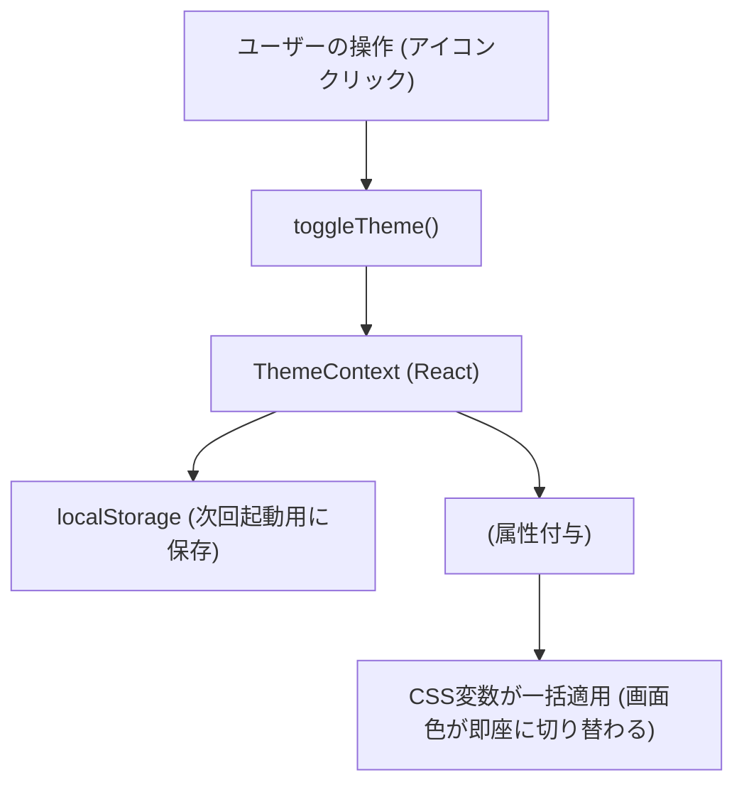
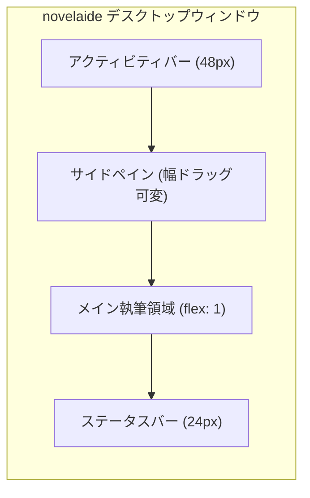
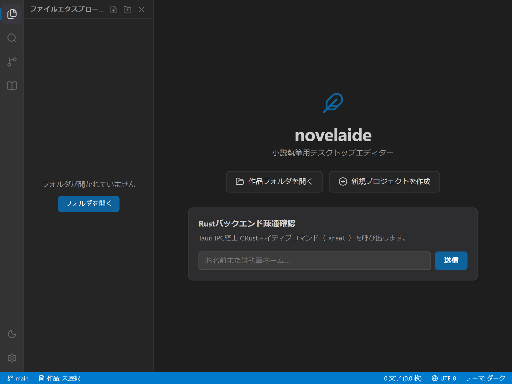
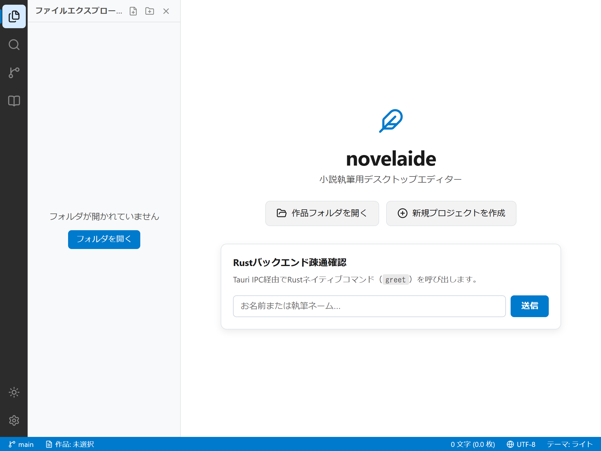
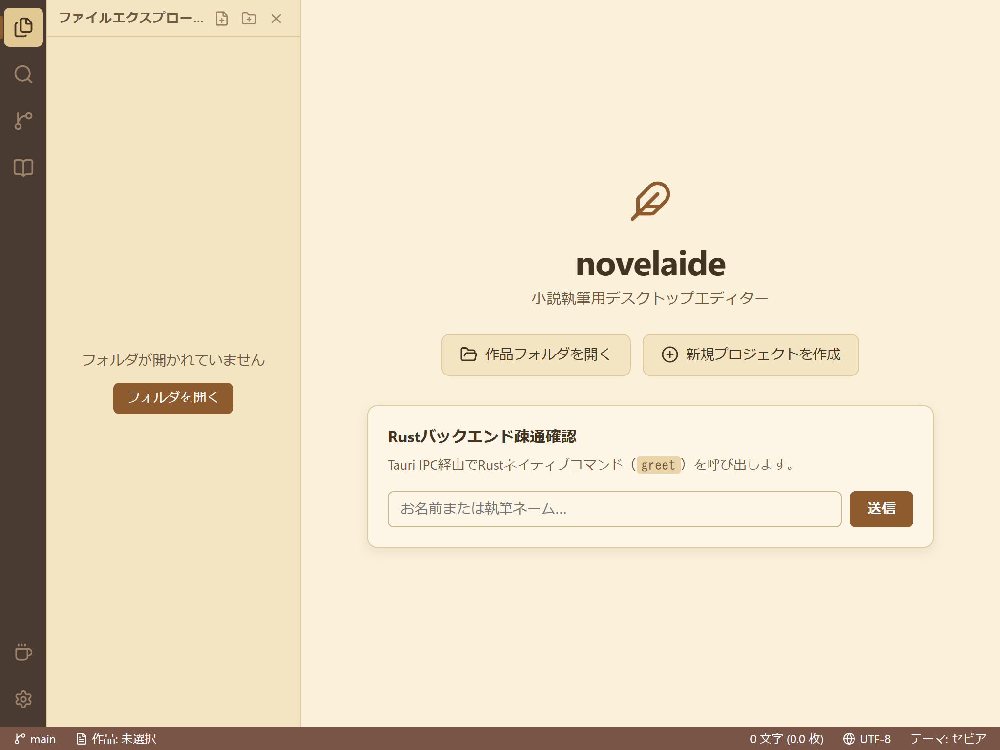

# 第3回：執筆に没頭できる画面を作る —— テーマシステムと基本3ペインレイアウト

こんにちは！ 小説執筆用エディター **「novelaide」**（コードネーム: novelaid-e）のメイキング連載第3回です。

前回 [第2回：最初の一歩](./02_Tauri環境の構築と疎通確認.md) では、Tauri 2.x + React でデスクトップアプリの土台を作り、Rustバックエンドとの通信（`greet` コマンド）に成功しました。

今回は **Phase 1 の総仕上げ** として、以下の2つの重要ステップを実装していきます！

1. **Step 1.2: テーマシステムとCSS変数設計**（ダーク / ライト / セピア / システム自動追従）
2. **Step 1.3: 基本3ペインレイアウトの構築**（アクティビティバー / 幅調整できるサイドパネル / メイン執筆領域 / ステータスバー）

一気に「本格的なデスクトップエディター」らしい外観と使い勝手へと進化します。プログラミング初心者の方でも自分で作れるよう、仕組みを丁寧に解説します！

---

## 1. 今回の課題と入力したプロンプト

前回までの画面は、中央に入力フォームとロゴがあるだけのシンプルなものでした。小説を快適に書くためには、以下の要素が不可欠です。

* **左端のアイコン列（アクティビティバー）**: ファイル一覧や検索、執筆履歴（Git）などを切り替える。
* **開閉・幅調整ができるサイドパネル（サイドペイン）**: 原稿ツリーや登場人物の設定などを表示する。
* **目に優しいテーマ切り替え**: 部屋の明るさや時間帯に合わせて、ダークやライトだけでなく、原稿用紙のような「セピア」も選べるようにする。
* **最下部の情報バー（ステータスバー）**: 現在の文字数や原稿用紙換算枚数が一目でわかる。

そこで、AIエージェントに次のプロンプトを入力して作業を進めました。

### 実際に投げたプロンプト
> 次の作業へ進んでください

---

## 2. AIによる設計・実装プロセス

### ポイント1：CSS変数（カスタムプロパティ）によるテーマ設計
テーマ切り替えの仕組みとして、CSSの「カスタムプロパティ（CSS変数）」を採用しました。

HTMLのトップ（`:root`）に色を定義しておき、テーマが切り替わると `data-theme="light"` や `data-theme="sepia"` という属性を切り替えるだけで、画面全体の色が一瞬で変わります。

```css
/* src/styles/theme.css より抜粋 */
:root {
  /* デフォルト: ダークテーマ */
  --bg-primary: #1e1e1e;       /* メイン執筆エリア背景 */
  --bg-side-pane: #252526;     /* サイドパネル背景 */
  --text-primary: #cccccc;     /* 本文文字色 */
  --accent-color: #0e639c;     /* アクセント色 */
}

/* 小説執筆特化：セピアテーマ（温かみのある原稿用紙風） */
:root[data-theme='sepia'] {
  --bg-primary: #fbf0d9;
  --bg-side-pane: #f4e5c2;
  --text-primary: #433422;
  --accent-color: #8d5b2d;
}
```

さらに、Reactの `Context API`（`ThemeContext.tsx`）を使い、選択したテーマをブラウザの `localStorage` に保存することで、**「次回アプリを起動したときも前回のテーマが維持される」** ようにしました。



---

### ポイント2：VS Code風の3ペインレイアウト構成
画面の骨組みは、多くの開発者や作家に親しまれている「VS Code風」のレイアウトにしました。



- **`ActivityBar.tsx`**: 左端の縦帯。`lucide-react` アイコンを使い、ファイル、検索、Git、設定資料、そしてテーマ切り替えボタンを配置。
- **`SidePane.tsx`**: 開閉可能で、右端のリサイズハンドルをマウスドラッグすることで横幅を自由に広げたり縮めたり（180px〜500px）できます。
- **`StatusBar.tsx`**: 最下部に配置。小説執筆で一番気になる「文字数」や「400字詰原稿用紙換算枚数」、Gitブランチ名を常時表示します。

---

## 3. 実際に動かしてみた結果（スクリーンショット）

前回のスクリプト `scripts/capture-screenshots.js` を拡張し、新しく実装した3つのテーマのスクリーンショットを自動撮影しました！

### 1. ダークテーマ（初期状態）
暗い部屋でも目が疲れず、執筆に深く没頭できるダーク配色です。


### 2. ライトテーマ
昼間の明るい部屋や、すっきりした気分で執筆したいときに最適な清潔感のあるホワイト配色です。


### 3. セピアテーマ（小説執筆特化！）
昔ながらの原稿用紙や文庫本を思わせる、温かみのあるクリーム色調です。ブルーライトが苦手な方にもおすすめです。


---

## 4. まとめと次回予告

今回で **「Phase 1: アプリの土台作り」** がすべて完了しました！
* ✅ Step 1.1: Tauri 2.x + React + TypeScript 環境構築 & 疎通確認
* ✅ Step 1.2: テーマシステム（CSS変数 & React Context）
* ✅ Step 1.3: 基本3ペインレイアウト（アクティビティバー、サイドペイン、ステータスバー）

詳しい仕様書や操作マニュアルは以下で確認できます。
* 開発仕様: [docs/dev/テーマシステムおよびUIレイアウト仕様.md](../../docs/dev/テーマシステムおよびUIレイアウト仕様.md)
* ユーザーマニュアル: [docs/manual/画面構成とテーマの切り替え.md](../../docs/manual/画面構成とテーマの切り替え.md)

次回からは **「Phase 2: プロジェクト管理とファイル操作」** に突入します！  
小説の原稿フォルダを実際に開き、サイドパネルにファイルツリーを展開して、新しい章ファイルやメモを作成できるようにしていきます。どうぞお楽しみに！
