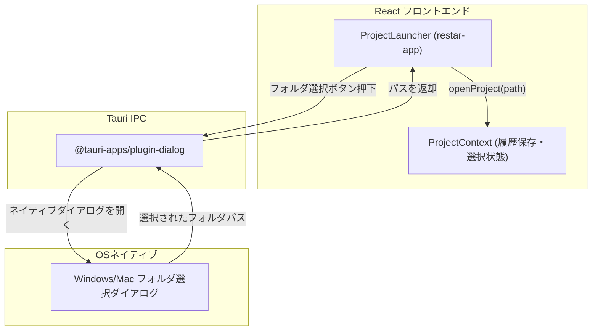
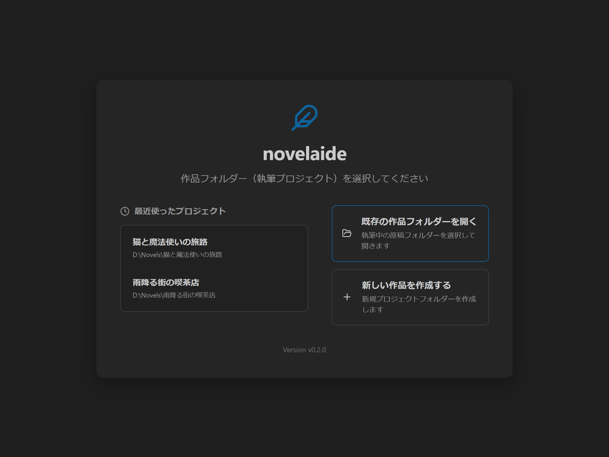
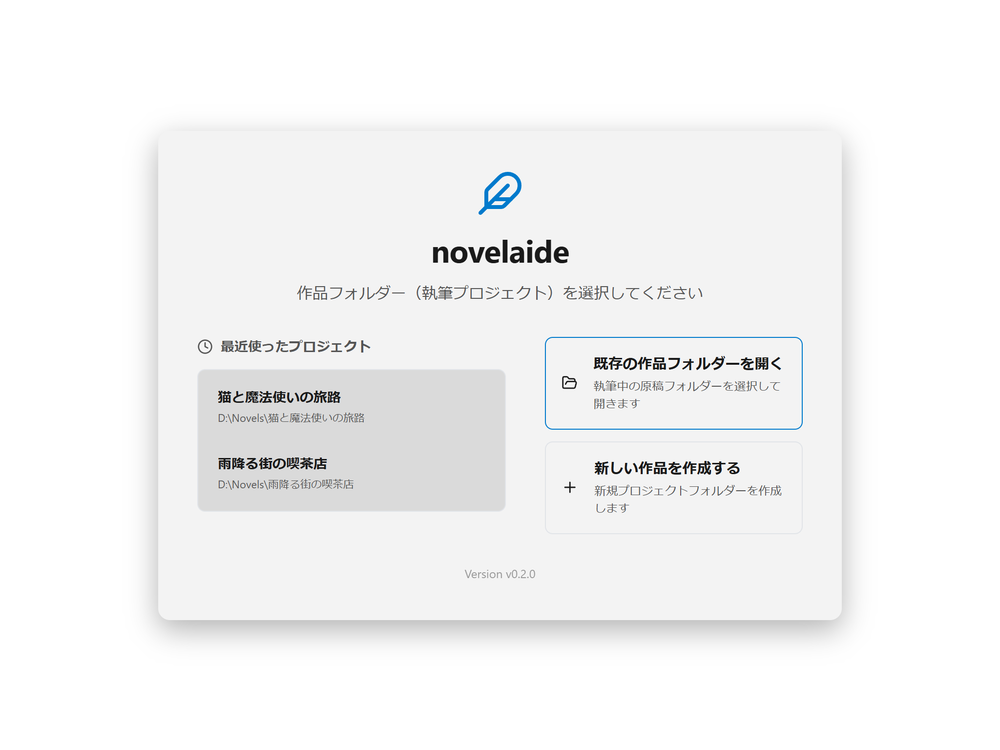
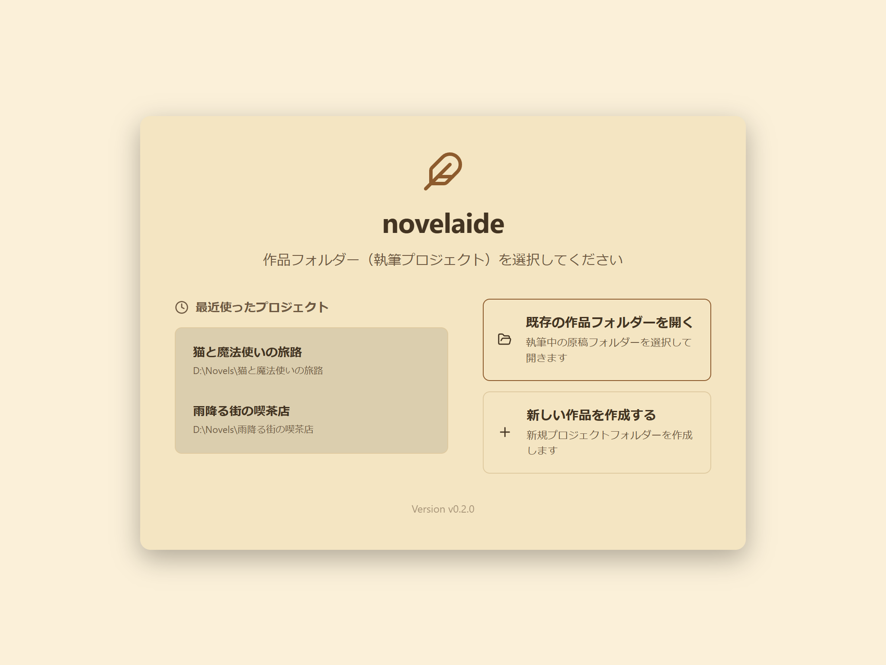

# 第4回：作品を開く入り口を創る —— restar-app を使ったプロジェクト選択画面

こんにちは！ 小説執筆用エディター **「novelaide」**（コードネーム: novelaid-e）のメイキング連載第4回です。

前回 [第3回：執筆に没頭できる画面を作る](./03_テーマと基本レイアウトの構築.md) では、テーマシステム（ダーク / ライト / セピア）と基本3ペインレイアウトを完成させました。

今回からはいよいよ **Phase 2「プロジェクト管理とファイル操作」** に突入します！  
その最初のステップとして、**「Step 2.1: プロジェクト選択・ランチャー画面の実装」** を行いました。

自作の共通UIライブラリである **`restar-app`** の `ProjectLauncher` コンポーネントを導入し、TauriのOSネイティブダイアログと組み合わせて「作品フォルダーを開く」「最近書いた小説をすぐに選ぶ」画面を作っていきます。

---

## 1. 今回の課題と入力したプロンプト

エディターアプリにとって、「どの作品フォルダーを作業場所にするか」はすべての基本です。

既存の `novelaid-editor` では専用のランチャー画面がありましたが、これを再利用可能な汎用Reactライブラリとして独立させたものが **`restar-app`** です。

今回はユーザー様から「`restar-app` を使用する方向で検討してほしい」「細かくコミット・確認しながら進めてほしい」というご指示をいただき作業を進めました。

### 実際に投げたプロンプト
> プロジェクト選択UIはrestar-appライブラリを使用する方向で検討してください。なお、restar-*、および、novelaid-*、などのライブラリーについては、変更が必要な個所などがある場合、変更したい内容を提案してください。別途、修正が可能な場合があります。

> 細かく、コミット、および、確認をしながら実装を進めてください

---

## 2. AIによる設計・実装プロセス

### ポイント1：`restar-app` の特徴とテーマ変数の一致
`restar-app` に含まれる `ProjectLauncher` コンポーネントは、以下のような豊富な機能をすでに備えています。
- 最近開いたプロジェクト一覧の表示と履歴削除
- 「既存フォルダーを開く」「新しいプロジェクトを作成する」の2大アクション
- エディターへの「戻る」ボタン

さらに嬉しいことに、`restar-app` の内部スタイルはすべて CSSカスタムプロパティ（CSS変数: `--bg-primary`, `--bg-secondary`, `--accent-color` 等）で書かれているため、**前回作った novelaide のテーマ（ダーク、ライト、セピア）が何の設定もせずそのまま適用**されます！



---

### ポイント2：Tauri 2.x のダイアログプラグイン連携
ブラウザのJavaScriptだけでは、パソコンの「フォルダ選択ウィンドウ」を自由に出すことはできません。

そこで、Tauriの公式プラグイン **`@tauri-apps/plugin-dialog`** を導入しました。

```typescript
// src/pages/ProjectLauncherPage.tsx より抜粋
import { open } from "@tauri-apps/plugin-dialog";

const handlePickDirectory = async (): Promise<string | undefined> => {
  const selected = await open({
    directory: true,    // フォルダを選択可能にする
    multiple: false,     // 複数選択は不可
    title: "作品フォルダー（プロジェクト）を選択",
  });

  return typeof selected === "string" ? selected : undefined;
};
```

Rust側（`src-tauri/Cargo.toml`）にも `tauri-plugin-dialog = "2"` を追加し、権限設定（`capabilities/default.json`）で `"dialog:default"` を許可することで、安全にOSネイティブのフォルダ選択ダイアログを呼び出せるようになります。

---

### ポイント3：状態管理（`ProjectContext`）と画面遷移
作品フォルダを開いた状態かどうかを管理する `ProjectContext` を作成しました。

- アプリ起動時: まだ作品が開かれていなければ **ランチャー画面（`ProjectLauncherPage`）** を表示。
- 作品を選択: 選択したフォルダのパスを `localStorage` に保存し、**執筆エディター画面（`MainLayout`）** へ切り替え。
- エディター最下部のステータスバー（「作品: 〇〇」）をクリックすれば、いつでもランチャー画面に戻って別の作品に切り替えることができます。

---

## 3. 実際に動かしてみた結果（スクリーンショット）

Playwrightによる自動撮影スクリプトを走らせ、生成されたランチャー画面の様子です。

### 1. ダークテーマ
落ち着いた背景色に、最近使った作品リストが綺麗に並びます。


### 2. ライトテーマ
ホワイトを基調としたすっきりした画面です。


### 3. セピアテーマ（小説執筆特化）
暖かみのあるクリーム色調で、長時間の作品整理でも目が疲れません。


---

## 4. まとめと次回予告

今回は `restar-app` を活用し、小説の執筆ワークスペースを選択・新規作成するためのランチャー画面を完成させました！

* ✅ `restar-app` および `@tauri-apps/plugin-dialog` の導入
* ✅ プロジェクト状態管理（`ProjectContext`）の実装
* ✅ ランチャー画面とエディター画面のシームレスな行き来
* ✅ バージョンを `v0.3.0` へアップデート

詳しい仕様書や操作マニュアルは以下で確認できます。
* 開発仕様: [docs/dev/プロジェクト選択および管理仕様.md](../../docs/dev/プロジェクト選択および管理仕様.md)
* ユーザーマニュアル: [docs/manual/プロジェクトの選択と新規作成.md](../../docs/manual/プロジェクトの選択と新規作成.md)

次回は **「Phase 2: Step 2.2 & 2.3 —— Tauriバックエンドによるファイルアクセス基盤と小説ファイルツリー（novelaid-fs）の実装」** に進みます！  
選んだ作品フォルダの中にある原稿ファイルや設定資料をツリー状に読み込んで表示できるようにしていきます。どうぞお楽しみに！
