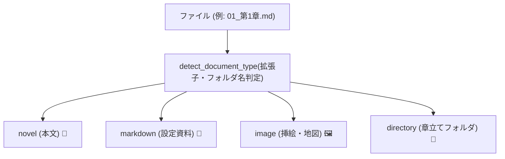
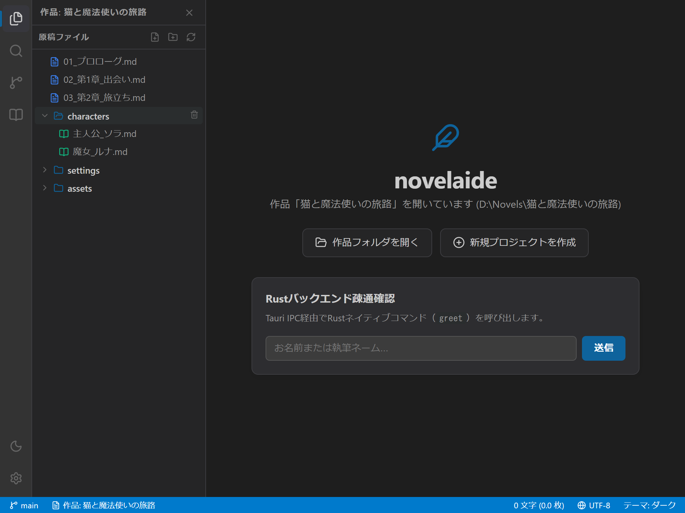
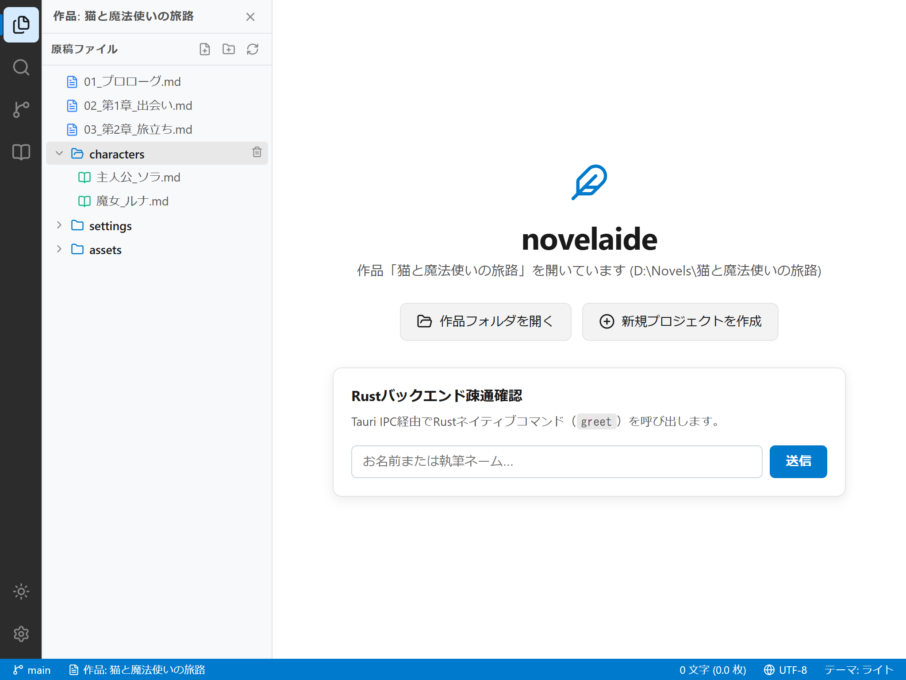
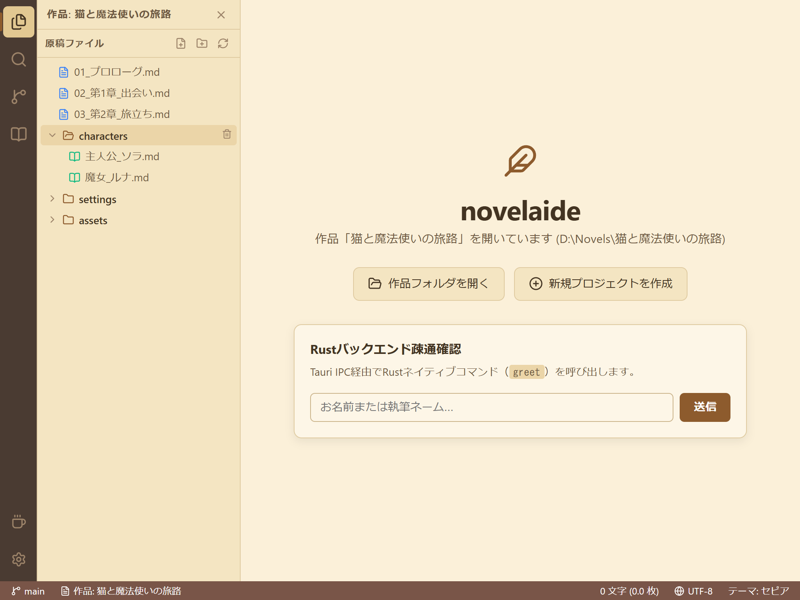

# 第5回：原稿を整理しよう —— Rustファイル操作基盤と小説ファイルツリー

こんにちは！ 小説執筆用エディター **「novelaide」**（コードネーム: novelaid-e）のメイキング連載第5回です。

前回 [第4回：作品を開く入り口を創る](./04_プロジェクト選択画面の実装.md) では、`restar-app` の `ProjectLauncher` を導入し、小説の執筆ワークスペース（フォルダー）を選択する画面を作りました。

今回は **Phase 2 の後半** として、以下の2大機能を一気に実装していきます！

1. **Step 2.2: Tauriバックエンドによる安全なファイルアクセス基盤**（Rustネイティブのファイル読み書き・再帰一覧取得）
2. **Step 2.3 & 2.4: 小説ファイルツリー（novelaid-fs）とカスタムアイコン**（階層ツリー表示、新規作成、削除、ファイル種別の色分け）

選んだ作品フォルダーの中にある原稿ファイルや設定資料がサイドパネルにずらりと並び、一気に本格エディターの風格が漂い始めます！

---

## 1. 今回の課題と入力したプロンプト

フォルダーを選べるようになった次のステップは、「そのフォルダーの中身を読み取って画面に表示すること」です。

小説執筆では、以下のような特徴があります：
* **章やエピソードごとのファイル分割**: `01_プロローグ.md`, `02_第1章.md` などの本文ファイル。
* **設定資料やキャラクターのフォルダ分け**: `characters/` や `settings/` など。
* **挿絵やマップ画像**: `assets/` など。

これらを普通のファイル一覧として無機質に並べるのではなく、**「ひと目で本文か、設定資料か、画像かが分かるアイコンと色分け」** を備えたファイルツリーを構築します。

### 実際に投げたプロンプト
> 進めて

---

## 2. AIによる設計・実装プロセス

### ポイント1：Rustバックエンドによる高速・安全なファイル走査
デスクトップアプリの強みは、OSのファイルシステムに直接・高速にアクセスできることです。

`src-tauri/src/fs.rs` に、指定したフォルダーを再帰的に巡回してツリー構造（`NovelaidDirEntry`）を組み立てるRustコマンドを作成しました。

```rust
// src-tauri/src/fs.rs より抜粋
#[tauri::command]
pub fn fs_read_dir(path: String, recursive: bool) -> Result<Vec<NovelaidDirEntry>, String> {
    // 隠しフォルダ（.git 等）は自動で除外
    // ディレクトリを先頭に、五十音・アルファベット順にソートして返却！
    read_dir_internal(Path::new(&path), recursive)
}
```

さらに、`fs_read_file`（テキスト読み込み）、`fs_write_file`（書き込み）、`fs_create_file`（新規作成）、`fs_remove`（削除）などの必須コマンドを一括で実装し、TauriのIPCハンドラーに登録しました。

---

### ポイント2：小説ファイル種別の自動判別とカスタムアイコン
小説のフォルダ内には多様なファイルが存在します。拡張子やフォルダ名から種類（`novel`, `markdown`, `image`, `chat`, `metadata`）を自動判別し、直感的なアイコンを表示する `DocumentIcon.tsx` を作りました。

* 📄 **ブルーのアイコン**: 本文原稿（`.txt` など）
* 📖 **グリーンのアイコン**: プロット・キャラクター設定（`.md` など）
* 🖼️ **ピンクのアイコン**: 挿絵・地図画像（`.png`, `.jpg` など）
* 📁 **アクセント色のフォルダー**: クリックで開閉（展開/折りたたみ）



---

### ポイント3：インタラクティブなファイルツリーUI
`src/components/FileExplorer/FileExplorer.tsx` では、以下の機能を盛り込みました。

1. **フォルダーの開閉トグル**: 矢印アイコンまたは行クリックで下層ファイルが展開されます。
2. **インライン新規作成**: ツールバーの「📄＋」「📁＋」ボタンを押すと、その場に入力フォームが現れ、ファイル名を入力してEnterを押すだけで作成されます。
3. **安全な削除機能**: マウスホバー時に現れるゴミ箱アイコンから、確認ダイアログ付きでファイルを削除できます。

---

## 3. 実際に動かしてみた結果（スクリーンショット）

サンプル作品「猫と魔法使いの旅路」を開いた状態のファイルツリーです。サイドパネルに美しく階層表示されています！

### 1. ダークテーマ
黒を基調とした背景に、青（本文）、緑（設定）、ピンク（画像）のアイコンが綺麗に映えます。


### 2. ライトテーマ
昼間の執筆に心地よい、清潔感あふれるツリー表示です。


### 3. セピアテーマ（小説執筆特化）
温かみのあるクリーム色調で、長時間の原稿整理でも目が疲れません。


---

## 4. まとめと次回予告

今回で **「Phase 2: プロジェクト管理とファイル操作」** のコア部分が完成しました！

* ✅ Rustバックエンドによる安全なファイルアクセス基盤（`fs_read_dir`, `fs_read_file`, `fs_write_file` 等）
* ✅ 小説ファイルツリー（`FileExplorer`）の実装（開閉トグル、新規作成、削除）
* ✅ ファイル種別（本文、プロット、設定、画像）の自動色分けアイコン
* ✅ バージョンを `v0.4.0` へアップデート

詳しい仕様書や操作マニュアルは以下で確認できます。
* 開発仕様: [docs/dev/ファイル操作基盤およびエクスプローラー仕様.md](../../docs/dev/ファイル操作基盤およびエクスプローラー仕様.md)
* ユーザーマニュアル: [docs/manual/原稿ファイルとフォルダーの管理.md](../../docs/manual/原稿ファイルとフォルダーの管理.md)

次回からはいよいよ **「Phase 3: 小説執筆エディターの実装（書く体験のコア）」** に突入します！  
VS Codeの頭脳でもある **Monaco Editor** を組み込み、サイドバーで選んだ原稿ファイルを開いて、実際にキーボードで文字を執筆・保存できるようにしていきます。どうぞお楽しみに！
