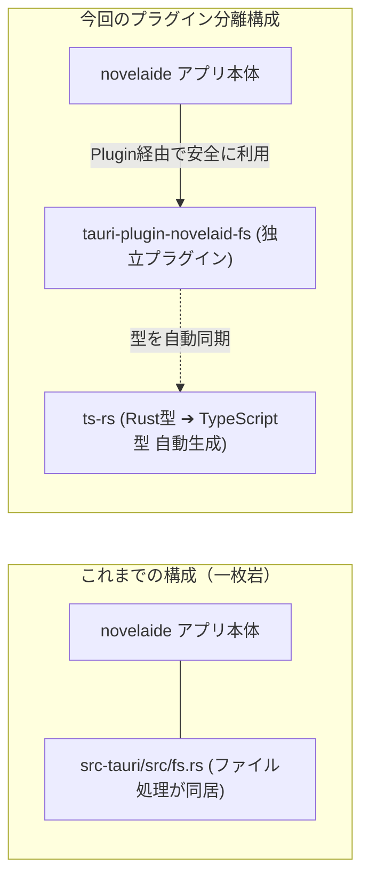

# 第6回：機能の独立と型自動生成 —— Tauriプラグイン化とts-rsで創る堅牢な基盤

こんにちは！小説執筆用エディター **`novelaide`**（コードネーム: `novelaid-e`）の開発メイキング連載第6回です。

前回（[第5回：原稿を整理しよう](./05_ファイルシステムと小説ツリーの実装.md)）は、Rustバックエンドにファイル走査とドキュメント判定処理を組み込み、React側で小説執筆用のファイルツリー（エクスプローラー）を表示できるようにしました。

しかし、アプリを長期的に開発し、今後さらに **Gitによる執筆履歴管理** や **AIアシスタント機能**、**EPUB/PDF出力** などの機能を追加していくと、アプリ本体（`src-tauri`）にすべてのコードを詰め込む「モノリス（一枚岩）」な構造では、以下のような課題が生じます。

1. **コードの肥大化と責任の曖昧さ**: UIの都合とOS依存の低レイヤ処理が混ざり合ってしまう。
2. **型定義の二重管理**: Rust側のデータ構造（StructやEnum）を変更した際、TypeScript側も手動で直さなければならず、タイポや更新漏れによる不具合が起きやすい。

そこで今回は、ファイルアクセス機能を独立した **`tauri-plugin-novelaid-fs` プラグイン** として切り出し、さらに **Rustの構造体からTypeScriptの型定義を全自動生成する仕組み（`ts-rs`）** を導入しました！

本記事では、プログラミング初心者の方でも「プラグイン化の意義」と「型自動生成の仕組み」が理解できるように、スモールステップで解説します。

---

## 1. なぜ「プラグイン」として分離するのか？

Tauri 2.x では、公式プラグイン（ダイアログやファイルオープナーなど）と同様に、**独自のカスタムプラグイン** を手軽に作成できる仕組みが備わっています。



### プラグイン分離の3大メリット
1. **アプリ本体の軽量化と関心事の分離**:
   アプリ本体は「画面の制御や執筆体験」に集中し、ファイルI/OやYAMLフロントマター解析などの低レイヤ処理はプラグイン側に任せることができます。
2. **高速な単体テスト**:
   プラグイン単独で `cargo test` を実行できるため、GUIアプリ全体を起動しなくてもファイル処理のバグを瞬時に発見できます。
3. **他のアプリへの転用や将来の拡張**:
   将来的にCLIツール（`novelaid-cli`）や別アプリでも、このプラグインをそのまま再利用できます。また、今後追加する「Git履歴管理」や「AI連携」も同様にプラグインとして綺麗に分離できます。

---

## 2. RustとTypeScriptの型不整合を防ぐ「`ts-rs`」

TypeScriptとRustを組み合わせた開発で最も開発者を悩ませるのが、**「Rust側の定義を変えたのに、TypeScript側を直し忘れて実行時エラーになる」** という問題です。

```rust
// Rust側（バックエンド）
pub enum NovelaidDocumentType {
    Novel,
    Markdown,
    Image,
    Chat,
    // ここに新しい種別を追加した場合…
}
```

手動でTypeScriptコード側にも `export type DocumentType = "novel" | "markdown" | ...` と書き写していると、いつか必ずズレが生じます。

そこで導入したのが **`ts-rs`** です！

### 仕組み：テストを実行するだけで型が出力される！

Rust側のモデル定義（`models.rs`）に、`#[derive(TS)]` と出力先ファイルパスを指定するだけです。

```rust
// tauri-plugin-novelaid-fs/src/models.rs
use serde::{Deserialize, Serialize};
use ts_rs::TS;

#[derive(TS, Debug, Clone, Copy, PartialEq, Eq, Serialize, Deserialize)]
#[ts(export, export_to = "../guest-js/models.ts")]
#[serde(rename_all = "camelCase")]
pub enum NovelaidDocumentType {
    Novel,
    Markdown,
    Image,
    Chat,
    GitDiff,
    Browser,
    Css,
    Unknown,
    External,
}

#[derive(Debug, Clone, Serialize, Deserialize, TS)]
#[ts(export, export_to = "../guest-js/models.ts")]
#[serde(rename_all = "camelCase")]
pub struct NovelaidDirEntry {
    pub name: String,
    pub path: String,
    pub base_name: String,
    pub file_title: String,
    pub is_directory: bool,
    pub document_type: NovelaidDocumentType,
    pub children: Option<Vec<NovelaidDirEntry>>,
}
```

`cargo test` を走らせると、`ts-rs` がテストスイートの中で自動的にTypeScriptコードを解釈・出力してくれます。

生成されたファイル（`guest-js/models.ts`）は以下の通りです：

```typescript
// tauri-plugin-novelaid-fs/guest-js/models.ts
// This file was generated by [ts-rs](https://github.com/Aleph-Alpha/ts-rs). Do not edit this file manually.

export type NovelaidDirEntry = {
  name: string;
  path: string;
  baseName: string;
  fileTitle: string;
  isDirectory: boolean;
  documentType: NovelaidDocumentType;
  children: Array<NovelaidDirEntry> | null;
};

export type NovelaidDocument = {
  path: string;
  baseName: string;
  fileTitle: string;
  content: string;
  metadata: any;
  documentType: NovelaidDocumentType;
};

export type NovelaidDocumentType =
  | "novel"
  | "markdown"
  | "image"
  | "chat"
  | "gitDiff"
  | "browser"
  | "css"
  | "unknown"
  | "external";
```

一切の手作業なしで、RustとTypeScriptの間で完全な型の整合性が保たれます！

---

## 3. 1コマンドで型を更新する「`npm run typegen`」

開発者が日常的に型を最新化できるよう、アプリ本体の `package.json` に便利なワンライナースクリプトを登録しました。

```json
{
  "scripts": {
    "build:plugin": "npm run build --prefix tauri-plugin-novelaid-fs",
    "typegen": "cargo test --manifest-path tauri-plugin-novelaid-fs/Cargo.toml && npm run build:plugin"
  }
}
```

これにより、開発者はターミナルで：

```bash
npm run typegen
```

と入力するだけで、
1. `cargo test` による Rust 側の型チェック ＆ TypeScript 型出力（`models.ts`）
2. Rollup による プラグインクライアント（`dist-js/`）のコンパイルと型定義（`.d.ts`）出力

が数秒で完了し、フロントエンド側ですぐに最新の型補完が効くようになります。

---

## 4. アプリ本体への組み込み

アプリ本体（`novelaide`）側での組み込みも非常にシンプルです。

### 1. `src-tauri/Cargo.toml`
```toml
[dependencies]
tauri-plugin-novelaid-fs = { path = "../tauri-plugin-novelaid-fs" }
```

### 2. `src-tauri/src/lib.rs`
```rust
pub fn run() {
    tauri::Builder::default()
        .plugin(tauri_plugin_opener::init())
        .plugin(tauri_plugin_dialog::init())
        .plugin(tauri_plugin_novelaid_fs::init()) // プラグイン登録
        .run(tauri::generate_context!())
        .expect("error while running tauri application");
}
```

### 3. フロントエンド（`src/services/fileService.ts`）
```typescript
import * as novelaidFs from "tauri-plugin-novelaid-fs-api";

export const fileService = {
  async readDirectory(path: string, recursive: boolean = true) {
    return await novelaidFs.readDirectory(path, recursive);
  },
  // ...
};
```

このように、アプリ本体からは「公式プラグインを使うのと同じ感覚」で自作プラグインの安全なAPIを呼び出すことができます。

---

## 5. 今後のプラグイン分離計画

今回の `tauri-plugin-novelaid-fs` を皮切りに、`novelaide` では以下の機能を順次プラグインとして分離・設計していきます。

- **`tauri-plugin-novelaid-git`**:
  執筆ブランチの分岐、セーブポイントの自動記録、差分表示
- **`tauri-plugin-novelaid-ai`**:
  ローカルLLMやAPI連携によるキャラクター壁打ち対話、表現推敲
- **`tauri-plugin-novelaid-export`**:
  電子書籍（EPUB）や同人誌印刷用PDF、投稿サイト向けテキストフォーマット出力

モジュールごとに明確な役割を持たせることで、長く安心して開発を続けられる構造を実現しています。

---

## まとめと次回予告

今回は、ファイルアクセス機能を独立したプラグインに切り出し、`ts-rs` による型自動生成パイプラインを構築しました。
これで、バックエンドの変更がフロントエンドに安全かつ即座に伝播する、堅牢な開発土台が完成しました！

次回は、いよいよ小説執筆エディターの心臓部である **「本文エディター（Markdown / プレーンテキスト編集機能）」** の実装に進みます。
文字数カウントや行番号、執筆に集中できるエディター体験を創り込んでいきます。どうぞお楽しみに！

---

### 📚 関連ドキュメント
- [プラグインアーキテクチャおよびRust型定義自動生成仕様書](../../docs/dev/プラグインアーキテクチャおよびRust型定義自動生成仕様.md)
- [ファイル操作基盤およびエクスプローラー仕様書](../../docs/dev/ファイル操作基盤およびエクスプローラー仕様.md)
- [日次作業ログ (2026-10-24)](../logs/2026-10-24.md)
