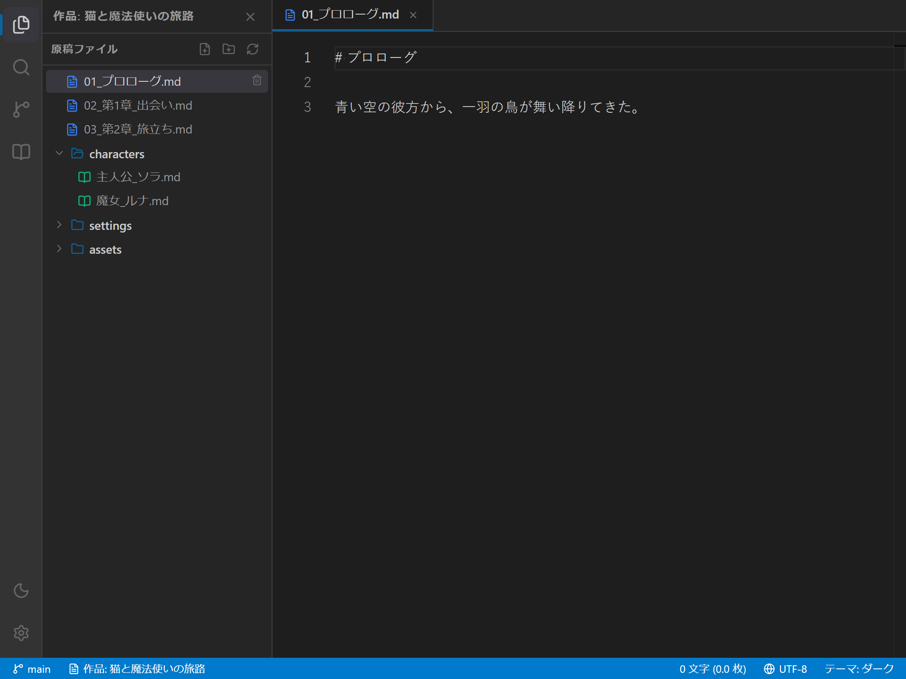
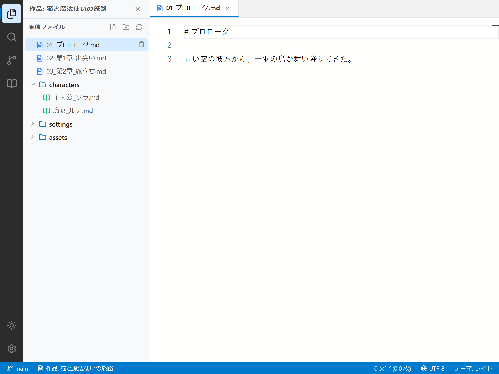
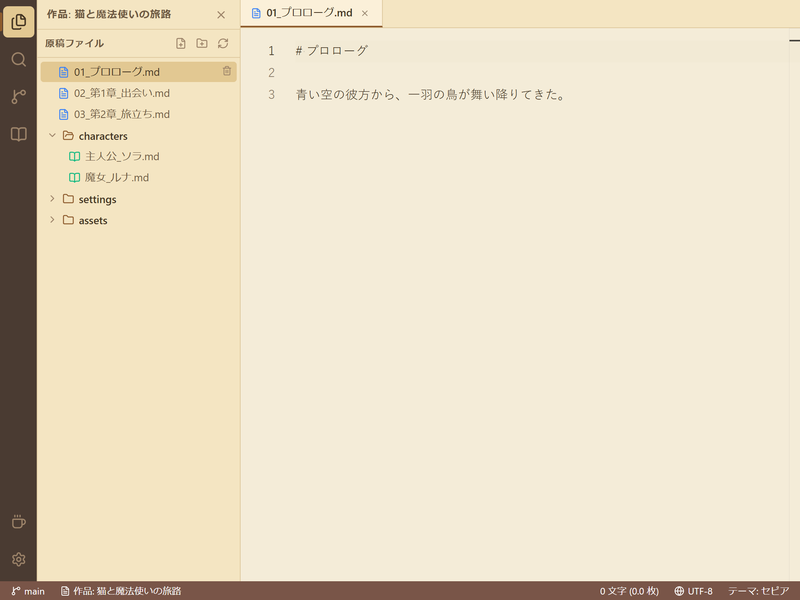
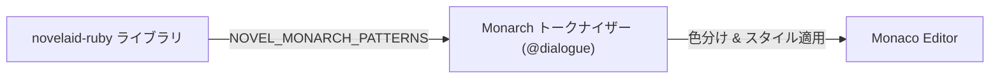

# 第7回：物語を紡ぐ場所 —— Monaco Editorとnovelaid-rubyで創る小説執筆エディター

こんにちは！小説執筆用エディター **`novelaide`** 開発チームの三葉（みつは）です。

前回（[第6回：機能の独立と型自動生成](./06_プラグイン分離とRust型自動生成.md)）は、ファイルアクセス機能を独立したプラグインに切り出し、Rustの構造体からTypeScript型を全自動生成する仕組みを整えました。

いよいよ今回は、小説執筆エディターの心臓部である **「本文エディター」** の実装に入ります！
現行で実際に愛用されている **`novelaid-editor`** の優れた執筆体験と知見をベースに、VS Code のコアエンジンである **Monaco Editor** を組み込み、独自ライブラリ **`novelaid-ruby`** と連携した小説特化のエディターを創り上げました。

---

## 1. 完成した小説執筆エディターの姿

まずは完成したエディター画面をご覧ください。
ファイルツリーから原稿ファイルをクリックすると、上部にタブが開き、日本語小説に特化したゆったりとした行間と文字サイズで原稿が表示されます。

````carousel

<!-- slide -->

<!-- slide -->

````

ダークモード、ライトモード、そして文庫本のような温かみのあるセピアモードのすべてに、専用のエディター配色を定義しています。

---

## 2. なぜ Monaco Editor なのか？

エディターの基盤には、VS Code で実績のある **Monaco Editor（`@monaco-editor/react`）** を採用しました。

### プログラミング用エディターを小説に使う理由
1. **数十万文字の長編でもカクつかない超高速な描画性能**
2. **Monarch トークナイザーによる柔軟な構文解析**（小説の会話文やルビ記法を自由にハイライト可能）
3. **デコレーション機能**（段落冒頭の全角スペースやルビ箇所に薄い枠線を表示）
4. **安心の操作性**（Undo/Redo、検索・置換、`Ctrl + S` 保存など）

しかし、そのまま使うと「文字が小さすぎる」「行間が詰まっている」「ミニマップが邪魔」「全角スペースが警告色になる」といった問題が生じます。
そこで、**小説執筆に特化したチューニング** を施しました。

```typescript
options={{
  wordWrap: 'on',                                      // 右端で自然に折り返し
  minimap: { enabled: false },                         // ミニマップを非表示にして視覚ノイズを削減
  fontSize: 16,                                        // 目が疲れにくい文字サイズ
  lineHeight: 28,                                      // ゆったりとした行間（約1.75倍）
  fontFamily: "'Yu Gothic', 'Meiryo', sans-serif",    // 日本語フォント指定
  renderWhitespace: 'all',                             // スペースを視認可能に
  scrollBeyondLastLine: false,                         // 末尾の過剰スクロールを抑制
  unicodeHighlight: {
    ambiguousCharacters: false,                        // 句読点や全角記号の誤警告をオフ
    invisibleCharacters: false,
  },
}}
```

---

## 3. `novelaid-ruby` 連携によるルビ・台詞のハイライト

小説の原稿には、コードとは異なる独自の表現記法が存在します。
現行の `novelaid-editor` で培われた独自ライブラリ **`novelaid-ruby`** を活用し、Monaco Editor に `novel` 言語として登録しました。



### ハイライトされる記法

1. **会話文（台詞）**:
   `「……」` や `『……』` で囲まれた範囲を爽やかなグリーン系でハイライト。地の文と台詞のメリハリが生まれ、シーンのテンポが直感的に掴めます。
2. **ルビ記法（カクヨム／なろう準拠）**:
   `｜親文字《るび》` や `漢字《るび》` のルビ部分をターコイズ系のイタリックで表示。
3. **傍点（圏点）**:
   `《《強調》》` をオレンジ色のボールドで表示。

```typescript
// src/components/Editor/EditorSupport.ts
monaco.languages.register({ id: 'novel' });

monaco.languages.setMonarchTokensProvider('novel', {
  tokenizer: {
    root: [
      [NOVEL_MONARCH_PATTERNS.DIALOGUE_START, { token: 'novel.dialogue', next: '@dialogue' }],
      [NOVEL_MONARCH_PATTERNS.DIALOGUE_DOUBLE_START, { token: 'novel.dialogue', next: '@dialogue_double' }],
      [NOVEL_MONARCH_PATTERNS.RUBY_PIPE, 'novel.ruby'],
      [NOVEL_MONARCH_PATTERNS.RUBY_KANJI, 'novel.ruby'],
      [NOVEL_MONARCH_PATTERNS.BOUTEN, 'novel.bouten'],
      { include: '@whitespace' },
    ],
    dialogue: [
      [NOVEL_MONARCH_PATTERNS.DIALOGUE_END, { token: 'novel.dialogue', next: '@pop' }],
      [NOVEL_MONARCH_PATTERNS.RUBY_PIPE, 'novel.ruby'],
      [NOVEL_MONARCH_PATTERNS.RUBY_KANJI, 'novel.ruby'],
      [/./, 'novel.dialogue'],
    ],
    // ...
  },
});
```

ステートマシン（`@dialogue`）を使うことで、「台詞の中にルビが含まれている場合」でも破綻せずに両方が正しく色分けされます！

---

## 4. 全角スペース（字下げ）の可視化

日本語小説では、**「段落の冒頭を全角1マス字下げする」** のが基本作法です。
しかし、一般的なエディターでは全角スペースが透明で見えないため、「字下げし忘れた」「誤って半角スペースを打ってしまった」というトラブルが頻発します。

そこで、Monaco Editor の **`deltaDecorations`** を利用し、全角スペース（`\u3000`）の箇所に薄い四角い枠線を描画するようにしました。

```css
/* 全角スペース可視化用のスタイル */
.monaco-full-width-space {
  background-color: rgba(255, 255, 255, 0.08);
  border: 1px solid rgba(255, 255, 255, 0.2);
  border-radius: 2px;
  box-sizing: border-box;
  width: 1em !important;
}
```

これにより、段落の字下げ状態が一目でわかり、安心して執筆に集中できます。

---

## 5. 三点リーダー・ダッシュのスマート入力補完

小説で頻出する **三点リーダー（`……`）** や **ダッシュ（`――`）** は、一般的な日本語入力ソフトだと「てん」や「だっしゅ」と変換する必要があり、執筆のリズムを削ぎがちです。

本エディターでは、Monaco の補完プロバイダー（`CompletionItemProvider`）を登録し、入力中にいつでも 2倍角の `……` や `――` をスムーズに呼び出せるようにしました。
さらに、`「` を開いて執筆しているときは、文末で自動的に `」` の閉じ候補がサジェストされます。

---

## 6. マルチタブと保存処理（`Ctrl + S`）

複数話を並行して推敲できるよう、**マルチタブ管理（`DocumentContext`）** と **`EditorTabs`** も整備しました。

- **タブの切り替えと閉じる**: 開いている原稿をタブで瞬時に行き来可能。
- **未保存マーク（`●`）**: テキストを変更するとタブに `●` マークが点灯。
- **ショートカット保存**: `Ctrl + S`（Macは `Cmd + S`）を押すと、前回作成した `tauri-plugin-novelaid-fs` 経由で即座にローカル原稿へ保存され、`●` マークが消去されます。

---

## まとめと次回予告

今回は、現行の `novelaid-editor` の知見を受け継ぎ、Monaco Editor と `novelaid-ruby` を融合させた本格的な小説執筆エディターを構築しました！

次回は、執筆の進み具合をリアルタイムに実感できる **「ステータスバーと文字数・原稿用紙換算枚数カウント機能」** の実装に進みます。
執筆者が最も気にする「現在の文字数」を、ルビの親文字換算や空白除外など日本の出版基準に合わせて正確にカウントする仕組みを創り込んでいきます。

どうぞお楽しみに！

---

### 📚 関連ドキュメント
- [エディター基盤および小説執筆設定仕様書](../../docs/dev/エディター基盤および小説執筆設定仕様.md)
- [小説執筆エディターの使い方マニュアル](../../docs/manual/小説執筆エディターの使い方.md)
- [日次作業ログ (2026-10-24)](../logs/2026-10-24.md)
