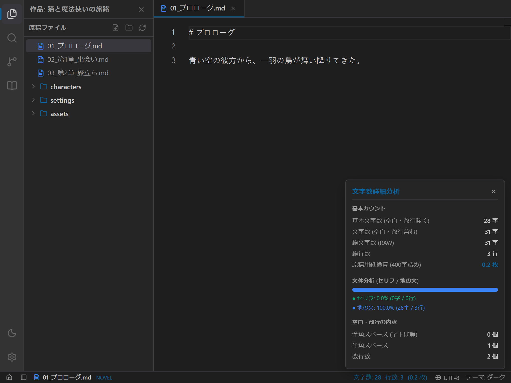
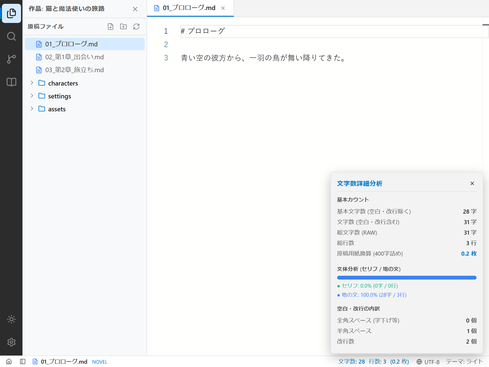
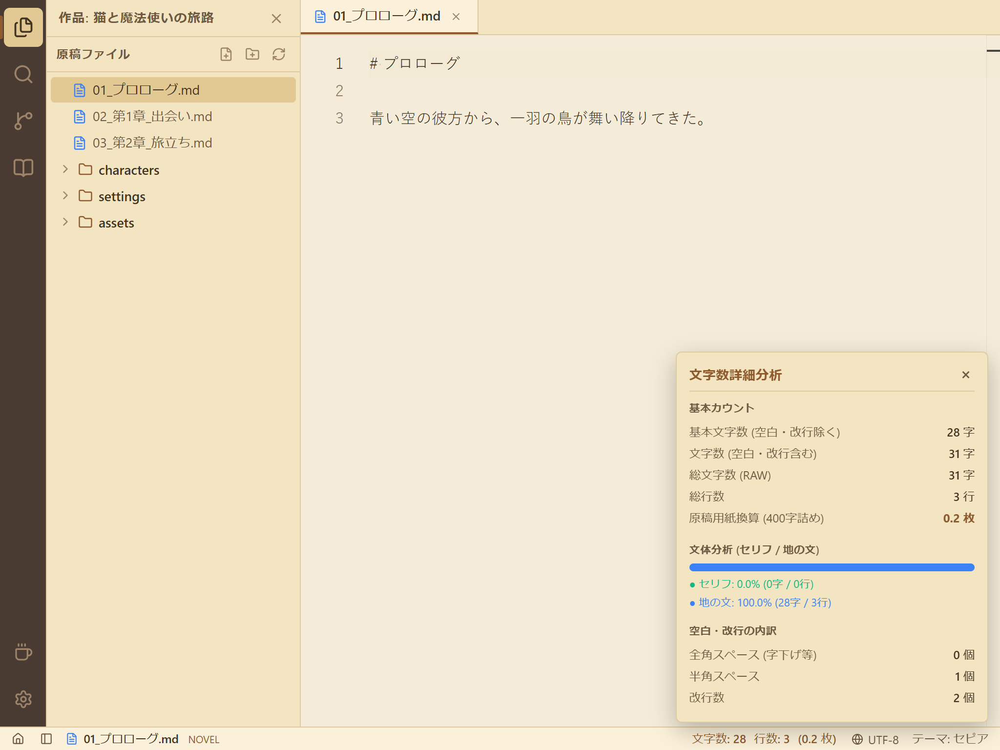

# 第8回：書いた実感をその手に —— ステータスバーと文字数・原稿用紙換算カウント

こんにちは！小説執筆用エディター **`novelaide`** 開発チームの三葉（みつは）です。

前回（[第7回：物語を紡ぐ場所](./07_小説執筆エディターの導入とnovelaid-ruby連携.md)）は、Monaco Editor と独自ライブラリ `novelaid-ruby` を融合させ、ルビ・台詞のハイライトや全角スペースの可視化を備えた本格エディターを構築しました。

今回は、小説家にとって執筆のペースとモチベーションを保つために最も重要な指標である **「ステータスバーとリアルタイム文字数・原稿用紙換算カウント機能」** を実装しました！

現行の **`novelaid-editor`** で大好評だった「セリフと地の文の比率バー」や「選択範囲の動的文字数カウント」を完全に再現しています。

---

## 1. 完成した文字数詳細分析画面

まずは完成した画面をご覧ください。
エディター最下部の文字数エリアをクリックすると、上向きに詳細分析ポップアップが美しく展開されます。

````carousel

<!-- slide -->

<!-- slide -->

````

ダーク、ライト、セピアのどのテーマでも、エディター全体の配色と美しく調和しています。

---

## 2. なぜ小説執筆において文字数カウントが決定的なのか？

プログラミングでは「行数」や「ファイルサイズ」が主な指標ですが、小説執筆においては「文字数」こそがすべての基準となります。

1. **執筆進捗の実感とモチベーション**:
   「今日3,000文字書けた！」「原稿用紙にして10枚分進んだ」という手応えは、数万〜数十万文字の長編を完結させるための最大の原動力です。
2. **投稿サイトごとの異なる集計基準**:
   - **カクヨム**: ルビ文字・ルビ記号・空白類をすべて除外した「純粋な日本語本文」のみをカウント。
   - **小説家になろう**: ランキング等の標準文字数はカクヨム同様ですが、1話あたり最大7万文字のシステム制限（保存上限）では空白や改行も含めてカウント。
3. **文体（会話文と地の文のバランス）のセルフチェック**:
   会話が多すぎて軽くなりすぎていないか、逆に情景描写が重すぎてテンポが落ちていないかを客観的な比率（%）で把握できます。

---

## 3. `novelaid-ruby` による高速・正確なカウントエンジン

文字数の算出には、シリーズ共通ライブラリ **`novelaid-ruby`** の `countCharacters(text)` を使用しています。

```typescript
import { countCharacters, DetailedCountResult } from 'novelaid-ruby';

const metrics: DetailedCountResult = countCharacters(content);
```

この関数ひとつで、以下の高度な解析データが一瞬で取得できます：

- **`charCount`**: カクヨム・なろう基準の基本文字数（ルビ文字・記号・空白類を完全除外）
- **`charCountWithSpaces`**: なろうシステム上限用の空白・改行を含む文字数
- **`rawLength`**: 原稿全体のRAW文字数（`text.length`）
- **`lineCount`**: 総行数
- **`manuscriptSheets`**: 400字詰原稿用紙換算枚数（改行による行消費も精密計算）
- **`dialogue` / `narrative`**: カギ括弧（`「」` `『』`）から判定した会話文と地の文の文字数・行数
- **`spaces`**: 全角スペース（字下げ等）と半角スペースの内訳

---

## 4. タイピングを邪魔しない「150ms Debounce」設計

文字数カウントで最も重要な技術的課題は、**「入力の軽快さ（キーストロークの応答性）を絶対に損なわないこと」** です。

キーを1文字打つたびに同期的に正規表現でルビ除去やセリフ分析を走らせていると、原稿が10万文字を超えたあたりから画面がプチフリーズ（カクつき）を起こします。

そこで、**150ms のデバウンス（Debounce）処理** を施したカスタムフック `useCharacterCount` を設計しました。

```typescript
// src/hooks/useCharacterCount.ts
export function useCharacterCount(content: string, selectedText: string = '', delay: number = 150) {
  const [detailedMetrics, setDetailedMetrics] = useState<DetailedCountResult | null>(null);

  useEffect(() => {
    // 前回のタイマーをクリア
    const timer = setTimeout(() => {
      setDetailedMetrics(content ? countCharacters(content) : null);
    }, delay);

    return () => clearTimeout(timer);
  }, [content, delay]);

  // ...
}
```

作家がタイピングしている最中は計算を保留し、入力が一瞬（150ms）途切れた瞬間にバックグラウンドで即座に集計します。
これにより、どれだけ長大な原稿であっても、羽のように軽いタイピング体験が維持されます。

---

## 5. 推敲が捗る「選択テキスト（Selection）連動」

エディター上で文章の一部をマウスやキーボードで選択すると、ステータスバーの表示が自動的に：

```
選択中: 150 / 3,450 字
```

のように、**「選択範囲の文字数 / 全体文字数」** のハイライト表示に切り替わります！

Monaco Editor の `onDidChangeCursorSelection` イベントと連携しており、推敲時に「このシーンだけで何文字あるか」「コンテストのあらすじ枠（例: 400文字）に収まっているか」を直感的に確認できます。

---

## 6. 文体分析（セリフと地の文のビジュアル比率バー）

詳細ポップアップの中央には、会話文（グリーン）と地の文（ブルー）の比率を示すツートンカラーのプログレスバーが配置されています。

```
[=========セリフ (35.0%)========|=====地の文 (65.0%)====]
● セリフ: 35.0% (1,207字 / 45行)
● 地の文: 65.0% (2,243字 / 97行)
```

ライトノベルやWeb小説では会話のテンポ感が重視される一方、純文学やハイファンタジーでは重厚な情景描写が求められます。
自分の文体が今どのようなバランスになっているかを視覚的に確認しながら推敲できる、作家に寄り添った機能です。

---

## まとめと次回予告

今回は、現行 `novelaid-editor` の知見を受け継ぎ、執筆者のモチベーションと客観的な推敲を支えるステータスバーと文字数カウント機能を構築しました！

次回は、Markdown で執筆した原稿のルビやスタイルを美しく確認できる **「小説対応Markdownプレビュー機能」** の実装に進みます。
横書きプレビューやルビの `<ruby>` レンダリングなど、読者に届く完成形をプレビューできる環境を創り込んでいきます。

どうぞお楽しみに！

---

### 📚 関連ドキュメント
- [ステータスバーおよびリアルタイム文字数カウント仕様書](../../docs/dev/ステータスバーおよびリアルタイム文字数カウント仕様.md)
- [ステータスバーと文字数カウント機能の使い方マニュアル](../../docs/manual/ステータスバーと文字数カウント.md)
- [日次作業ログ (2026-10-24)](../logs/2026-10-24.md)
- [文字数カウント共通仕様 (novelaid-editor-docs)](../../../novelaid-editor-docs/docs/dev/文字数カウント仕様.md)
