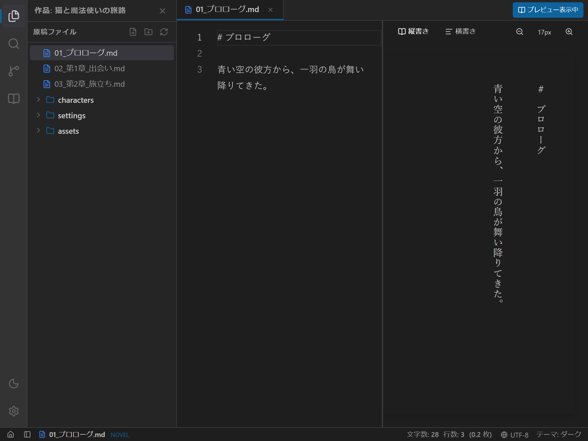
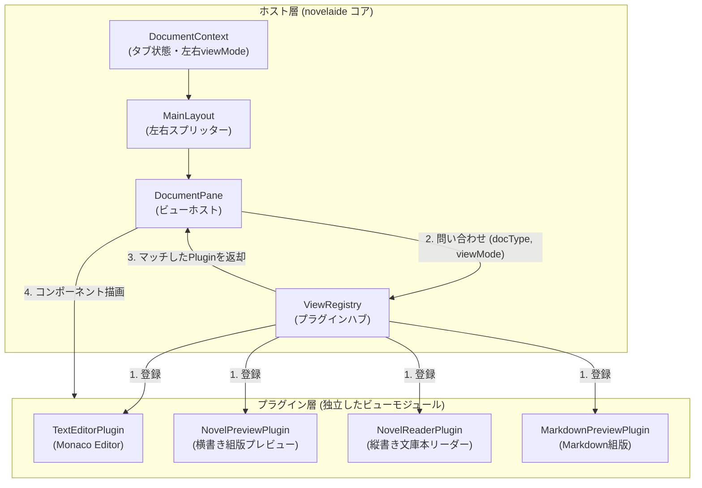
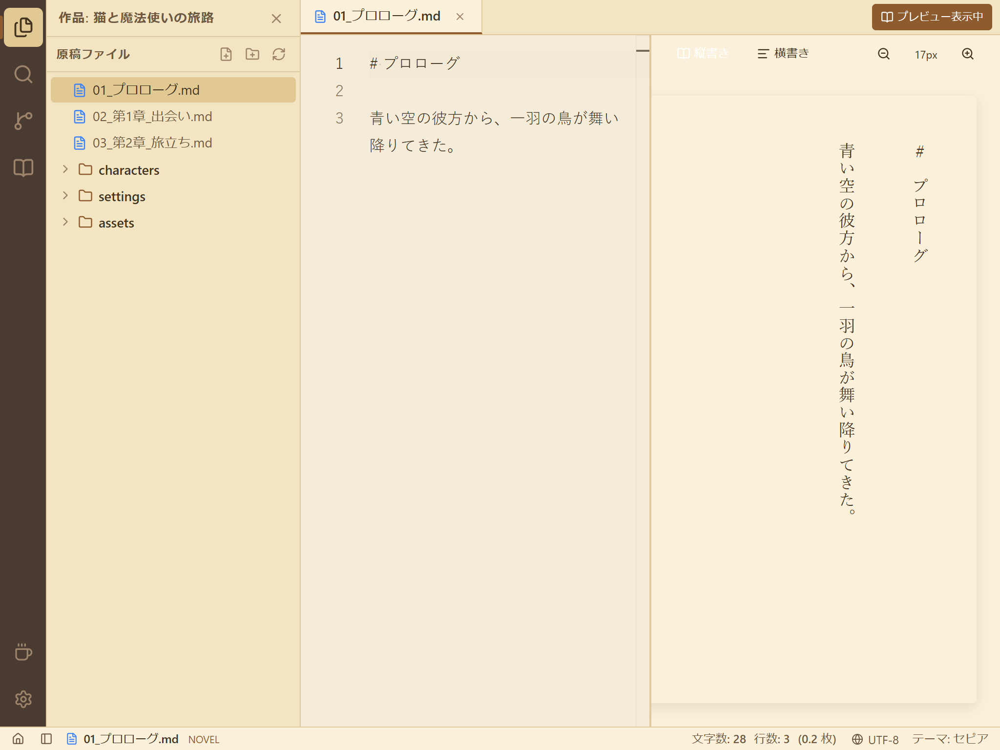
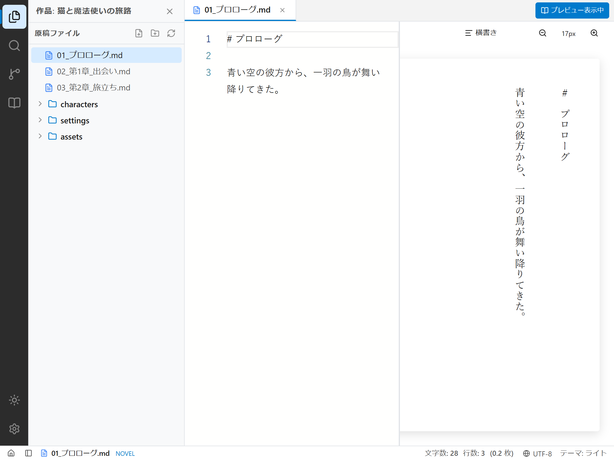

# 【第9回】ビューをプラグインとして分離する！縦書き文庫プレビューと2画面スプリットビューの実装

## はじめに

小説の執筆において、「書くこと」と同じくらい大切なのが **「読者目線で読むこと（推敲・校正）」** です。
ルビや傍点、会話文のテンポ、段落の改行幅などは、エディターの編集用画面だけではなかなか実感しづらいもの。

そこで今回は、小説本文エディターの真横に、文庫本そのままのレイアウトでリアルタイムに組版を確認できる **「縦書きプレビュー＆スプリットビュー（2画面分割）」** を実装しました！

さらに今回は、今後の機能拡張（画像資料ビューアー、会話劇UI、キャラクター相関図など）や、別ツール・Webサイトへの単体流用を見据えて、**「各ビューを完全にプラグインとして切り離すアーキテクチャ（View Plugin Registry）」** を導入しました。



---

## 1. ユーザーからのプロンプトと設計の問い

エディターのプレビュー機能を検討する中で、ユーザーから非常に鋭い提案をいただきました。

> **ユーザー入力プロンプト:**  
> 「各ビューやエディターのコア部分は将来的な流用や機能の分離のためにプラグイン的にわけた実装は可能ですか？」

通常、アプリを作るときは `MainLayout` の中で以下のように条件分岐を書いてしまいがちです。

```tsx
// よくあるモノリシックな条件分岐の例
if (doc.type === 'novel') {
  if (viewMode === 'preview') return <NovelPreview />;
  return <CodeEditor />;
} else if (doc.type === 'markdown') {
  if (viewMode === 'preview') return <MarkdownPreview />;
  return <MarkdownEditor />;
}
```

しかし、この作り方だと：
1. 新しいファイル形式（会話劇 `.chat` や画像資料、プロットカード）を追加するたびに、レイアウトや状態管理のコアコードを書き直さなければならない（**開放閉鎖原則の破綻**）。
2. 「縦書きプレビューだけをWebサイトで再利用したい」「Monaco小説エディター単体を別プロジェクトで使いたい」というときに、コードが絡み合って切り出せない。

そこで、**「コア（タブ・2ペイン・ファイル管理）」と「ビュー（表示・編集の実装）」を完全に切り離すプラグイン・レジストリ方式** を採用することにしました。

---

## 2. ビュープラグイン・アーキテクチャの構造



### プラグイン共通インターフェース (`DocumentViewPlugin`)

すべてのビューは、以下の共通仕様に従う独立したモジュールとして実装します。

```typescript
export interface DocumentViewProps {
  path: string;
  content: string;
  documentType: NovelaidDocumentType;
  isReadOnly?: boolean;
  onChangeContent?: (newContent: string) => void;
  paneSide?: 'left' | 'right';
  metadata?: Record<string, any>;
}

export interface DocumentViewPlugin {
  readonly id: string;
  readonly name: string;
  readonly viewMode: DocumentViewMode; // 'editor' | 'reader' | 'preview' | 'canvas'
  readonly supportedDocumentTypes: NovelaidDocumentType[];
  readonly priority?: number;
  readonly component: React.ComponentType<DocumentViewProps>;
}
```

ホストペイン（`DocumentPane`）は、渡されたドキュメント種別とビューモードから `viewRegistry.findPlugin(...)` を呼び出すだけ。
これにより、将来新しいビューやサードパーティ拡張を追加しても、既存のUIコードを1行も触る必要がなくなりました。

---

## 3. 文庫本のような縦書きリアルタイム組版

小説のプレビューコンポーネント（`NovelPreview.tsx`）では、独自ライブラリ `novelaid-ruby` の `transformToHtml` を活用しています。

```typescript
// カクヨム・なろうのルビ・傍点記法をHTMLへ変換
const formattedHtml = useMemo(() => {
  if (!content) return '';
  return transformToHtml(content);
}, [content]);
```

- **ルビ（`<ruby><rt>`）**: `|魔法《マジック》` を親文字の上に美しく配置。
- **傍点（ごま点）**: `《《強調》》` を CSS の `text-emphasis: filled sesame;` で文字の右側（縦書き時）に配置。
- **縦書きレイアウト**: CSS の `writing-mode: vertical-rl; text-orientation: upright;` を適用し、文庫本と同様に「右上から左下」へ流れるページレイアウトを実現。

ツールバーには「縦書き／横書き切り替え」と「文字サイズ拡大縮小ボタン（12px〜28px）」も備えています。

---

## 4. 2画面スプリットビューとドラッグリサイズ

執筆と推敲を同時に行えるよう、エディタータブバーの右端に「プレビュー」ボタンを配置しました。

1. **ワンクリックで分割**:
   ボタンを押すと `DocumentContext` の `rightViewMode` が有効化され、即座に画面が左右にスプリットされます。
2. **境界スプリッターのドラッグ調整**:
   左右ペインの間にあるスプリッターバーをマウスでドラッグすることで、20%〜80%の範囲で好みの比率にスムーズに幅を調整できます。
3. **完全なリアルタイム同期**:
   左側のエディターで文字を入力したりルビを振ったりすると、右側の縦書き文庫プレビューに瞬時に反映されます。

---

## 5. テーマごとの表示確認

自動テスト（Playwright）を用いて、各テーマでのスプリットビュー画面を撮影しました。

### セピアモード（文庫本古紙スタイル）
目に優しいセピア色と明朝体フォントが組み合わさり、まるで本物の文庫本を読んでいるかのような没入感が得られます。



### ライトモード
印刷前の紙面チェックや、昼間の明るい部屋での推敲に最適です。



---

## まとめと次回予告

今回は、各ビューを独立モジュールとして分離する **「ビュープラグイン・アーキテクチャ」** を導入し、小説執筆の醍醐味である **「縦書き文庫プレビュー＆スプリットビュー」** を実現しました。

- **モジュラー設計**: エディターやプレビューが疎結合になり、将来のWebパーツ化や拡張機能追加が容易に。
- **文庫本組版**: `novelaid-ruby` とCSS縦書き技術により、本物の文庫本と同じルビ・傍点を再現。
- **快適なスプリット**: ドラッグで比率を自由に変えられる2ペインで、執筆と通読が同時に進行。

これでエディターの基礎機能（執筆・保存・文字数カウント・縦書きプレビュー）が盤石になりました！
次回は、環境設定モーダルやGitによる執筆履歴（版管理・セーブポイント機能）の実装へと進んでいきます。どうぞお楽しみに！
