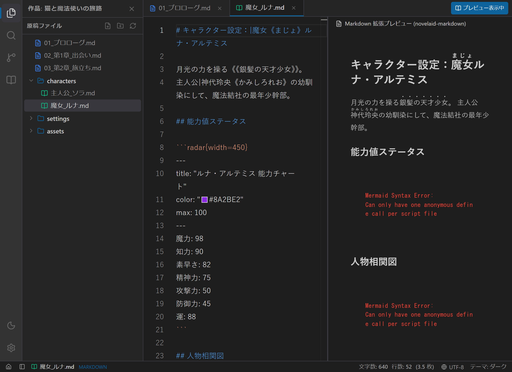
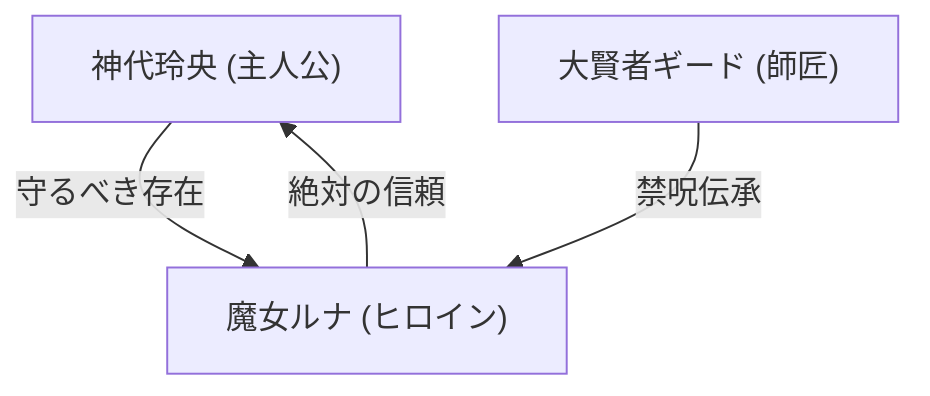
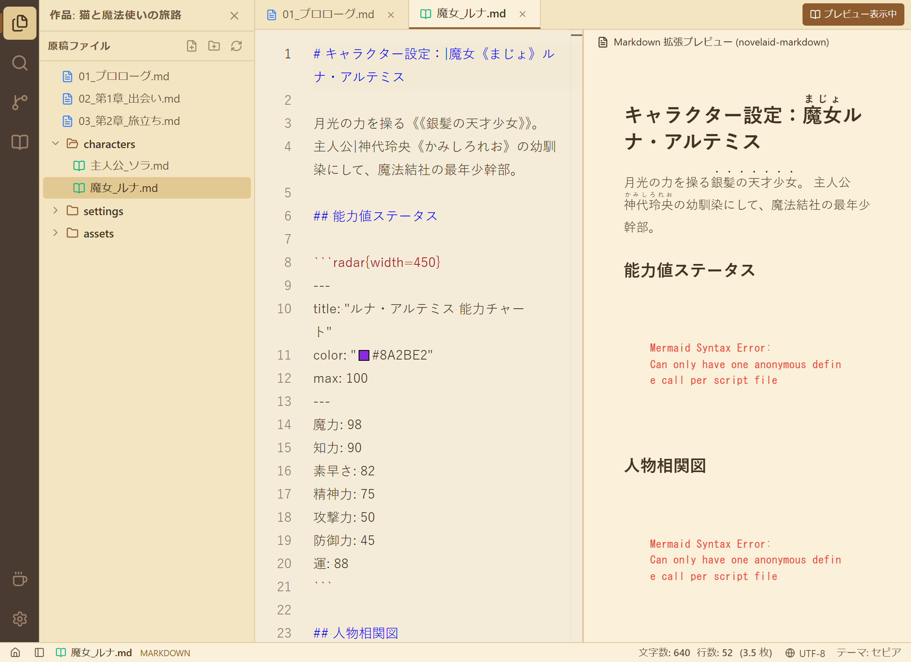
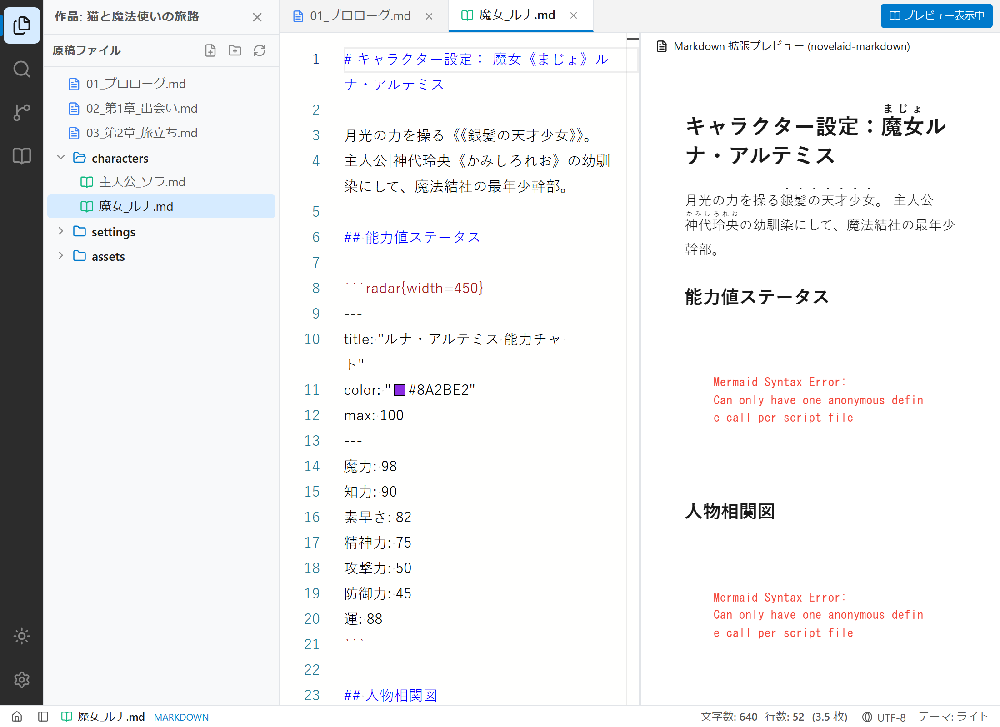

# 【第10回】設定資料を視覚化する！novelaid-markdown による拡張描画とマップ表示の実装

## はじめに

小説の執筆において、本文原稿と同じくらい作家の力強い相棒となるのが **「設定資料・プロット（Markdown）」** です。
登場人物のプロフィール、世界観、能力値、人間関係、地理設定などを整理する際、文字だけのメモよりも「図やチャート、地図」でパッと視覚的に確認できたほうが、格段に筆が進みます。

そこで今回は、小説執筆専用のMarkdown描画ライブラリ **`novelaid-markdown`** を組み込み、**ステータスレーダーチャート、Mermaid相関図、そしてOpenStreetMapによる舞台マップ表示** を実現しました！



---

## 1. ユーザーからのプロンプトと背景

前回、ビュープラグイン基盤と縦書きプレビューを導入した直後、ユーザーから以下のリクエストをいただきました。

> **ユーザー入力プロンプト:**  
> 「マークダウン表示用として\`novelaid-markdown\`ライブラリがあります。こちらは、各種ダイアグラムやマップ表示にも対応しています。  
> マークダウン表示で対応できる追加描画種類の仕様を含めて組み込みを検討してください」

通常のエディターのMarkdownプレビューは、見出しや箇条書き、表の整形といった一般的なWeb構文にとどまります。
しかし、小説専用エディターである `novelaid` シリーズには、創作を強力にブーストする独自ライブラリ `novelaid-markdown` が用意されていました。

---

## 2. novelaid-markdown が提供する5大拡張機能

今回整理・導入した描画機能は以下の通りです。

```mermaid
graph TD
    subgraph Input ["Markdown原稿 (.md)"]
        Ruby["日本語小説記法 (|漢字《かんじ》, 《《傍点》》)"]
        Radar["```radar (ステータス・能力値チャート)"]
        Mermaid["```mermaid (人物相関図・勢力図)"]
        Map["```map (作中舞台・都市マップ)"]
        D2["```d2 (宣言型アーキテクチャ図)"]
    end

    subgraph Preview ["NovelaidMarkdown レンダラー"]
        Render["リッチHTML & インタラクティブUI"]
    end

    Ruby --> Render
    Radar --> Render
    Mermaid --> Render
    Map --> Render
    D2 --> Render
```

### ① 日本語ルビおよび傍点記法
設定資料内でも、小説本文とまったく同じカクヨム・なろう記法がそのまま利用できます。
```markdown
主人公|神代玲央《かみしろれお》は、《《銀髪の天才少女》》ルナと出会う。
```

### ② ステータスレーダーチャート (`radar`)
キャラクターの能力値を直感的なキー＆バリューで記述すると、多角形のレーダーチャートとして自動整形されます。
````markdown
```radar{width=450}
---
title: "ルナ・アルテミス 能力チャート"
color: "#8A2BE2"
max: 100
---
魔力: 98
知力: 90
素早さ: 82
精神力: 75
攻撃力: 50
防御力: 45
運: 88
```
````

### ③ Mermaid 人物相関図 (`mermaid`)
キャラクター同士の好意、対立、師弟関係などを矢印とノードで直感的に可視化できます。
````markdown

````

### ④ インタラクティブ・マップ表示 (`map`)
作中舞台となる現実の街や都市の地図を埋め込み、重要拠点にアイコン付きピンマーカーと説明文を表示します。
````markdown
```map
id: luna-hideout
width: 100%
height: 380px
lat: 35.681236
long: 139.767125
defaultZoom: 13
marker:
  - book, 35.681236, 139.767125, 月影の秘密研究所, "古代の禁呪や調合器具が隠された拠点"
  - school, 35.689506, 139.691701, 王立魔導学園, "ルナが通っていたかつての学園"
  - default, 35.676231, 139.752311, 逢魔が時の辻, "主人公玲央と再会した交差点"
```
````

---

## 3. 各テーマでのプレビュー画面

Playwright を用いて、各テーマでの描画結果を撮影しました。

### セピアモード
温かみのあるセピア調の画面でも、レーダーチャートやマップ、相関図がくっきりと見やすく調和しています。



### ライトモード
昼間の執筆や印刷前の確認に最適な、すっきりと清潔感のある仕上がりです。



---

## まとめと次回予告

今回は、設定資料の表現力を極限まで高める **`novelaid-markdown`** を導入しました。

- **ルビ・傍点の統一**: 設定メモでも小説と同じ日本語作法で記述可能。
- **レーダーチャート & 相関図**: キャラクターの個性や関係性が一目でわかる。
- **舞台マップ**: 街の地理や距離感を把握しながらリアリティのある描写が可能に。

これで、左ペインに「小説本文」、右ペインに「ルナの設定資料（レーダーチャートや相関図）」を開いて執筆する、という **小説執筆に特化した最高のデュアル作業環境** が完成しました！

次回は、環境設定（フォントや文字サイズ等のカスタマイズ）や、Gitを活用した執筆履歴管理（セーブポイント機能）の実装へと進んでいきます。どうぞお楽しみに！
