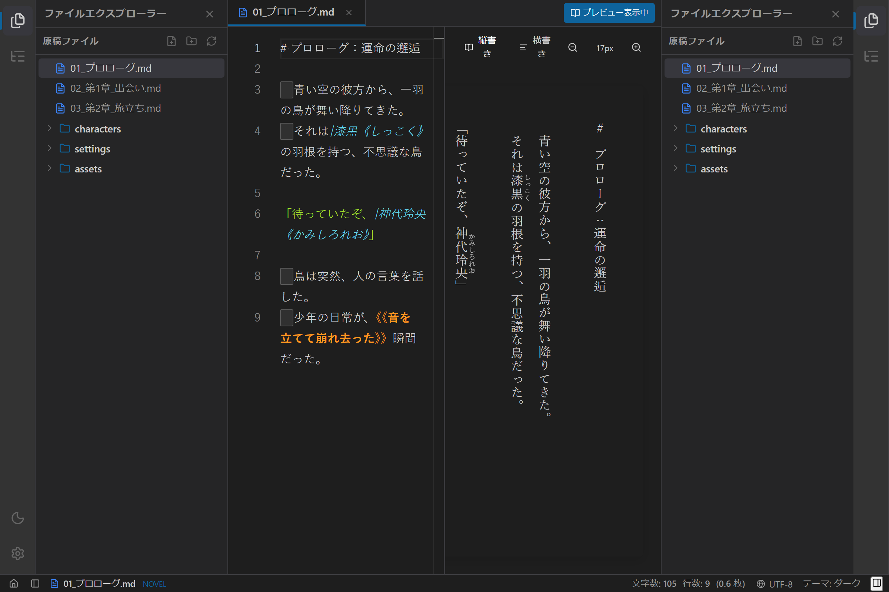
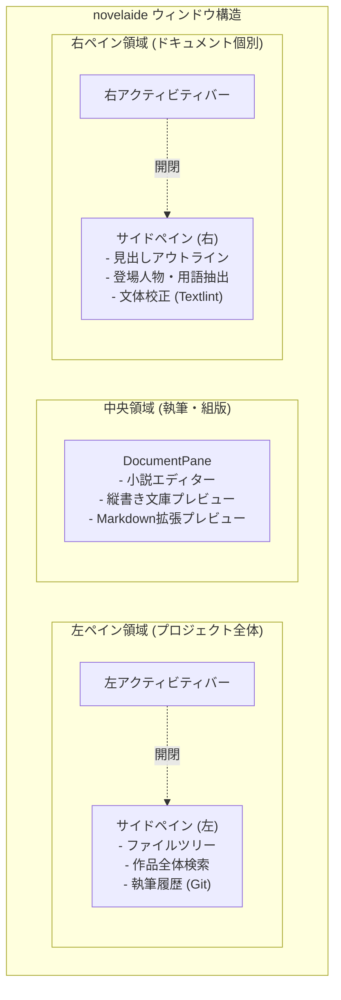
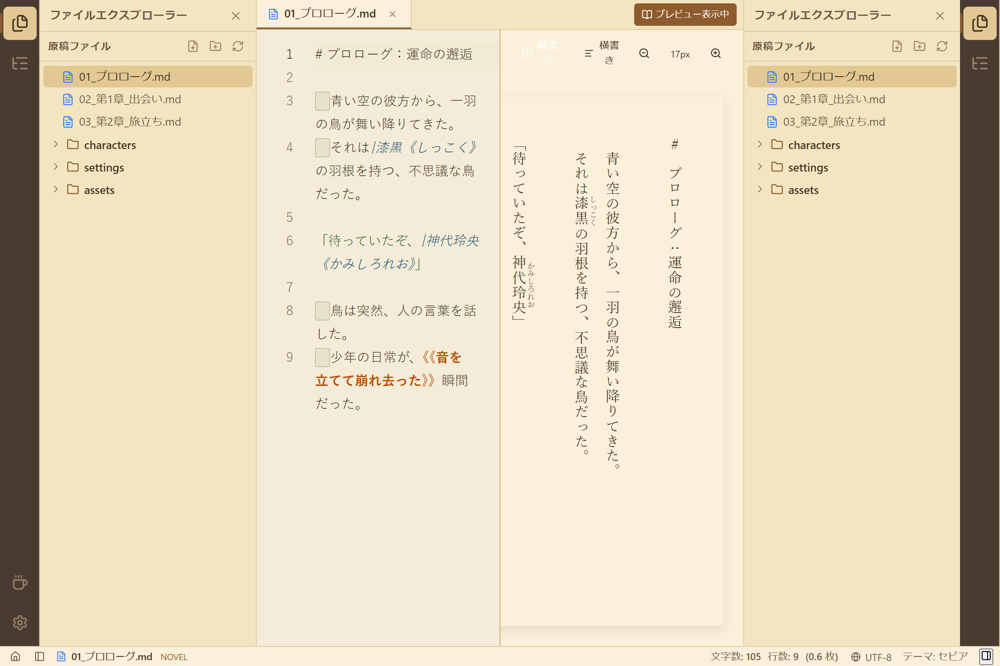
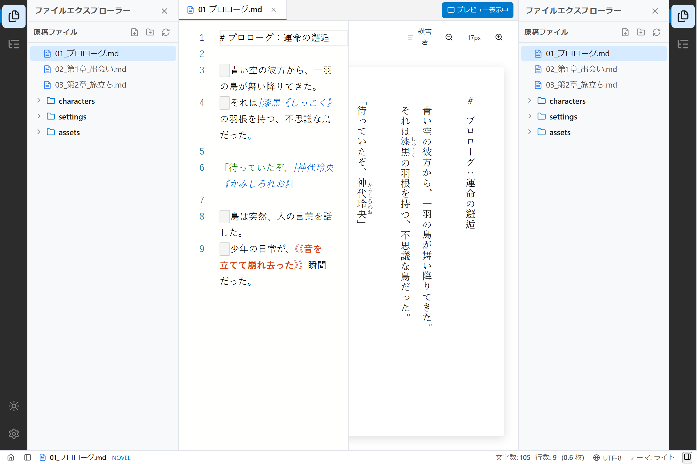

# 【第11回】左右対称ペインとUIプラグイン化！洗練された執筆ワークスペースの構築

## はじめに

テキストエディターを開発する際、画面の左側には「ファイル一覧」、中央には「エディター」、下部には「ステータスバー」という配置が一般的です。
しかし、小説という長大な物語を執筆・推敲する上では、**「作品全体を管理する視点」** と **「いま書いている原稿そのものに集中する視点」** の2つが常に交錯します。

そこで今回は、ユーザーからの提案をもとに、アプリ全体のUI（左右ペイン、パネル、ドキュメントビュー、ステータスバー）をすべてプラグインとして追加・拡張できる **「統合UIプラグイン・アーキテクチャ」** を導入し、**左右対称のサイドペイン構造** を実現しました！



---

## 1. ユーザーからのプロンプトと設計の問い

前回のMarkdown拡張機能の導入に続き、アプリ全体のUI設計について非常に深い視座からのリクエストをいただきました。

> **ユーザー入力プロンプト:**  
> 「その他の部分のプラグイン構造についても検討してください。  
> 主なUI要素として、左右のペイン、および、ペイン内部のパネル、  
> 中央のドキュメントビュー、下部のステータスバーがあります。  
> これらのUI部分にはそれぞれプラグイン的に表示を追加できるものとします。  
> まず、ペイン部分にはプラグイン的にパネルを追加可能です。  
> なお、このペイン部分は配置的に左右に分かれるだけで、機能的な違いはありません。  
> おおよその役割として、左ペインがドキュメント全体に関わるもの、右ペインが個々のドキュメントに関わるものとなります。  
> ステータスバーには、個々のパネルやドキュメントなどの情報を表示可能です。」

この提案の素晴らしい点は、**「左右のペインコンテナに機能的な差をつけず、対称な構造にしておく」** という点です。
左ペインと右ペインを別々にハードコードしてしまうとコードが重複し、将来「アウトラインを左に置きたい」というカスタマイズが難しくなります。
「配置されるスロットが左右にあるだけで、コンテナとしては同じ」という抽象化を行うことで、極めて高い拡張性が生まれました。

---

## 2. 統合UIプラグイン体系の見取り図



### 左右ペインの自然な役割分担
- **左ペイン（プロジェクト全体）**:
  作品フォルダー内のすべてのファイルを行き来するエクスプローラー、作品全体の検索、Gitセーブポイント履歴など。
- **右ペイン（個々のドキュメント）**:
  現在開いている原稿の見出し・章節構造（アウトライン）、登場人物・専門用語の抽出リスト、誤字脱字・文体チェックなど。

---

## 3. パネルプラグイン (`PanelPlugin`) の仕組み

すべてのサイドパネルは、以下の共通仕様で独立したモジュールとして実装され、`PanelRegistry` に登録されます。

```typescript
export interface PanelPlugin {
  readonly id: string;
  readonly title: string;
  readonly icon: React.ComponentType<{ size?: number }>;
  readonly defaultPlacement: 'left' | 'right';
  readonly scope: 'project' | 'document';
  readonly component: React.ComponentType<PanelProps>;
}
```

今回、右ペイン用プラグインの第一弾として **「見出しアウトラインパネル（`OutlinePanelPlugin`）」** を実装しました。
小説本文の `【第一話】` や `第〇章`、Markdownの `# 見出し` をリアルタイムに自動解析し、クリック可能な目次リストとして右側に表示します。

---

## 4. 各テーマでの動作確認

Playwright による自動撮影スクリプトで、左にファイルツリー、中央にエディター＆縦書きプレビュー、右に見出しアウトラインが同時に展開された状態を撮影しました。

### セピアモード（文庫本古紙スタイル）
左右のパネルもセピア調に美しく染まり、物語の世界に没入できる統一感のある空間が広がります。



### ライトモード
左右のパネル境界とスプリッターが明瞭で、構成の全体像がすっきりと見渡せます。



---

## まとめと次回予告

今回は、主要なUI要素（左右ペイン、パネル、中央ビュー、ステータスバー）をすべてプラグインとして拡張可能にする **「統合UIプラグイン・アーキテクチャ」** を導入しました。

- **左右対称のペインコンテナ**: コード重複ゼロで、左に「作品全体」、右に「個別ドキュメント」という明快な空間分離を実現。
- **プラグイン式パネル**: 見出しアウトラインやファイルツリーなど、必要なパネルを自在に登録・開閉可能。
- **洗練されたワークスペース**: 左（ファイル）→ 中央（執筆＆縦書きプレビュー）→ 右（目次アウトライン）という、プロの作家が求める完璧なレイアウトが完成。

次回は、いよいよ小説家向けの安心機能である **「Gitを活用した執筆履歴管理（セーブポイント・版管理機能）」** の実装へと進んでいきます。どうぞお楽しみに！
