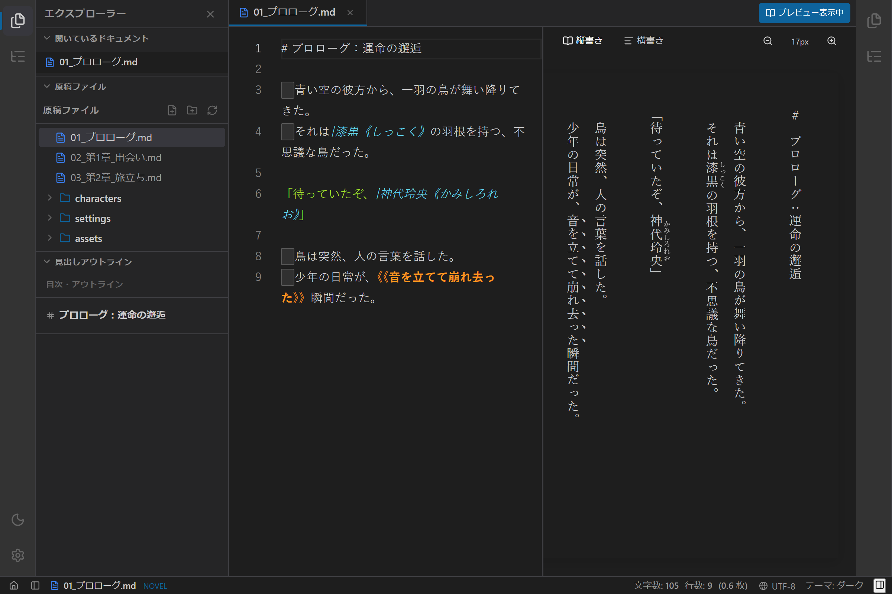
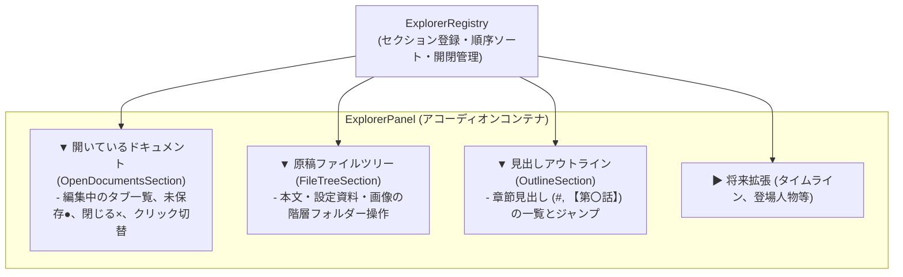
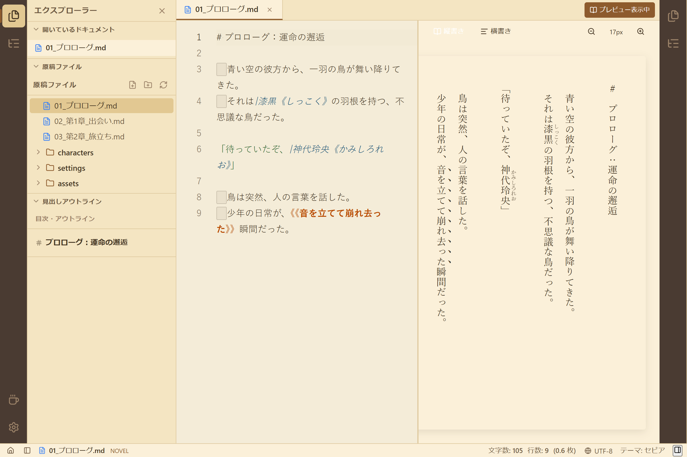
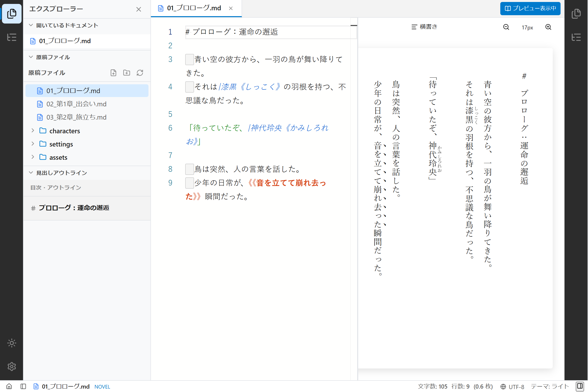

# 【第12回】原稿・ファイル・目次を一望する！汎用エクスプローラーパネルとアコーディオンセクションの実装

## はじめに

小説を執筆しているとき、作家の手元には常に複数の「見たい情報」が存在します。
「いま開いて推敲している原稿はどれか？」「次の章のファイルはどこにあるか？」「この話の見出し構成はどうなっていたか？」。

これらをいちいち別画面や別パネルに切り替えて確認するのは、集中力を削ぐ原因になります。
そこで今回は、単一のファイルツリーにとどまらず、**「開いているドキュメント」「原稿ファイル」「見出しアウトライン」** を折りたたみ可能なアコーディオンセクションとして統合した **「汎用エクスプローラーパネル（`ExplorerPanel`）」** を実装しました！



---

## 1. ユーザーからのプロンプトと背景

前回のUIプラグイン化に続き、エクスプローラーのあり方について以下のご提案をいただきました。

> **ユーザー入力プロンプト:**  
> 「現在のFileExplorerPanel部分の汎用、プラグイン化を検討してください。  
> まず、パネルとしては、ExplorerPanelとして、ファイル一覧に限らない、汎用的な閲覧パネルとします。  
> これは、VSCodeなどのエクスプローラ―に近いです。  
> 例えば、このパネルには、現在開いているドキュメントの一覧なども表示可能です。  
> それぞれをExlorerComponentなどとして、更にプラグイン構造で追加できるようにします。  
> それ以外に追加する項目の案としては、編集中のドキュメントのアウトライン表示などはこの中が適切かもしれません。」  
> *(※検索機能とは明確に切り分けて、個別に仕様・実装を進める方針)*

VSCodeのエクスプローラーが「開いているエディター」「フォルダー」「アウトライン」を折りたたみセクションとして並べているように、**パネルの内部を「セクション（コンポーネント）プラグイン」として多層的にモジュール化する** アプローチです。

---

## 2. アコーディオン式セクション構造



### セクションプラグイン共通インターフェース (`ExplorerSectionPlugin`)

各セクションは、以下のインターフェースに従う独立したモジュールとして実装され、`ExplorerRegistry` に登録されます。

```typescript
export interface ExplorerSectionProps {
  activeDocument: DocumentState | null;
  projectPath: string | null;
}

export interface ExplorerSectionPlugin {
  readonly id: string;
  readonly title: string;
  readonly defaultExpanded?: boolean;
  readonly priority: number;
  readonly component: React.ComponentType<ExplorerSectionProps>;
}
```

コンテナ側（`ExplorerPanel`）は、登録されたセクションを `priority` 順に並べ、ヘッダーのクリックで展開／折りたたみをトグル制御します。

---

## 3. 実装した3大組み込みセクション

### ① 開いているドキュメント (`OpenDocumentsSection`)
現在エディターで開いているタブ一覧をコンパクトに縦並び表示します。
- **未保存マーク（`●`）**: 変更が未保存のファイルが一目でわかります。
- **ワンクリック切替**: 上部のタブバーまで視線を動かさずに、左手元で素早く原稿を切り替え可能。
- **閉じるボタン（`×`）**: 不要になったタブをその場でクローズ。

### ② 原稿ファイル (`FileTreeSection`)
作品フォルダー全体の階層ツリー。
小説本文原稿（`.txt`）や設定資料（`.md`）、画像素材（`.png`）の新規作成・フォルダ整理を行えます。

### ③ 見出しアウトライン (`OutlineSection`)
現在編集中の原稿に含まれる見出し（Markdownの `#` や、小説の `【第一話】`、`第〇章` 等）を自動抽出して目次表示します。
右サイドペインを開かなくても、左ペイン1箇所で章節構造を俯瞰しながら執筆できます。

---

## 4. 各テーマでの動作確認

Playwright による自動撮影スクリプトで、3つのセクションが美しく調和して展開されている様子を撮影しました。

### セピアモード（文庫本古紙スタイル）
セピア調の用紙テクスチャと左側のエクスプローラーが一体となり、落ち着いた長編執筆の雰囲気を醸し出します。



### ライトモード
セクションごとの境界線やChevronアイコンが明瞭で、素早いファイル操作が可能です。



---

## まとめと次回予告

今回は、単一のファイルツリーから脱却し、開いている原稿・ツリー・目次アウトラインを1箇所に統合する **「汎用エクスプローラーパネル（`ExplorerPanel`）」** を実装しました。

- **多層プラグイン設計**: パネルの中にセクションプラグインを配置する柔軟なアコーディオン構造。
- **視線の集約**: 左ペインを見れば「いま開いているもの」「作品全体の構成」「現在の章見出し」がすべて把握可能。

次回は、今回切り分けたもう一つの重要テーマである **「汎用検索パネル（本文全文検索、メタデータ検索、セリフ特化検索プロバイダー）」** の仕様策定と実装へと進んでいきます。どうぞお楽しみに！
