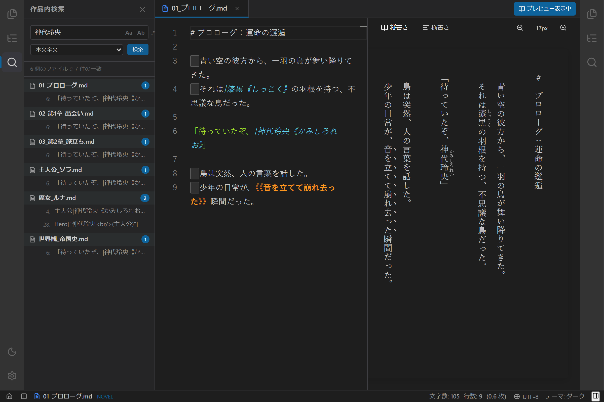
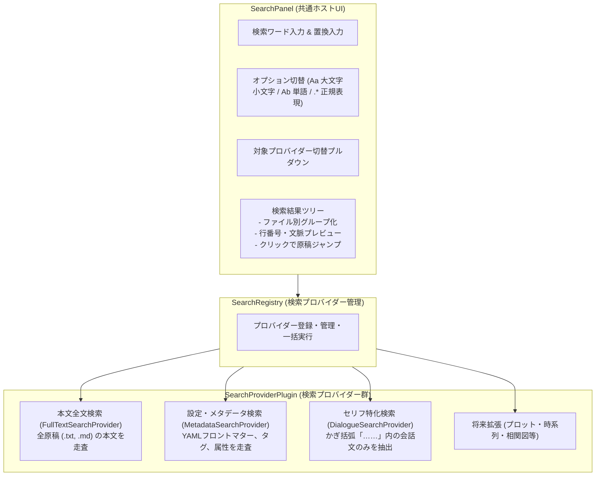
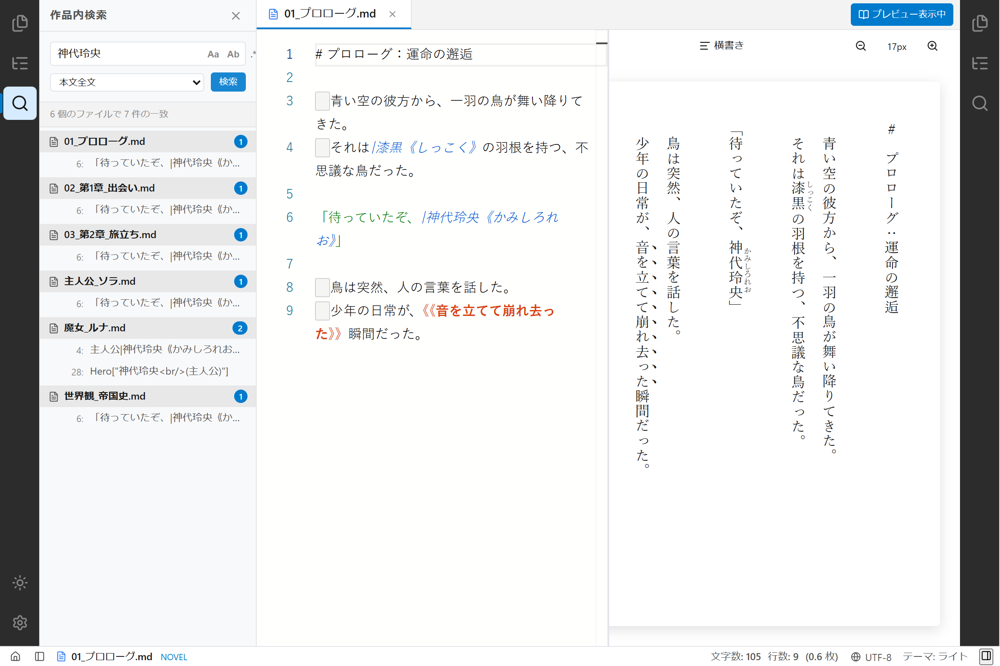
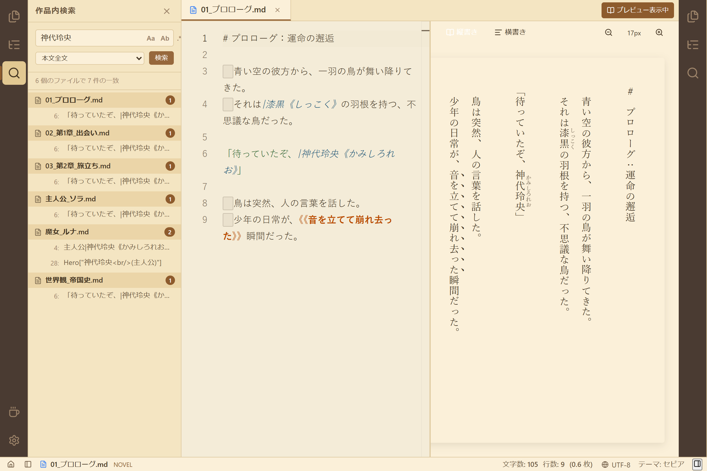

# 【第13回】長編の伏線やセリフを一発抽出！汎用検索パネルとプラグイン式検索プロバイダーの実装

## はじめに

長編小説の執筆が進むにつれて、原稿の分量は数十万文字、数十話以上にも膨れ上がります。
そんなとき、作家の手元で頻繁に発生するのが次のような検索ニーズです。

- **「第1話で張ったあの伏線、どのファイルの何行目で言及したっけ？」**（本文全文検索）
- **「主人公のステータスや魔剣の設定、用語集のどこにメモしたっけ？」**（設定資料・メタデータ検索）
- **「ライバルキャラの口調『〜だぜ』と『〜だな』、会話文の中で表記揺れしてない？」**（セリフ特化検索）

単なるエディターの「ページ内検索（Ctrl+F）」だけでは、複数ファイルにまたがる壮大な物語の管理には太刀打ちできません。
そこで今回は、検索入力やオプション設定、結果ツリー表示などの**共通UI**を基盤とし、目的に応じて検索ロジックを自在に追加・拡張できる**「汎用検索パネル（`SearchPanel`）」**と、小説執筆に特化した**プラグイン式検索プロバイダー群**を実装しました！



---

## 1. ユーザーからのプロンプトと背景

前回の汎用エクスプローラーパネルに続き、検索機能の設計について以下のご要望をいただきました。

> **ユーザー入力プロンプト:**  
> 「現在の検索部分についても別途検討してください。  
> こちらは、プラグイン的に検索対象を追加、検索する形になるかもしれません。  
> 例えば、メタデータの検索や、何らかの複雑な条件による検索など。  
> 検索内容の入力と結果表示部分を標準機能として含むと良いのかもしれませんが、要検討とします。」  
> 「エクスプローラ―と検索はそれぞれ別のものです。それぞれ分けて仕様と実装を行います」  

「検索入力バーや結果一覧」という汎用的なUIコンテナと、「どこをどう探すか」という走査ロジックをきれいに分離し、プラグインとして差し替え可能にするアーキテクチャの実現です。

---

## 2. アーキテクチャ設計：ホストUIと検索プロバイダーの分離

検索パネルの全体設計は、以下のようになっています。



### 検索プロバイダー共通インターフェース (`SearchProviderPlugin`)

```typescript
export interface SearchQuery {
  text: string;
  replacement?: string;
  caseSensitive: boolean;
  matchWholeWord: boolean;
  useRegex: boolean;
}

export interface SearchMatch {
  filePath: string;
  fileName: string;
  lineNumber: number;
  columnStart: number;
  columnEnd: number;
  previewLine: string;
  matchText: string;
  providerId: string;
  providerTitle: string;
}

export interface SearchProviderPlugin {
  id: string;
  title: string;
  description: string;
  order: number;
  search: (query: SearchQuery, projectPath: string | null) => Promise<SearchMatch[]>;
}
```

UI側は「どのプロバイダーがどんなロジックで動いているか」を意識する必要がなく、ユーザーの入力を `SearchQuery` として渡し、返ってきた `SearchMatch[]` をファイル別ツリーに束ねて描画するだけです。

---

## 3. 小説執筆に特化した3つの検索プロバイダー

今回は初期実装として、小説執筆で最も役立つ3つのプロバイダーを登録しました。

### ① 本文全文検索 (`FullTextSearchProvider`)
プロジェクト配下にあるすべての原稿ファイル（`.txt` および `.md`）を読み込み、正規表現や単語単位、大文字小文字の区別を適用して検索します。
各ヒット箇所の行番号や前後の文章を切り取ってプレビュー表示します。

### ② 設定・メタデータ検索 (`MetadataSearchProvider`)
原稿冒頭のフロントマター（`---` で囲まれた設定ブロック）や、設定フォルダー内のキャラクタープロファイル、世界観設定メモを走査します。
「神代玲央」がどの話でどんなタグ（例: `role: 主人公`, `status: 覚醒前`）で登場しているかを瞬時に確認できます。

### ③ セリフ特化検索 (`DialogueSearchProvider`)
**小説執筆エディターならではのユニークな機能**です。
地の文を除外し、かぎ括弧（`「……」`、`『……』`）の中に含まれる会話文だけを抽出してマッチングを行います。
キャラクターの口調や語尾の確認、セリフの重複・表記揺れチェックに抜群の効果を発揮します。

---

## 4. テーマ別ビジュアルとUI操作感

検索を実行すると、マッチした原稿ファイルごとにアコーディオン形式でヒット結果が一覧表示されます。
行番号と前後の文章がハイライトされ、クリックするだけで中央エディターで該当のファイルが開き、その行へと自動スクロール・カーソル移動します。

| ダークモード | ライトモード |
| :---: | :---: |
|  |  |

| セピア（原稿用紙）モード |
| :---: |
|  |

左サイドペイン上部のアクティビティバー（虫眼鏡アイコン）をクリックするだけで、いつでも瞬時にエクスプローラーと検索を行き来できます。

---

## 5. まとめと次回予告

エクスプローラーパネルに続き、検索パネルもプラグイン式プロバイダー構造へと進化しました。
UIと検索ロジックが美しく疎結合化されたことで、将来的に「正規表現マクロ」「形態素解析による品詞検索」「AIによるプロット類似度検索」といった高度な検索プロバイダーも簡単に追加できるようになりました。

次回は、小説の執筆履歴を安全かつ手軽に守る**「Git執筆履歴・セーブポイント管理機能」**や、エディターの細かな動作をカスタマイズする**「環境設定パネル」**の実装へと歩みを進めます！
どうぞお楽しみに！
