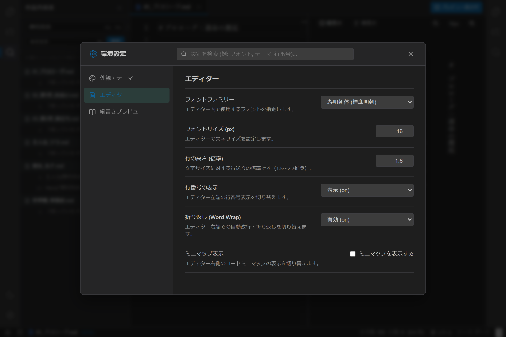
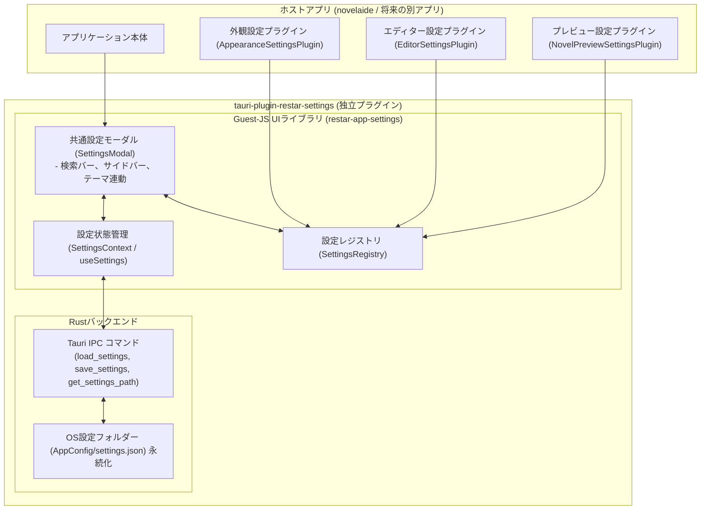
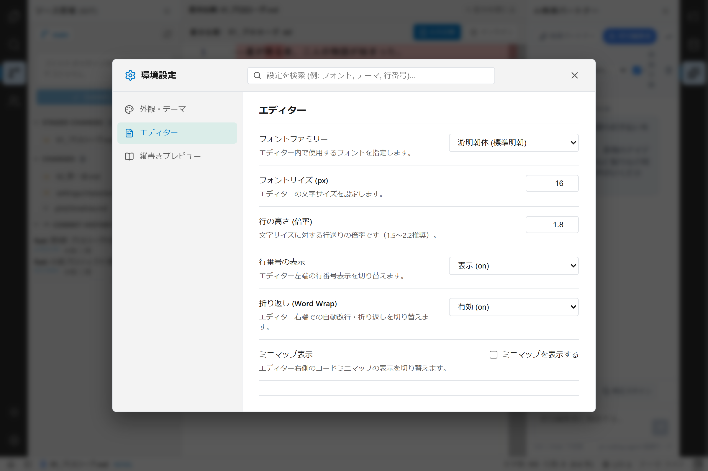
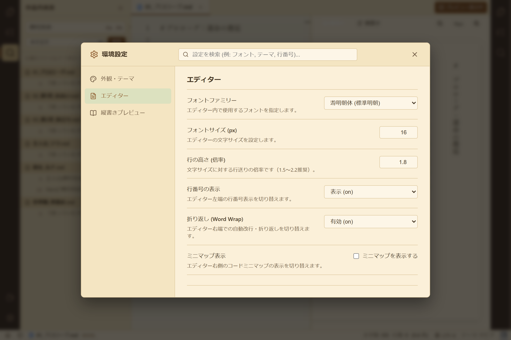

# 【第14回】執筆環境を自分色に染める！設定プラグインアーキテクチャと設定モーダルの実装

## はじめに

作家にとって、「文字サイズ」「フォント」「行間」「テーマ」「原稿用紙の行・文字数」は、執筆のリズムやモチベーションを大きく左右する極めて個人的で重要な要素です。
明朝体でゆったりとした行間で書きたい作家もいれば、ゴシック体で等幅に近い引き締まった画面を好む作家もいます。また、公募の規定に合わせて「40字×30行」や「20字×20行」で換算枚数を把握したいというニーズも日常茶飯事です。

これらの多様な好みに応えるため、今回は**「設定タブプラグイン（`SettingTabPlugin`）」**によるプラグイン式設定アーキテクチャと、洗練された**「環境設定モーダル（`SettingsModal`）」**を実装しました！



---

## 1. ユーザーからのプロンプトと背景

これまでのUIプラグイン化、汎用エクスプローラー、汎用検索パネルに続き、設定機能について以下のご要望をいただきました。

> **ユーザー入力プロンプト:**  
> 「設定関連の実装を検討します。また、設定自体もプラグイン的に構成できるものとします。」  
> 「設定画面の仕組みは将来的に別なアプリでも使用したいです。tauri-plugin としてtauri-plugin-novelaid-fs のように構造的に分離可能か検討してください。名称としては、restar-app-settings? or setting? を候補として検討してください。」  

設定項目を単一のモーダルや設定画面にベタ書きするのではなく、**エディター、テーマ、縦書きプレビュー、そして将来追加される新機能が、それぞれ自分自身の設定項目を独立したプラグインとして登録できる構造** を目指します。  
さらに、この仕組み自体を小説エディター専用にとどめず、他のデスクトップアプリ（`restar-app` エコシステム等）でも横断的に再利用できるよう、**Tauriプラグイン（`tauri-plugin-restar-settings` / npm: `restar-app-settings`）として完全に独立分離する** 方針を決定しました。

---

## 2. アーキテクチャ設計：tauri-plugin-restar-settings による構造分離



### 設定タブプラグイン共通インターフェース (`SettingTabPlugin`)

```typescript
export interface SettingTabProps {
  settings: Record<string, any>;
  updateSetting: <T>(key: string, value: T) => void;
  resetSetting: (key: string) => void;
  searchQuery: string;
}

export interface SettingTabPlugin {
  id: string;               // 'appearance', 'editor', 'preview' など
  title: string;            // 表示名
  icon?: string;            // アイコン
  order: number;            // 並び順
  keywords?: string[];      // 検索用キーワード
  defaultValues: Record<string, any>; // 初期設定値
  render: (props: SettingTabProps) => React.ReactNode;
}
```

このインターフェースにより、新機能を追加する開発者は、本体のコードを汚すことなく「自分の設定タブ」を1つのファイルで定義し、レジストリに `register` するだけで設定画面を拡張できます。

---

## 3. 初期提供する3大設定プラグイン

### ① 外観・テーマ設定 (`AppearanceSettingsPlugin`)
- **🌙 ダーク**: 目を疲れさせない黒基調
- **☀️ ライト**: クッキリとした白基調
- **📜 セピア（原稿用紙）**: レトロな風合いの原稿用紙カラー

ボタンをクリックした瞬間、アプリケーション全体のテーマがリロード不要で即座に切り替わります。

### ② エディター設定 (`EditorSettingsPlugin`)
- **フォント**: 游明朝体、BIZ UD明朝、游ゴシック体、等幅フォント
- **文字サイズ**: 10px〜36px（スライダー/数値入力）
- **行の高さ（倍率）**: 1.2〜3.0倍（ゆったりとした行送り）
- **行番号 & ミニマップ**: 表示／非表示の個別切り替え
- **折り返し（Word Wrap）**: 有効／無効
- **原稿用紙換算設定**: 1行あたりの文字数（デフォルト20）× 1ページあたりの行数（デフォルト20）＝ 400字。執筆公募のフォーマットに合わせた自由な換算が可能。

### ③ 縦書き文庫プレビュー設定 (`NovelPreviewSettingsPlugin`)
- プレビュー起動時のデフォルト組版方向（縦書き／横書き）
- 文庫本フォントファミリー（ヒラギノ明朝、游明朝、BIZ UD明朝）
- プレビュー文字サイズ

---

## 4. テーマ別ビジュアルとUI操作感

左アクティビティバー最下部の「歯車アイコン（⚙️）」をクリックするか、グローバルショートカット **`Ctrl + ,`（Macでは `Cmd + ,`）** を押すだけで、いつでも瞬時に設定モーダルを呼び出すことができます。

| ダークモード | ライトモード |
| :---: | :---: |
|  |  |

| セピア（原稿用紙）モード |
| :---: |
|  |

上部の検索バーに「フォント」や「行番号」と入力すれば、該当するカテゴリへ素早くジャンプできます。

---

## 5. まとめと次回予告

これで、ビュー、サイドパネル、エクスプローラーセクション、検索プロバイダーに続き、**設定システムまでもが美しいプラグイン構造**として統合されました。
設定値を変更すれば、開いているエディターやプレビュー画面へ即座に反映され、LocalStorageへ安全に保存されます。

次回は、小説執筆における究極の安心安全機能である**「Git執筆履歴・セーブポイント管理機能（版管理・タイムトラベル機能）」**の実装へと歩みを進めます！
どうぞお楽しみに！
