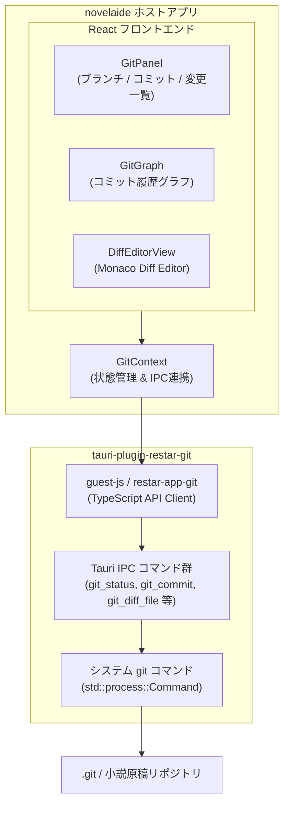
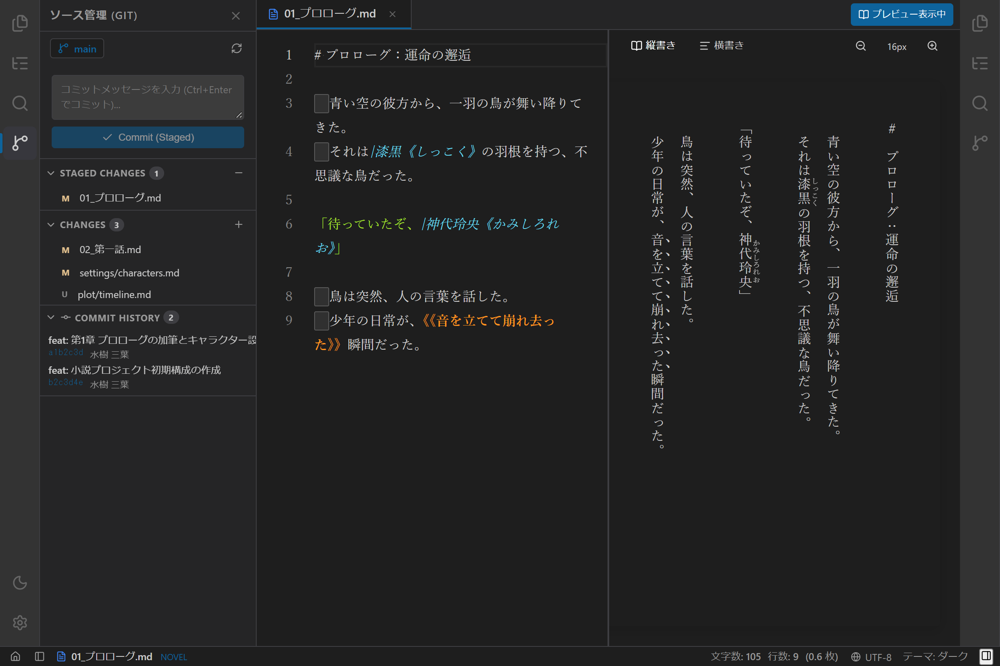
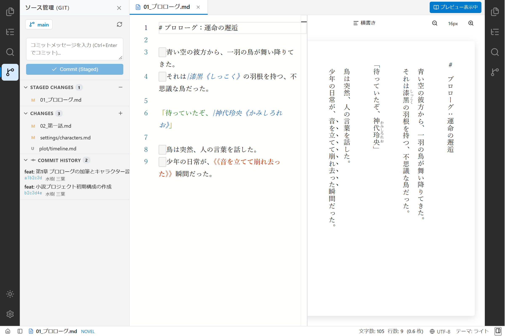
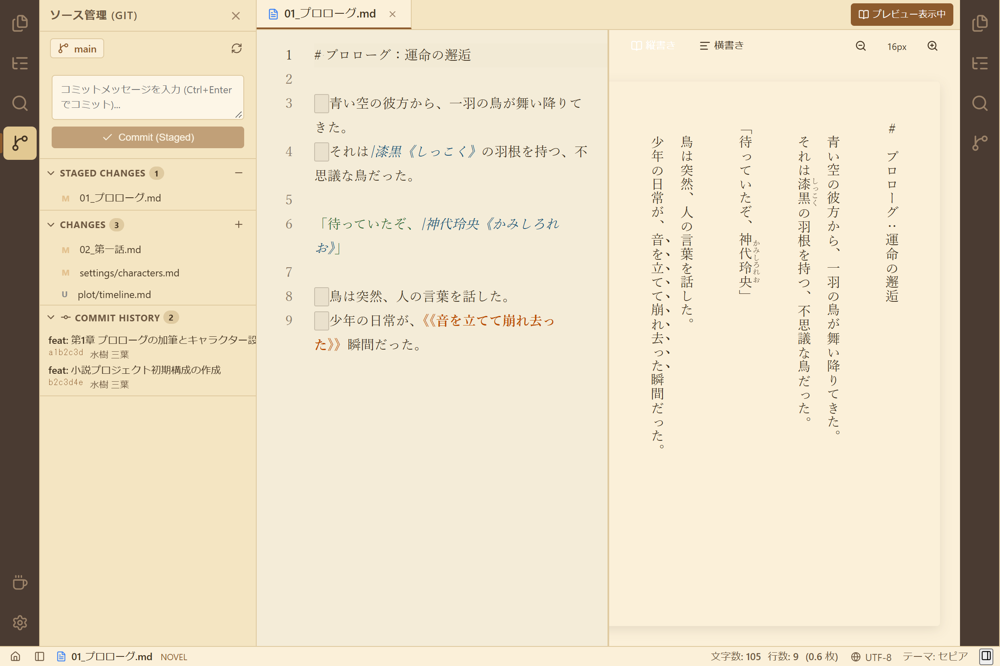

# 第15回：推敲の歴史を刻み、原稿の差分を一望する —— Gitソース管理プラグインとMonaco Diff Editorの実装

小説の執筆は、一度書いたら終わりではありません。推敲を重ね、言葉を選び直し、時には大胆にシーンを差し替えたり削除したりする「試行錯誤の歴史」そのものです。

「昨日消したあのセリフ、やっぱり残しておけばよかった……」  
「推敲前の文章とどこが変わったのか、左右に並べて一目で確認したい」

こうした執筆者の切実な願いを叶えるため、`novelaide` に本格的な **Git ソース管理機能** を実装しました。本記事では、Git 機能を独立した Tauri プラグイン（`tauri-plugin-restar-git`）として構築し、Monaco Editor の強力な **差分比較エディター（`DiffEditor`）** と融合させた開発プロセスをご紹介します。

---

## 1. 開発の背景とユーザーからの要望

小説執筆アプリでは、Git を「バックアップ」や「クラウド同期」のようにオブラートに包んで隠す設計も考えられます。しかし、今回は実際に執筆とプログラミングを行う作者自身が最も使いやすい形を目指し、以下の要件で開発を進めました。

> **ユーザーからのリクエスト**:
> 1. 用語としては Git の用語（Commit, Stage / Unstage, Branch, Diff, Discard 等）をダイレクトに使用すること。
> 2. 実際の Git 操作は、システムの `git` コマンドを Rust から直接呼び出すこと（SSH鍵やGitHub認証、ユーザー設定をそのまま利用できるため）。
> 3. コミット履歴をグラフィカルに可視化し、左右で差分を並べて比較できること。
> 4. 将来的に別アプリでも再利用できるよう、独立したプラグイン（`tauri-plugin-restar-git` / `restar-app-git`）として分離すること。

---

## 2. プラグインアーキテクチャ設計（`tauri-plugin-restar-git`）

設定画面（`tauri-plugin-restar-settings`）と同様、Git 関連の Rust バックエンドとフロントエンド SDK を独立した Tauri プラグインとして切り出しました。



### なぜ `git2` (libgit2) ではなく `git` コマンド直接実行なのか？
Rust で Git を扱う場合、C言語の `libgit2` バインディング（`git2-rs`）を使う選択肢もあります。しかし、以下の理由からシステムの `git` コマンド直接呼び出しを採用しました。

1. **認証・設定の完全継承**: ユーザーが設定している `~/.gitconfig` のユーザー名やメールアドレス、SSH 鍵、GPG 署名、GitHub Credential Helper が追加設定なしでそのまま動作します。
2. **日本語ファイル名の安全な扱い**: `-c core.quotepath=false` を標準引数に付与することで、小説の日本語ファイル名（例: `01_プロローグ.md`）が 8進数エスケープされることなくクリーンに扱えます。

```rust
// tauri-plugin-restar-git/src/commands.rs より抜粋
fn run_git_command(repo_path: &Path, args: &[&str]) -> Result<String, String> {
    let output = std::process::Command::new("git")
        .current_dir(repo_path)
        .args(["-c", "core.quotepath=false"]) // 日本語ファイル名のエスケープ防止
        .args(args)
        .output()
        .map_err(|e| format!("Failed to execute git: {}", e))?;

    if !output.status.success() {
        let stderr = String::from_utf8_lossy(&output.stderr);
        return Err(stderr.to_string());
    }

    Ok(String::from_utf8_lossy(&output.stdout).to_string())
}
```

---

## 3. Monaco Diff Editor による左右差分比較

差分表示には、本アプリですでに採用している Monaco Editor に標準搭載されている `<DiffEditor />` を活用しました。

- **変更前（Original）**: 直前コミット（HEAD）のファイル内容
- **変更後（Modified）**: 作業ツリー（Working Tree）の最新原稿
- **ハイライト**: 行単位の追加・削除だけでなく、**行内のどの単語・文字が修正されたか** まで一目でわかるインラインハイライトを提供。

変更ファイルをクリックするだけで、中央のエディターが通常のテキスト編集から差分比較ビューへと瞬時に切り替わります。

---

## 4. テーマ別のスクリーンショットギャラリー

ダーク、ライト、セピアの各テーマにおける Git ソース管理パネルと Monaco 差分比較ビューの様子です。

````carousel

<!-- slide -->

<!-- slide -->

````

左ペインにはブランチ名（`🌿 main`）、コミットメッセージ入力エリア、ステージング状態、変更ファイル一覧、そしてコミット履歴グラフが美しく配置されています。中央領域では、小説原稿の加筆・修正箇所が色鮮やかにハイライトされています。

---

## 5. 今回のまとめと今後の展望

Git ソース管理機能と Monaco Diff Editor の融合により、小説執筆における「安全な推敲」と「履歴のトレーサビリティ」が飛躍的に向上しました。

* **Git 用語のストレートな活用**: 執筆者が慣れ親しんだ直感的な操作感を実現。
* **プラグインによる疎結合設計**: `tauri-plugin-restar-git` として分離され、別アプリへの転用も容易。
* **高精度な差分表示**: 行・文字レベルの差分比較により、推敲前後の変化を迷わず確認可能。

次回は、さらに小説制作を加速させる機能の拡充やエージェント機能の統合を進めていきます。お楽しみに！
