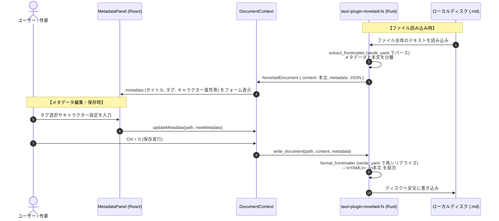
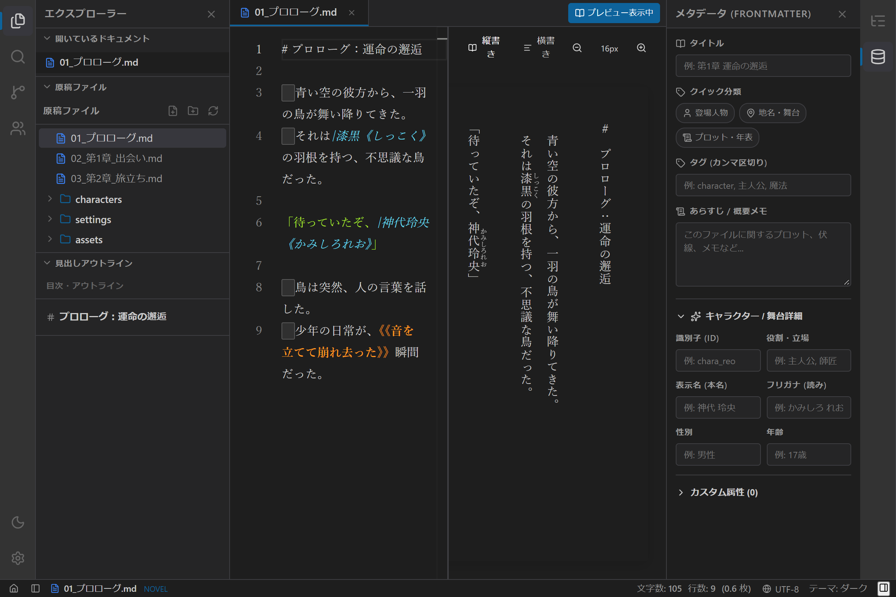
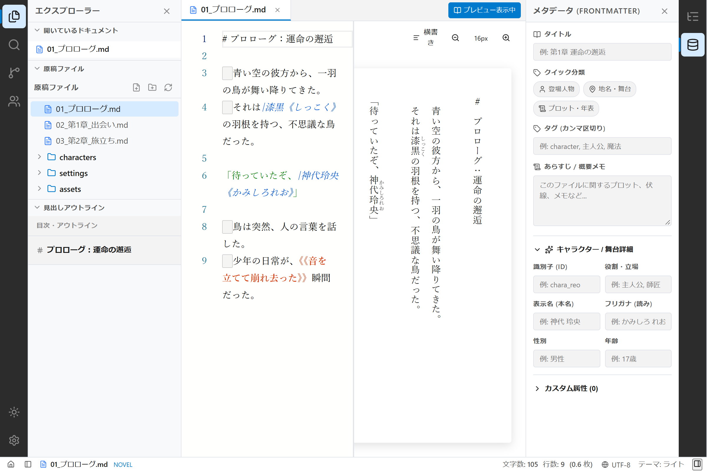
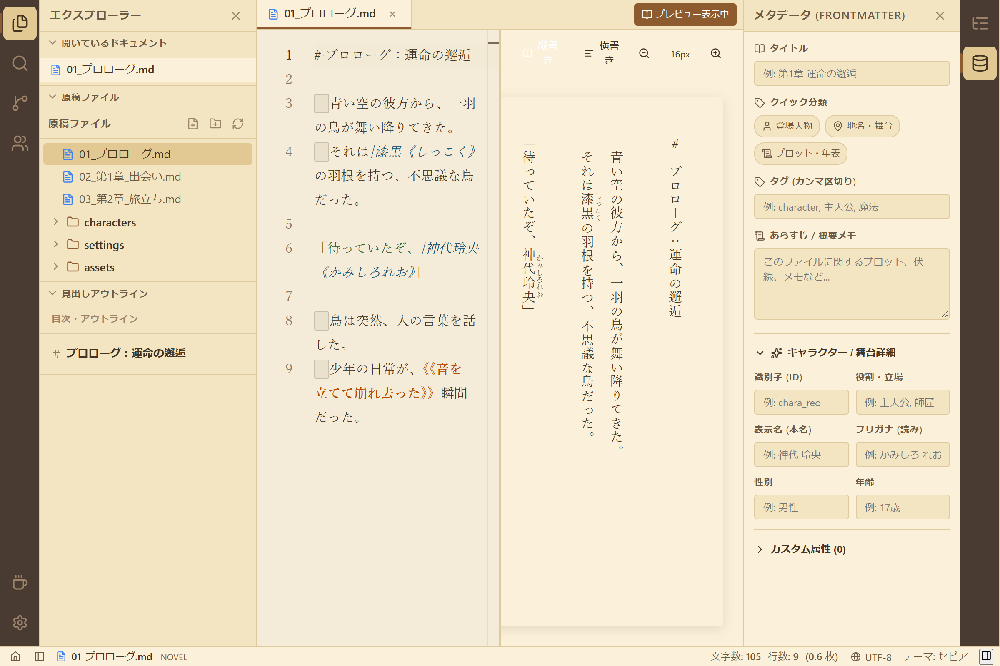

# 第16回：設定資料を整理し、物語を構造化する —— メタデータ管理とFrontmatter編集パネルの実装

小説の執筆が進むにつれて増えていく「登場人物の生年月日や能力」「訪れる街や王国の設定」「各章のあらすじや伏線メモ」。
これらを本文とは別にメモ帳に散らばらせておくのではなく、原稿ファイル自身にスマートに持たせる手段が **YAML Frontmatter** です。

本記事では、`novelaide` に Markdown ファイル先頭の Frontmatter をフォーム形式で直感的に閲覧・編集できる **メタデータ編集パネル（`MetadataPanel`）** と、作品全体の設定資料を俯瞰できる **設定資料一覧パネル（`MetadataListPanel`）** を実装したプロセスをご紹介します。

---

## 1. 開発の背景とアプローチ

Markdown エディターでは、ファイルの先頭に以下のような YAML 形式のメタデータを記述するのが一般的です。

```markdown
---
title: "星詠みの魔女 ルナ"
role: "ヒロイン / 導き手"
tags:
  - character
  - ヒロイン
  - 星魔法
summary: "星の言葉を聞くことができる静謐な少女。ソラの記憶を探す旅を共にする。"
---
# ルナの設定本文...
```

しかし、作家が原稿を書く際に手作業でインデントやコロンを気にして YAML を直接入力するのはストレスになります。
そこで、以下の要件を満たすメタデータ専用 UI を開発しました。

1. **Rust バックエンドによる高速・堅牢なパース**:
   - フロントエンドに重い YAML パーサーを抱え込まず、`tauri-plugin-novelaid-fs` の Rust ネイティブ処理（`serde_yaml`）で読み書きを分離。
2. **直感的なフォーム入力**:
   - 「登場人物」「地名」「プロット」をワンクリックで切り替えられるクイックタグトグル。
   - キャラクター名、フリガナ、役割、年齢などの属性入力欄。
   - 独自のキーを自由に追加できるカスタム属性リスト。
3. **プロジェクト全体の設定資料逆引き**:
   - `character` や `location` などのタグがついたファイルをプロジェクト全体から収集し、左ペインからワンクリックで開ける一覧パネル。

---

## 2. アーキテクチャと処理の流れ

ファイルの読み込み時と保存時において、Rust とフロントエンドが協調して動作します。



エディター上には純粋な小説本文のみが表示されるため、原稿用紙換算枚数カウントや縦書き文庫プレビューがメタデータの YAML に影響されることなく、常に正確に動作します。

---

## 3. テーマ別のスクリーンショットギャラリー

ダーク、ライト、セピアの各テーマにおけるメタデータ編集パネルの様子です。

````carousel

<!-- slide -->

<!-- slide -->

````

右ペインに「タイトル」「クイック分類（登場人物・地名・プロット）」「タグ」「あらすじ」「キャラクター詳細」が美しく整頓されて並んでいます。中央の縦書き文庫プレビューやエディターと調和し、執筆しながらリアルタイムに設定を確認・更新できます。

---

## 4. 今回のまとめと今後の展望

今回のメタデータ機能の実装により、小説執筆における「設定資料の構造化」と「エディターとのシームレスな一体感」が実現しました。

* **Rust バックエンドのフル活用**: ネイティブの `serde_yaml` による堅牢なパースとシリアライズ。
* **左右対称ペインの活用**: 左ペインに「設定資料一覧」、右ペインに「個別メタデータ編集」を配置し、操作動線を最適化。
* **表現力の拡大**: キャラクター詳細やカスタム属性により、長編ファンタジーや群像劇でも設定の破綻を防ぐ。

次回は、執筆中の文章の誤字・脱字や助詞重複をリアルタイムに検知する「日本語文章校正支援エンジン」の実装へと進んでいきます。お楽しみに！
