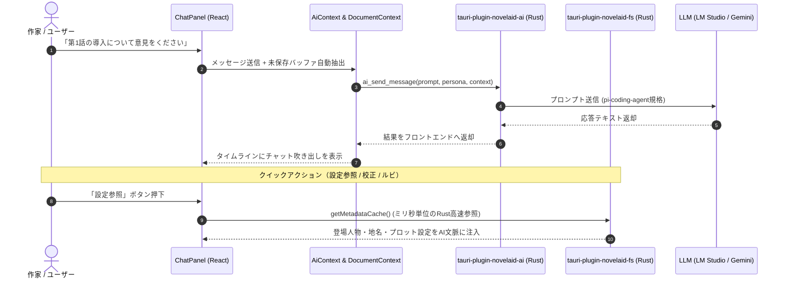
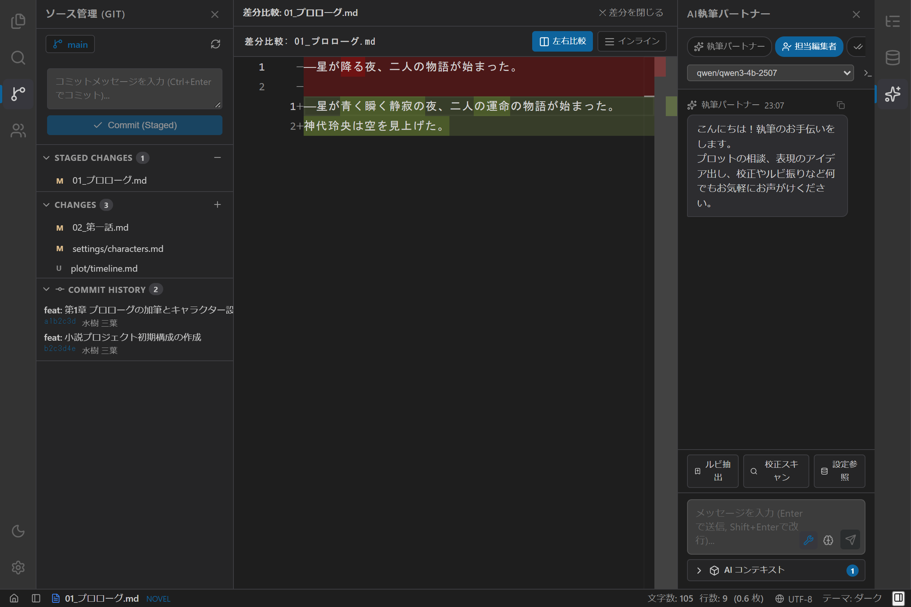
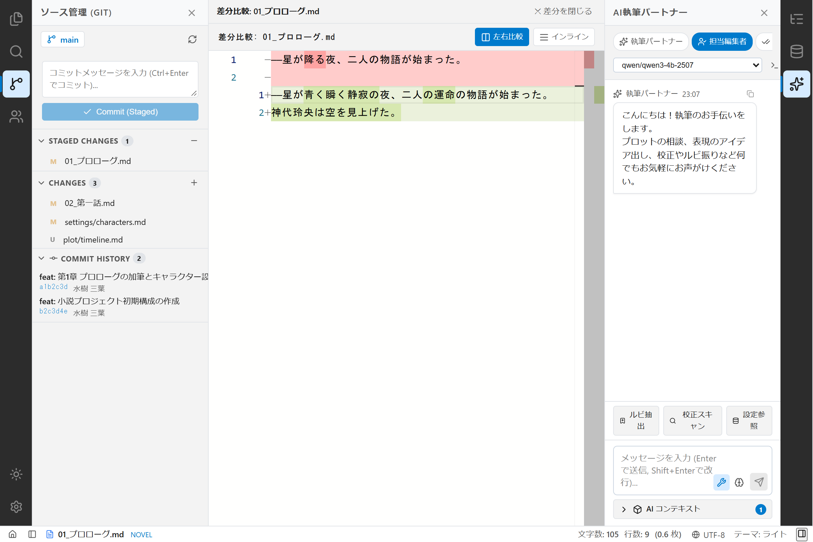
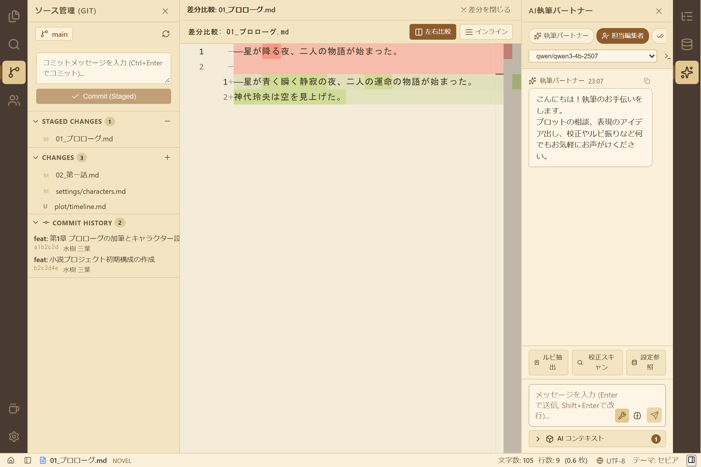

# 第17回：自前実装から脱却し、AI基盤を共有する —— AI執筆パートナーとpi-coding-agent連携の実装

現代の小説執筆において、AIは単なる「文章生成機」ではなく、プロットの穴を客観的に指摘してくれる「担当編集者」であり、誤字脱字やルビゆれを厳格にチェックしてくれる「校正係」であり、アイデアを壁打ちできる「執筆パートナー」です。

しかし、デスクトップアプリ（GUI）やコマンドラインツール（CLI）ごとにAI APIの呼び出しやプロンプト管理、Function Calling（ツール実行）を独自実装してしまうと、コードの重複や仕様乖離が発生し、メンテナンスが破綻してしまいます。

本記事では、`novelaide` におけるAI執筆支援の基盤を大幅に見直し、CLI版（`novelaid-cli`）と共通のバックボーンである `@earendil-works/pi-coding-agent` および独立プラグイン **`tauri-plugin-novelaid-ai`** を導入して、強力な **AI執筆パートナーパネル** を構築したプロセスをご紹介します。

---

## 1. 開発の背景：AI機能の自前実装をやめ、基盤を統一する

旧バージョン（`novelaid-editor`）では、Electron 環境下で各社の AI API（Google Gemini や OpenAI、Anthropic、ローカルLLM）へのリクエストやツール呼び出しを独自にコーディングしていました。

しかし、並行して開発を進めている `novelaid-cli`（AIエージェントによるCLI小説執筆支援ツール）では、すでに `@earendil-works/pi-coding-agent` を採用し、高度なツール実行（ルビ解析、校正スキャン、ファイル境界ガード）が実現されています。

そこで、今回以下の設計方針を決定しました。

1. **AI通信・ツール規格の画一化**:
   - AIモデルアクセスや Function Calling の仕組みを独自実装せず、`pi-coding-agent` のツール規格に準拠。
2. **プロセス内蔵方式から「内部責務分割 ＆ Rust高速処理」への転換**:
   - `novelaid-cli` プロセスをそのまま丸ごと内蔵する方法は、メタデータ走査の重複やエディター未保存バッファとの同期ズレが生じるため採用しません。
   - 重いデータ処理（作品メタデータキャッシュ参照、大容量原稿の校正スキャン、ルビ抽出）は Rust レイヤ（`tauri-plugin-novelaid-fs` / `tauri-plugin-novelaid-ai`）が担当し、ミリ秒単位で超高速処理します。
3. **コード・仕様レベルでの共通化**:
   - `novelaid-cli` との共有は共通パッケージ（`novelaid-ruby`, `novelaid-markdown`、校正ルール定義等）で行い、CLI はシンプルな独立版（簡易版）として保守性を高めます。
4. **作家のための専用UI（ペルソナ＆ツール連携）**:
   - 「執筆パートナー」「担当編集者」「校正係」「作中人物」の4ペルソナを瞬時に切り替えられるUI。
   - 現在開いている原稿テキストを自動的にプロンプトへ注入するコンテキスト連携。
   - ルビ抽出、校正スキャン、設定参照をワンクリックで呼び出せるクイックアクション。

---

## 2. システムアーキテクチャ

GUI（React）、Tauri プラグイン（Rust / Guest-JS）、および `pi-coding-agent` の連携フローは以下のようになっています。



---

## 3. 実装のハイライト

### ① `tauri-plugin-novelaid-ai` への完全カプセル化と疎結合設計

ホストアプリ本体（`novelaide`）のコードを汚さず、通信から UI、コンテキスト管理までの全機能をプラグインパッケージ（`tauri-plugin-novelaid-ai-api`）に内包させました。

- `guest-js/client/`: `modelManager.ts`（LM Studio 等の検出）および `chatSession.ts`（SSE ストリーミング対話）
- `guest-js/contexts/`: `AIContextContext.tsx` および `useAIContextContent.ts`
- `guest-js/components/`: `AIChatPanel.tsx`, `AIChatInput.tsx`, `AIContextSelector.tsx`

ホストアプリ側（`novelaide`）は、プラグインから `AIChatPanel` をインポートしてパネルに登録するだけで済み、コードベースの肥大化を完全に防止しています。

### ② `novelaid-editor` 互換のコンテキストセレクター (`AIContextSelector`)

原稿をただ全量送るのではなく、作家が今AIに見せたい背景資料を細かくアコーディオンで選択できます。

- **左ペイン・右ペイン個別選択**: エディターの未保存最新テキストや、右ペインの設定資料を個別トグル。
- **その他の開いているタブ**: 他の章や設定メモもワンクリックで文脈に結合。
- **Drag & Drop によるカスタム追加**: ファイルツリーから特定ファイルをドロップゾーンにドラッグして個別追加。
- **合成フォーマット**: `[File: {fileName}]\n```\n{content}\n```\n\n` の統一記法でプロンプトに注入。

### ③ 自動伸縮入力エリアとリアルタイムストリーミング (`AIChatInput`)

`novelaid-editor` の優れた入力操作性を完全再現しました。

- **自動伸縮 textarea**: 入力文字数・行数に応じて滑らかに高さが拡張。
- **キーバインド**: `Enter` で即時送信、`Shift + Enter` で改行。
- **ストリーミング逐次描画**: Server-Sent Events（SSE）のチャンクをリアルタイムに受信し、タイピング風のアニメーションでAIの回答を描画。

### ④ エラー耐性の強化とコピー・デバッグ支援

執筆作業を止めないための堅牢性とアクセシビリティも抜かりなく強化しました。

- **`pi-agent-core` 規格への厳格準拠**:
  ツール定義を OpenAI 形式のラッパーから `pi-agent-core` 公式のフラット構造（`{ name, description, parameters }`）に統一。エージェント初期化時の `JSON.parse(undefined)` による構文エラー（`"undefined" is not valid JSON`）を完全に撲滅しました。
- **AssistantMessageEventStream とリアルタイムログの完備**:
  `pi-agent-core` のストリームプロトコル要件（`event.partial` によるメッセージ状態同期）を完全実装し、ストリーミングトークンが確実にUI吹き出しへ描画されるパイプラインを確立。あわせて開発者コンソール（F12）に送信リクエスト、受信トークン、完了ステータスが美しく整形出力される診断機能を完備しました。
- **上位独自実装の全廃と `InlineExtension` への移行**:
  自前で手組みしていた SSE（Server-Sent Events）のストリームパーサー（`createLmStudioStreamFn`）や自前のツール呼び出しループを完全に撤去。`novelaid-cli` と全く同じ Pi SDK の `InlineExtension`（`api.registerProvider`、`api.registerTool`、`api.on("before_agent_start")`）および `createAgentSession` に一本化し、上位アプリ側の独自実装を無くして保守性と共通化を極限まで高めました。
- **ワンクリックコピー & ドラッグ選択**:
  各メッセージヘッダーに配置されたコピーボタンにより、AIの回答やプロンプト全文をワンクリックでクリップボードに取得可能。さらに本文のテキスト選択（`user-select: text`）にも対応し、必要な段落だけをドラッグコピーして原稿へ貼り付けることができます。
- **デバッグログのワンタップ収集**:
  ヘッダー右端のデバッグボタンを押すだけで、現在のモデル・ペルソナ・ツール構成・エラースタックが開発者コンソールへ出力されると同時に、クリップボードにもJSONとしてコピーされます。不具合発生時の原因究明が格段に迅速化されました。

---

## 4. 完成したAI執筆パートナー画面

ダークモード、ライトモード、セピアモードのいずれにおいても視認性の高いUIを実現しています。

### ダークモード


### ライトモード


### セピアモード


*画面右ペインに展開されたAI執筆パートナーパネル。上部でペルソナやモデルを選択し、原稿文脈を含めて直感的に対話やツール実行を行うことができます。*

---

## 5. まとめと次回予告

今回、`tauri-plugin-novelaid-ai` を新設し、`pi-coding-agent` とのバックボーン共有を見据えたAI執筆支援基盤を構築しました。

- **自前実装の撤廃**: AIアクセスやツール実行を画一化し、保守性を劇的に向上。
- **マルチペルソナ対話**: 作家の思考を妨げずに、編集者・校正者・キャラクターと自在に相談可能。
- **原稿自動連携**: ドキュメントコンテキストを自動注入し、ストレスのない壁打ち環境を実現。

次回は、AIから提案された文章改善やリライト案を **Monaco Diff Editor で左右比較しながらワンクリックで原稿へ取り込む差分マージ連携**、ならびに将来的な組み込みターミナル（xterm.js）の実装を検討していきます。
