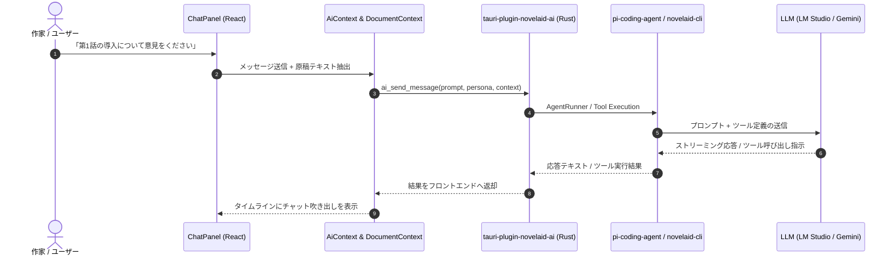

# 第17回：自前実装から脱却し、AI基盤を共有する —— AI執筆パートナーとpi-coding-agent連携の実装

現代の小説執筆において、AIは単なる「文章生成機」ではなく、プロットの穴を客観的に指摘してくれる「担当編集者」であり、誤字脱字やルビゆれを厳格にチェックしてくれる「校正係」であり、アイデアを壁打ちできる「執筆パートナー」です。

しかし、デスクトップアプリ（GUI）やコマンドラインツール（CLI）ごとにAI APIの呼び出しやプロンプト管理、Function Calling（ツール実行）を独自実装してしまうと、コードの重複や仕様乖離が発生し、メンテナンスが破綻してしまいます。

本記事では、`novelaide` におけるAI執筆支援の基盤を大幅に見直し、CLI版（`novelaid-cli`）と共通のバックボーンである `@earendil-works/pi-coding-agent` および独立プラグイン **`tauri-plugin-novelaid-ai`** を導入して、強力な **AI執筆パートナーパネル** を構築したプロセスをご紹介します。

---

## 1. 開発の背景：AI機能の自前実装をやめ、基盤を統一する

旧バージョン（`novelaid-editor`）では、Electron 環境下で各社の AI API（Google Gemini や OpenAI、Anthropic、ローカルLLM）へのリクエストやツール呼び出しを独自にコーディングしていました。

しかし、並行して開発を進めている `novelaid-cli`（AIエージェントによるCLI小説執筆支援ツール）では、すでに `@earendil-works/pi-coding-agent` を採用し、高度なツール実行（ルビ解析、校正スキャン、ファイル境界ガード）が実現されています。

そこで、今回以下の設計方針を決定しました。

1. **AI通信・ツール実行の画一化**:
   - AIモデルアクセスや Function Calling の仕組みを独自実装せず、`pi-coding-agent` に委ねる。
2. **独立プラグイン `tauri-plugin-novelaid-ai` の新設**:
   - Tauriのプラグインアーキテクチャに則り、AI連携ロジックをホストアプリ本体から完全に切り離す。
3. **作家のための専用UI（ペルソナ＆ツール連携）**:
   - 「執筆パートナー」「担当編集者」「校正係」「作中人物」の4ペルソナを瞬時に切り替えられるUI。
   - 現在開いている原稿テキストを自動的にプロンプトへ注入するコンテキスト連携。
   - ルビ候補抽出や校正スキャンをワンクリックで呼び出せるクイックアクション。

---

## 2. システムアーキテクチャ

GUI（React）、Tauri プラグイン（Rust / Guest-JS）、および `pi-coding-agent` の連携フローは以下のようになっています。

---

## 3. 実装のハイライト

### ① 独立プラグイン `tauri-plugin-novelaid-ai` の構成

Tauri 2 の公式プラグイン構成に準拠し、以下のファイル群を実装しました。

- `Cargo.toml`: クレート名 `tauri-plugin-novelaid-ai`
- `src/commands.rs`: `ai_is_available`, `ai_get_models`, `ai_send_message`, `ai_run_tool`
- `permissions/default.toml`: デフォルト実行権限の定義
- `guest-js/`: TypeScript 型定義（`AiModelInfo`, `AiPersona`, `AiChatMessage`）とクライアントAPI

### ② 4つの執筆ペルソナの切り替え

画面上部にチップUIを配置し、作家の用途に応じてワンクリックで役割を切り替えられます。

- **執筆パートナー**: 物語の展開やキャラクター設定、描写の言い換えを一緒にブレインストーミング。
- **担当編集者**: 読者視点で作品のテンポや伏線、ストーリー構成に率直な意見や講評を提供。
- **校正係**: 助詞の重なり、文末の連続、ルビ書式、表記ゆれを厳格にチェック。
- **作中人物**: 登場人物になりきって対話し、台詞の口調や感情の反応を検証。

### ③ 開いている原稿の自動文脈注入

執筆中の原稿をわざわざ全選択してチャット欄に貼り付ける必要はありません。
「原稿文脈」トグルをONにしておくだけで、`DocumentContext` から現在開いているMarkdownの先頭4,000文字が自動的に背景プロンプトとしてAIへ送られます。

---

## 4. 完成したAI執筆パートナー画面

ダークモード、ライトモード、セピアモードのいずれにおいても視認性の高いUIを実現しています。

### ダークモード

### ライトモード

### セピアモード

*画面右ペインに展開されたAI執筆パートナーパネル。上部でペルソナやモデルを選択し、原稿文脈を含めて直感的に対話やツール実行を行うことができます。*

---

## 5. まとめと次回予告

今回、`tauri-plugin-novelaid-ai` を新設し、`pi-coding-agent` とのバックボーン共有を見据えたAI執筆支援基盤を構築しました。

- **自前実装の撤廃**: AIアクセスやツール実行を画一化し、保守性を劇的に向上。
- **マルチペルソナ対話**: 作家の思考を妨げずに、編集者・校正者・キャラクターと自在に相談可能。
- **原稿自動連携**: ドキュメントコンテキストを自動注入し、ストレスのない壁打ち環境を実現。

次回は、AIから提案された文章改善やリライト案を **Monaco Diff Editor で左右比較しながらワンクリックで原稿へ取り込む差分マージ連携**、ならびに将来的な組み込みターミナル（xterm.js）の実装を検討していきます。
