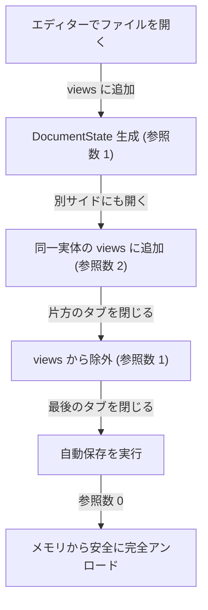

# 第18回：2画面分割の真髄へ —— 参照カウント式ライフサイクルと左右独立ドキュメントエリアの実装

こんにちは！ 小説執筆用デスクトップエディター **`novelaide`** の開発メイキング連載、第18回です。

前回（[第17回](./17_AI執筆パートナーとpi-coding-agent連携の実装.md)）では、`pi-coding-agent` の基盤を導入し、エディターに寄り添うAI執筆パートナーを構築しました。

今回は、小説エディターの操作性の要（かなめ）である**「ドキュメント表示エリアの2画面分割」**を抜本的に再設計・再実装した記録をお届けします。

現行の `novelaid-editor`（Electron版）が持っていた「左で第1章を書きながら、右で第2章や設定メモを独立して開く」という自由度の高いマルチタブ分割表示を、さらに洗練された**「参照カウント式ライフサイクル管理」**とともに実現しました！

---

## 1. これまでの課題：「ドキュメント内分割」の限界

これまでの `novelaide` のスプリットビューは、「1つの開いているドキュメントの中で、左にMonacoエディター、右に組版プレビューを表示する」という、いわば**ドキュメント内分割**の構造でした。

```text
【従来の構造：ドキュメント内分割】
┌───────────────────────────────────────────────┐
│ タブバー: [ 第1章.txt ]                       │
├───────────────────────┬───────────────────────┤
│ 左: 第1章（エディター）│ 右: 第1章（プレビュー）│
└───────────────────────┴───────────────────────┘
※「左に第1章、右に第2章」といった独立したドキュメント同士の並列表示ができなかった
```

これには以下の課題がありました：
1. **異なるドキュメントを左右に並べられない**: 「過去の章を右側で読み返しながら、左側で最新話を執筆する」「右側に登場人物メモを固定表示しておく」といった、作家が日常的に行う執筆スタイルが取れませんでした。
2. **プレビュー解除時の巻き込み事故**: 「分割プレビューを解除」しようとすると右ペイン自体が閉じてしまい、右側で作業していたドキュメントが意図せずクローズされてしまう問題がありました。

そこで、現行の `novelaid-editor` と同様に、**ドキュメントエリア自体を独立した2つのマルチタブペインとして配置する本格的な2画面分割**へと拡張することにしました。

---

## 2. 投げかけたプロンプトと設計の検討

AIエージェントに投げかけた実際のプロンプトがこちらです。

### ユーザープロンプト（抜粋）
> 現在、ドキュメントの表示はプレビュー時に右側表示が行われますが、
> どちらかというと、ドキュメント内分割の扱いです。
> 
> これを、`novelaid-editor`同様、ドキュメントエリア自体を左右分割領域表示に拡張します。
> 
> * Document(DocumentState?)としての実態は１つのドキュメントで１つのみです。
> 	+ これにより、左右分割の両方に表示しても同期します。
> * Documentのライフサイクルは、UIのViewに表示されている間のみです
> * Documentのライフサイクル管理は参照カウント式のような管理を行います。
> 	+ Document(DocumentState?)に表示しているViewのリスト？を持たせます。
> 	+ 例えば、editor.left、editor.right、contextなど、id的に区別できるviewIdを格納。
> 	+ なお、editorの場合、更にViewModeが必要なため、[(editor.left,edit),(editor.right,preview),(context,null)]のような感じがよいかも。
> 	+ 将来的にパネルがドキュメントを扱ったり、固有処理を行う場合も考えられるため、汎用的にする
> 
> これにより、ドキュメント表示部自体は、複数タブ対応のものを２つ配置する構造となります。
> 将来的に三分割や縦分割などへの拡張も可能な構造が出来上がります(現状、実装不要)。
> 
> まず、仕様を再検討します。
> 不明点については質問してください。

作家視点の使い勝手と、プログラミング上のクリーンな設計が両立した素晴らしい要件定義です！
ここからAIとの間でいくつか方針のすり合わせ（プレビューの挙動、未保存ドキュメントの扱い、右ペインのみ残った場合の昇格ルールなど）を行い、仕様を固めていきました。

---

## 3. 構築したアーキテクチャの全貌

### (1) 実体の単一性（Single Source of Truth）
左右両方のペインに同じファイル（例: `第1章.txt`）を開いた場合でも、メモリ上の `DocumentState`（`content`, `metadata`）は**絶対に1つしか生成しません**。

```typescript
export interface DocumentViewRef {
  /** Viewの識別ID (例: 'editor.left', 'editor.right', 'panel.outline') */
  viewId: string;
  /** 当該Viewでの表示モード ('editor' | 'preview' | 'reader' | 'canvas' | null) */
  viewMode?: DocumentViewMode | null;
}

export interface DocumentState {
  path: string;
  baseName: string;
  fileTitle: string;
  /** 原稿本文の単一実体（左右ペイン間で完全共有） */
  content: string;
  metadata: Record<string, any>;
  documentType: NovelaidDocumentType;
  isDirty: boolean;

  /** 現在このドキュメントを表示している View 一覧（参照カウント式） */
  views: DocumentViewRef[];
}
```

左ペインで一文字タイプした瞬間、右ペインのプレビューも遅延なく瞬時に更新されます。編集状態の二重化や競合は原理的に起きません。

### (2) 参照カウント式ライフサイクル管理
ドキュメントは、「いずれかのView（エディターのタブ、パネル等）に表示されている間」だけメモリに存在します。



- **タブを閉じる時**: `views` から該当ペインの参照を外します。
- **安心の自動保存**: 未保存（`isDirty: true`）のままタブやペインを閉じても、確認ダイアログを出さずに自動的にディスクへ安全保存します。
- **完全アンロード**: `views.length === 0`（どのViewからも見えなくなった）になった瞬間にメモリから破棄されます。

### (3) 右ペイン昇格ルール（1画面時は常に左ペイン）
左ペインのタブをすべて閉じて、右ペインにのみタブが残った場合、右ペインのタブを自動的に左ペイン（`editor.left`）へ一括昇格させます。
「1画面状態のときは常に左ペイン」という正規化ルールを徹底することで、状態管理が非常にシンプルで壊れにくくなりました。

---

## 4. 新しくなったエディターの操作性

新しく生まれ変わったドキュメントエリアでは、タブバー右端のボタンから以下の直感的な操作が可能です。

```text
┌───────────────────────────────────┬───┬───────────────────────────────────┐
│ [第1章.txt]  [表示] [横に分割] [分割プレビュー] │ S │ [第2章.txt]  [表示] [横に分割] [×ペインを閉じる] │
├───────────────────────────────────┤ P ├───────────────────────────────────┤
│ （左ペイン：執筆用エディター）    │ L │ （右ペイン：参照用プレビュー）    │
│ 彼は静かに佇んでいた。            │ I │ 一行あけて、次の段落へ進む。      │
│                                   │ T │                                   │
└───────────────────────────────────┴───┴───────────────────────────────────┘
```

1. **同一ペイン内切り替え（「表示」/「編集へ」）**:
   - 画面を分割せず、1画面のままでサッと組版プレビューを確認したい時に使用します。
2. **横に分割（「横に分割」）**:
   - 現在の表示状態（エディターならエディター、プレビューならプレビュー）のまま、反対側のペインに分割表示します。すでに反対側に開かれている場合は、新規作成せずそのタブを前面にしてアクティブ化します。
3. **別サイドでプレビュー（「分割プレビュー」）**:
   - 反対ペインを開き、対象ドキュメントを縦書きリーダーや組版プレビューとして展開します。すでにプレビューが開かれている場合はそのタブをアクティブ化します。
   - ※トグル解除によるペイン強制閉鎖を廃止したため、右側で開いていた他の章やメモが意図せず消える事故はもう起きません！
4. **右ペインを閉じる（「ペインを閉じる」）**:
   - 2画面での執筆・推敲を終えて1画面に戻したい時は、右ペインタブバーの「ペインを閉じる」を押すだけで、未保存原稿を自動保存した上でスマートに1ペインに戻ります。

---

## 5. まとめと次回予告

今回の改修によって、`novelaide` は現行の `novelaid-editor`（Electron版）が持っていた操作性を完全に再現しただけでなく、**参照カウント式によるメモリ管理**と**Single Source of Truth**という現代的で堅牢なアーキテクチャを手に入れました。

| 機能項目 | 従来の novelaide | 新生 novelaide (v0.18.9) |
| :--- | :--- | :--- |
| **画面分割** | 同一文書のエディター＋プレビューのみ | 左右独立のマルチタブ分割エリア |
| **異なる章の並列表示** | 不可 | 可能（左に第1章、右に第2章など） |
| **ドキュメント実体** | ペインごとに個別に意識が必要 | 単一の `DocumentState` で完全自動同期 |
| **ライフサイクル** | 手動管理 | Viewリスト参照カウントによる自動アンロード |
| **タブクローズ** | 未保存警告ダイアログ | ダイアログ不要で自動保存して即座に閉じる |
| **AIパートナー連携** | 単一アクティブのみ把握 | 左右ペインの未保存バッファをリアルタイム認識 |

次回は、今回整った強力なマルチペイン構造を活かし、さらなる執筆支援機能やキーボードショートカットのブラッシュアップを進めていきます。

どうぞお楽しみに！

---
* 関連仕様書: [左右分割ドキュメントエリアと参照カウント式ライフサイクル仕様書](../../docs/dev/左右分割ドキュメントエリアと参照カウント式ライフサイクル仕様.md)
* ユーザーマニュアル: [プレビューとスプリットビューの使い方](../../docs/manual/プレビューとスプリットビューの使い方.md)
