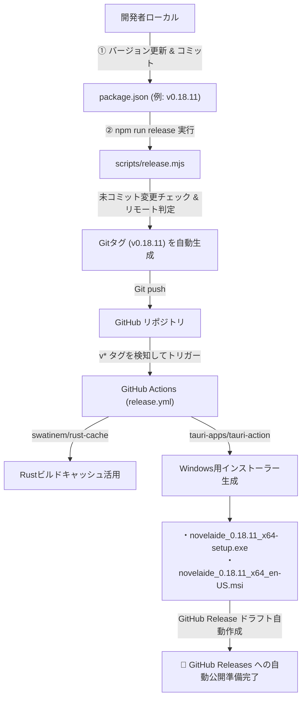

# 第20回：手作業リリースからの解放 —— GitHub ActionsとTauriによるインストーラー自動生成とリリース自動化

こんにちは！ 小説執筆用デスクトップエディター **`novelaide`** の開発メイキング連載、第20回です。

前回（[第19回](./19_アプリアイコンの刷新とTauriアイコン生成パイプライン.md)）では、親しみやすい猫モフのマスター画像からマルチプラットフォーム用の全アセットを一括生成し、アプリとしての「顔」を整えました。

第20回となる今回は、一般のユーザーや作家の皆さんにアプリを届けるための最重要インフラである**「インストーラー（Windows用 `.exe` / `.msi`）の自動ビルド」**と**「GitHub Releases への自動公開パイプライン」**を構築した過程をお届けします！

---

## 1. デスクトップアプリ開発における「リリースの壁」

Webサービスであればサーバーに最新コードをデプロイすれば完了ですが、デスクトップアプリには特有の難しさがあります。

* **プラットフォームごとのインストーラー作成**:
  WindowsであればNSIS形式（`.exe`）やWindowsインストーラー（`.msi`）などのパッケージ化が必要です。
* **コンパイル環境の維持**:
  TauriはバックエンドにRustを採用しているため、コンパイルにマシンパワーと時間が必要です。手元のPCで毎回フルビルドしていると作業が止まってしまいます。
* **手作業による事故**:
  バージョンの更新漏れ、タグの打ち間違い、未コミット変更を含んだビルド、アセットの添付漏れなど、手動リリースには人為的ミスが付きまといます。

これらの課題を解決するため、**「タグを打ってプッシュしたら、クラウド上のGitHub Actionsが自動でインストーラーをビルドし、GitHub Releaseのドラフトを作成してくれる」**仕組みを整えることにしました。

---

## 2. 投げかけたプロンプト

AIエージェントには、CI/CDワークフローの構築と、それを手元から1コマンドで呼び出せる安全なスクリプトの作成を依頼しました。

### プロンプト1：GitHub Actions ワークフローの追加
> githubでのビルド、リリース用のアクションを追加して

### プロンプト2：一括リリーススクリプトの作成
> リリース手順を一括で処理するスクリプトかコマンドなどの何かを用意できますか？
> 現在のパッケージバージョンを自動でtag設定してpushする機能として。なお、リモートはoriginでない場合も想定されます

---

## 3. リリース自動化パイプラインの全体像

今回構築したリリースパイプラインの全体像は以下の通りです。



開発者が行うのは、手元で `npm run release` を叩くだけ。あとはGitHub上の仮想マシン（Windows Runner）がすべてを肩代わりしてくれます。

---

## 4. 2つのGitHub Actionsワークフロー設計

用途に応じて2つのワークフロー（`ci.yml` と `release.yml`）を用意しました。

### ① 継続的インテグレーション：`ci.yml`
プルリクエストの作成や `main` ブランチへのプッシュ時に起動し、コードが正常にビルドできるかを高速に検証します。

* **Node.js 20 & Rust stable** のセットアップ
* **`swatinem/rust-cache@v2`** によるキャッシュ導入（重いRustコンパイル時間を大幅短縮）
* フロントエンドの型検査（`tsc`）＋ Vite バンドル検証
* Rustバックエンドのコンパイル検証（`cargo check`）

### ② 自動リリース：`release.yml`
`v*`（例: `v0.18.11`）という形式のタグがプッシュされたときに起動します。

```yaml
name: Release

on:
  push:
    tags:
      - 'v*'
  workflow_dispatch:

jobs:
  release:
    permissions:
      contents: write
    runs-on: windows-latest

    steps:
      - name: Checkout repository
        uses: actions/checkout@v4

      - name: Setup Node.js
        uses: actions/setup-node@v4
        with:
          node-version: 20
          cache: 'npm'

      - name: Setup Rust
        uses: dtolnay/rust-toolchain@stable

      - name: Rust cache
        uses: swatinem/rust-cache@v2
        with:
          workspaces: './src-tauri -> target'

      - name: Install dependencies
        run: npm ci

      - name: Build plugins
        run: npm run build:plugins

      - name: Build and Release Tauri App
        uses: tauri-apps/tauri-action@v0
        env:
          GITHUB_TOKEN: ${{ secrets.GITHUB_TOKEN }}
        with:
          tagName: ${{ github.ref_name }}
          releaseName: 'novelaide ${{ github.ref_name }}'
          releaseBody: 'novelaide ${{ github.ref_name }} のリリースです。'
          releaseDraft: true
          prerelease: false
```

Tauri公式が提供している **`tauri-apps/tauri-action@v0`** を利用することで、Windows用NSISインストーラー（`.exe`）や `.msi` パッケージのコンパイルから、GitHub Releaseの作成、バイナリの添付までを完全に全自動化できます。

また、`releaseDraft: true` を指定しているため、完成したリリースはいったん「下書き（ドラフト）」として保存されます。リリースノートに説明を追記した上で安心して公開ボタンを押す運用が可能です。

---

## 5. 1コマンドでリリースを完結させる `scripts/release.mjs`

GitHub ActionsをトリガーするにはGitタグを正しく打ってプッシュする必要がありますが、これを毎回手作業で行うとミスが生じがちです。
そこで、安全確認とタグプッシュを一発で行うスクリプトを作成しました。

### スクリプトの賢いポイント
1. **バージョン自動取得**: `package.json` の `"version"`（例: `0.18.11`）を読み取り、`v0.18.11` タグを自動生成。
2. **未コミット変更の自動ガード**: 作業ツリーに未コミットの変更が残っている場合は処理を中断し、中途半端なリリースを未然に防止。
3. **リモートリポジトリの自動検出**: カレントブランチのトラッキングリモートを優先し、見つからない場合も `github` や `origin` などのリモート名を自動判別。
4. **`--dry-run` 対応**: 実際にタグ作成やプッシュを行わずに実行内容をシミュレーション可能。

```pwsh
# 実行内容の事前確認（シミュレーション）
npm run release -- --dry-run

# 本番リリース実行（タグ作成 & リモートへプッシュ）
npm run release
```

---

## 6. クリーン環境ならではの落とし穴とトラブルシューティング

GitHub Actionsを導入した直後、早速**「ローカルでは動くのにCIで落ちる」**という定番の洗礼を受けました。

### 発生したビルドエラー
```text
Error: src/App.tsx(9,35): error TS7016: Could not find a declaration file for module 'tauri-plugin-novelaid-ai-api'. 'D:/a/novelaide/novelaide/tauri-plugin-novelaid-ai/dist-js/index.js' implicitly has an 'any' type.
```

### 原因究明と対策
* **原因1：プラグイン型定義の出力先ズレ**
  `tauri-plugin-novelaid-ai` の `tsconfig.json` で `rootDir` が明示されておらず、型定義が `dist-js/index.d.ts` ではなく `dist-js/guest-js/index.d.ts` に出力されていたため、TypeScriptが型定義を見つけられなくなっていました。
* **原因2：手元環境に残存していたキャッシュ**
  ローカル環境では過去に生成された古い `dist-js/index.d.ts` が残っていたためビルドが通っていましたが、何もないクリーンなGitHubコンテナではエラーが顕在化しました。
* **原因3：プラグインのビルド順序と `.gitignore` の不揃い**
  一部のプラグインの `dist-js/` がGitにコミットされていたり除外されていなかったりと不揃いでした。

### 解決策
1. 全プラグインの `tsconfig.json` で `"rootDir": "./guest-js"` を指定し、正確に `dist-js/index.d.ts` へ出力。
2. 全プラグインの `.gitignore` に `dist-js/` を含めてGit追跡から完全に除外。
3. `package.json` に `npm run build:plugins` コマンドを用意し、全プラグイン（AI、FS、Git、Settings）をクリーン状態から確実に一括ビルドしてからアプリ本体をバンドルする構成を確立。

この修正により、CIでも手元でもクリーンな状態から100%再現可能なビルド基盤が完成しました！

---

## 7. まとめと次回予告

今回の自動化により、アプリのリリース手順は以下のように劇的にシンプルになりました。

```pwsh
# 1. バージョン更新
npm version patch --no-git-tag-version

# 2. コミット
git commit -am "chore: release v0.18.11"

# 3. リリース実行（タグ打ち＆プッシュ）
npm run release
```

コマンドを1本叩くだけで、約5〜10分後には [GitHub Releases](https://github.com/mituha/novelaide/releases) にWindows用インストーラー（`.exe` / `.msi`）が自動で出来上がります。

開発者が一番やりたい「小説執筆機能の実装」に集中できる素晴らしい環境が整いました。

次回は、小説エディターとしての基本機能である、原稿ファイルや設定資料ファイルのメタデータを制御する**「`.novelaidattributes` 仕様の策定と属性判定エンジンの実装」**へと進んでいきます。お楽しみに！
