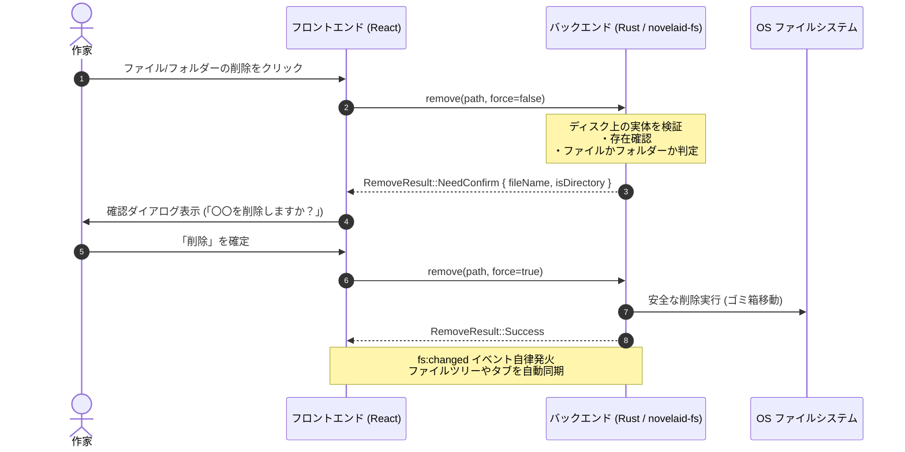

# 第21回：誤削除を防ぐ！バックエンド主導型ファイル操作基盤と安全設計

こんにちは！ 小説執筆用エディター **`novelaide`**（コードネーム: `novelaid-e`）の開発メイキング連載第21回です。

今回は、エディターで最も慎重さが求められる領域である**「ファイルの削除・作成・変更といったファイル操作基盤の安全設計」**についてお届けします。

大切な原稿を扱う小説エディターにおいて、「誤ってクリックして大事な章が消えてしまった」「確認ダイアログが適切なタイミングで出ない」といったトラブルは絶対に許されません。
本記事では、フロントエンド先行型チェックから**「Rustバックエンド主導型一元判定」**へと設計を刷新し、安全なファイル削除フローを構築した過程をご紹介します。

---

## 1. 抱えていた課題：フロントエンド先行確認の脆さ

以前の実装では、ファイルやフォルダーを削除する際、フロントエンド（React / TypeScript）側で以下のような処理を行っていました。

1. ユーザーがエクスプローラーで「削除」を押す。
2. フロントエンド側で「フォルダーですか？ ファイルですか？」を判定し、確認ダイアログを出す。
3. ユーザーがOKを押したら、Rustバックエンドの `remove` コマンドを呼ぶ。

一見問題なさそうに見えますが、これにはアーキテクチャ上の大きな欠陥がありました。

* **UIと実体のズレ**: フロントエンドが見ているツリー情報と、実際のディスク上の状態（すでに別プロセスで削除・リネームされていた等）にタイムラグがあると、誤った判断をしてしまう。
* **将来の拡張性（AIエージェント等）への対応困難**: 今後、GUIだけでなくAIエージェント（`novelaid-cli` や将来の内蔵エージェント）がファイル削除を要求する際、フロントエンドのダイアログに依存した設計だと、バックエンド単体で安全性を担保できない。

そこで、**「判断と検証の責任はすべてRustバックエンドが持ち、フロントエンドはUIの表示要求に従うだけ」**という設計へ大転換することにしました。

---

## 2. バックエンド主導型判定フローの設計

新しいアーキテクチャでは、フロントエンドは「削除したい」という意図だけをバックエンドに伝え、バックエンドがディスク上の実体を直接検証して結果を返す形に改めました。



### Rustバックエンドのモデル定義（`models.rs`）

バックエンドからの判定結果を表現するため、`ts-rs` を用いてTypeScript側と完全同期する `RemoveResult` 列挙型を定義しました。

```rust
#[derive(Debug, Clone, Serialize, Deserialize, TS)]
#[ts(export, export_to = "../guest-js/models.ts")]
#[serde(tag = "status", rename_all = "camelCase")]
pub enum RemoveResult {
    Success,
    NeedConfirm {
        file_name: String,
        is_directory: bool,
    },
    NotFound,
}
```

### バックエンドの一元判定ロジック（`commands.rs`）

`force: true`（強制フラグ）が指定されていない限り、バックエンドが対象の存在と属性を自ら確認し、「確認が必要である」という情報を返します。

```rust
#[command]
pub(crate) async fn remove<R: Runtime>(
    app: AppHandle<R>,
    path: String,
    force: Option<bool>,
) -> Result<RemoveResult> {
    let target = std::path::Path::new(&path);
    if !target.exists() {
        return Ok(RemoveResult::NotFound);
    }

    let skip_confirm = force.unwrap_or(false);
    if !skip_confirm {
        let is_directory = target.is_dir();
        let file_name = target
            .file_name()
            .map(|n| n.to_string_lossy().to_string())
            .unwrap_or_else(|| path.clone());

        return Ok(RemoveResult::NeedConfirm {
            file_name,
            is_directory,
        });
    }

    // 実際の削除処理（ゴミ箱移動等）を実行
    app.novelaid_fs().remove(target)?;

    // 削除成功をイベント発火してフロントエンド全体へ自律通知
    let _ = app.emit(
        "fs:changed",
        FsChangeEvent {
            action: "delete".into(),
            path,
            new_path: None,
        },
    );

    Ok(RemoveResult::Success)
}
```

---

## 3. フロントエンドの統合とイベント駆動の自律更新

この設計変更により、フロントエンド側のコードは驚くほどシンプルになりました。

```typescript
// FileExplorerContext.tsx
const deleteItem = useCallback(
  async (entry: DirEntry, force = false) => {
    try {
      const result = await fileService.remove(entry.path, force);

      // バックエンドから「確認が必要」と返ってきた場合のみダイアログを提示
      if (result.status === 'needConfirm') {
        const confirmed = await confirmDialog({
          title: result.isDirectory ? 'フォルダーの削除' : 'ファイルの削除',
          message: `「${result.fileName}」を削除してもよろしいですか？`,
          okLabel: '削除',
          cancelLabel: 'キャンセル',
          kind: 'warning',
        });

        if (confirmed) {
          // ユーザー確認を得て force=true で再実行
          await fileService.remove(entry.path, true);
        }
      }
    } catch (err) {
      alertDialog(`削除に失敗しました: ${err}`, 'エラー');
    }
  },
  [confirmDialog, alertDialog]
);
```

さらに、削除が完了するとバックエンドから `fs:changed` イベントが発火されるため、ファイルツリーの再読み込みや開いていたタブの自動クローズ処理が自律的に連動します。

---

## 4. まとめと次回予告

* **安全性の根本担保**: ファイルの存在確認や属性判定の責任をRustバックエンドへ集約し、フロントエンドの状態とディスク実体の乖離による誤動作を根絶しました。
* **プラットフォームに依存しない拡張性**: 将来的にAIエージェントやCLIツールから削除APIを呼び出す際も、バックエンド側のポリシーに沿った安全な運用が可能になりました。

次回は、**「アプリの起動時間14秒から4秒へ！ AIチャットの遅延ロード化と初期スプラッシュ画面によるUX改善」**をお届けします。どうぞお楽しみに！
