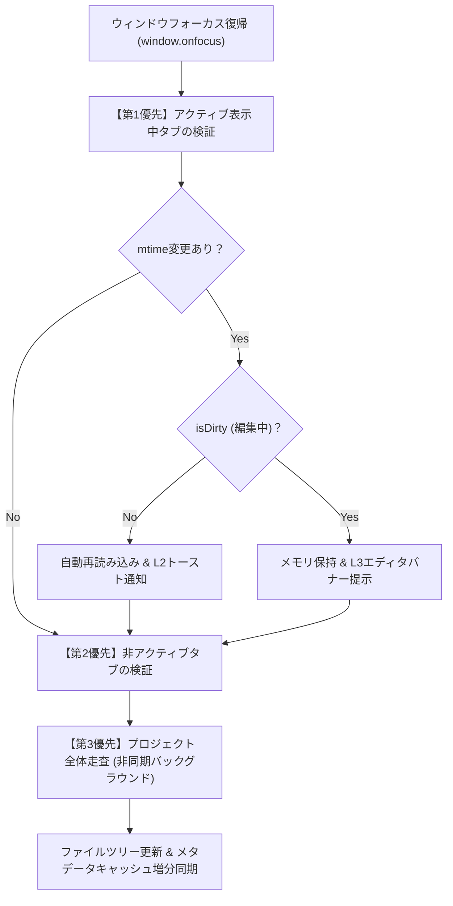

# 第23回：執筆を邪魔しない外部ファイル同期と原稿保護オートセーブの実装

こんにちは！ 小説執筆用エディター **`novelaide`**（コードネーム: `novelaid-e`）の開発メイキング連載第23回です。

今回は、小説エディターの信頼性を決定づける極めて重要な2つのテーマ、**「外部ファイル変更検知の再設計」**と**「原稿を絶対に失わせない多層的オートセーブ＆セーフティネット」**についてお届けします。

---

## 1. 執筆中の悪夢：「外部で変更されました」ダイアログ事件

現行の Electron 版（`novelaid-editor`）を使っている作家さんから、かねてより以下のような悩みが寄せられていました。

> 「集中して小説を書いている最中に、突然『〇〇 は外部で変更されました。破棄して再読み込みしますか？』という確認ダイアログが出て作業が中断される。他のアプリでファイルを開いているわけでもないのに、なぜ？」

せっかく物語のクライマックスに感情移入している最中に、突如画面中央にモーダルダイアログがポップアップして筆を止められてしまうのは、作家にとって最大のストレスです。

### コード調査で判明した「自作自演（自己保存エコー）」のバグ

コードを徹底的に調査したところ、驚愕の原因が明らかになりました。

1. **パス形式の食い違い**:
   - 保存時: `savingPaths.add(absolutePath)`（**絶対パス**で登録）
   - 判定時: `savingPaths.has(normalizedPath)`（**相対パス**で判定）
   - 形式が一致していないため、「自分自身が保存した」という判定が常に false になり、**「自分が保存した直後のファイル変更イベント」を「外部での変更」と誤認**していました。
2. **自動保存との競合**:
   - 自動保存（3秒後）が走った直後もタイピングを続けていると `isDirty: true`（編集中）のままになります。
   - その状態で自分自身の保存イベントが届くため、「外部で変更された未保存ファイル」と判定され、ダイアログが発火していたのです。

---

## 2. コペルニクス的転換：常時監視をやめ、オンデマンド検証へ

当初は「バックエンドでファイル監視（`notify` クレート）を動かし、自作イベントをフィルタリングしよう」と考えていました。しかし、ユーザーとの対話の中で本質的な気づきを得ました。

> **「大抵の場合は外部でのファイル監視を必要としません。多くの場合、エディターを使用中にわざわざ他のアプリで同じディレクトリを変更しないからです。」**

まさにその通りでした。執筆中に他エディタで同時に書き換えることは稀であり、プロジェクト全域を常時監視することは、OSリソースやバッテリーを消費し、自己保存エコーというバグの温床を生み出すだけでした。

そこで、常時監視スレッドを廃止し、**「ウィンドウフォーカス復帰時（`window.onfocus`）の3段階オンデマンド検証」**を採用しました。



* **作家の没入を完全保護**: 作家が `novelaide` 内で執筆している間はチェック自体が走らないため、予期せぬダイアログで筆が止まることは原理的にゼロ。
* **自然な同期タイミング**: Git GUIでブランチを切り替えたり、外部ツールで修正して `novelaide` に戻ってきた瞬間にだけチェックが走るため、作家の認知モデルと完全に一致します。
* **モーダルダイアログの排除**: 未編集ならトースト通知（L2）で静かに自動反映。編集中ならメモリ上のテキストを絶対に保護した上で、エディタ上部のインラインバナー（L3）で選択を促します。

---

## 3. 保存管理用タイムスタンプ（`mtime`）のフィードバック

この仕組みを確実にするため、Rustバックエンド（`tauri-plugin-novelaid-fs`）を拡張し、ファイル保存時にOS上の確定した最終更新日時（`mtime_ms`）をフロントエンドへフィードバックするようにしました。

```typescript
// 保存完了時に確定したmtimeをメモリ上のDocumentStateに保持
const mtime = await fileService.writeFile(doc.path, doc.content, doc.metadata);
setOpenDocuments((prev) =>
  prev.map((d) => (d.path === doc.path ? { ...d, isDirty: false, mtime } : d))
);
```

フロントエンドが「前回自分が保存したときのタイムスタンプ」をミリ秒単位で正確に把握しているため、「ディスク上の `mtime` > メモリ上の `mtime`」を比較するだけで、外部変更を極めて高速かつ正確に判定できます。

---

## 4. 原稿を絶対に失わせない！ 多層的オートセーブとセーフティネット

外部同期の基盤が整ったところで、作家の原稿を守る**多層的自動保存**を実装しました。

### ① タブ切り替え・ペイン移動・ウィンドウブラー時の即時保存
タブを切り替えたり、他アプリへフォーカスを移した瞬間に、未保存ドキュメントを即座に保存します。
これにより、**「現在アクティブなタブ以外は、常にディスク上に保存済みである」**という安全な状態を確立しました。

### ② IME（日本語変換）に配慮したデバウンス自動保存
タイピング停止から3秒後に自動保存を実行します。
ただし、作家が漢字変換や予測変換の選択を行っている最中（`isComposing === true`）に保存が走ると、Monaco Editor のカーソル位置や変換候補が乱れてしまいます。
そこで、**IME変換中はタイマーを一時停止し、確定（`compositionend`）した後にタイマーを開始・リセット**するきめ細やかな制御を組み込みました。

### ③ 大幅文字数激減検知セーフティネット（破壊的変更保護）
「うっかり全選択してバックスペースを押してしまった」「置換ミスで本文が消えた」――それが3秒後に勝手に上書き保存されてしまっては取り返しがつきません。
そこで、**「前回保存時より文字数が30%以上減少し、かつ200文字以上減っている」**場合、サイレント自動保存を即座に保留する安全弁を導入しました。

```typescript
const lengthDiff = lastSavedLength - currentLength;
const decreaseRatio = lengthDiff / Math.max(lastSavedLength, 1);

if (decreaseRatio >= 0.30 && lengthDiff >= 200) {
  // 自動保存を保留し、エディタ上部バナーで作家の判断を仰ぐ
  showBanner({
    id: `drastic-decrease-${doc.path}`,
    type: 'warning',
    message: `${doc.baseName} の文字数が大幅に減少しています（前回: ${lastSavedLength}字 → 現在: ${currentLength}字、-${Math.round(decreaseRatio * 100)}%）。この内容で保存しますか？`,
    actions: [
      { label: 'そのまま保存', onClick: () => saveDocument(doc.path, { force: true }) },
      { label: '保留', primary: true, onClick: () => dismissBanner(bannerId) },
    ],
  });
  return;
}
```

作家が明示的に `Ctrl + S` を押した場合は、作家の直接の意思とみなし、強制保存（`force: true`）として実行されます。

---

## 5. まとめと次回予告

* **過剰監視からの脱却**: 小説執筆の特性に合わせて「フォーカス復帰時オンデマンド検証」へと舵を切ることで、自己保存エコーを根絶し、執筆への没入を保護しました。
* **作家体験を尊重した通知設計**: モーダルダイアログを廃止し、トースト通知（L2）とエディタバナー（L3）を使い分けることで、作業を中断させない穏やかなUIを実現しました。
* **究極の原稿保護**: IME状態を考慮したデバウンス保存と、誤削除事故を防ぐ「文字数激減セーフティネット」により、安心して筆を走らせられる環境が完成しました。

次回は、いよいよ**「日本語文章校正機能（Calibration）の移植・再実装」**へと進みます！ 助詞の連続検知や表記揺れのチェックなど、小説の品質を高める推敲機能の構築をお届けします。どうぞお楽しみに！
