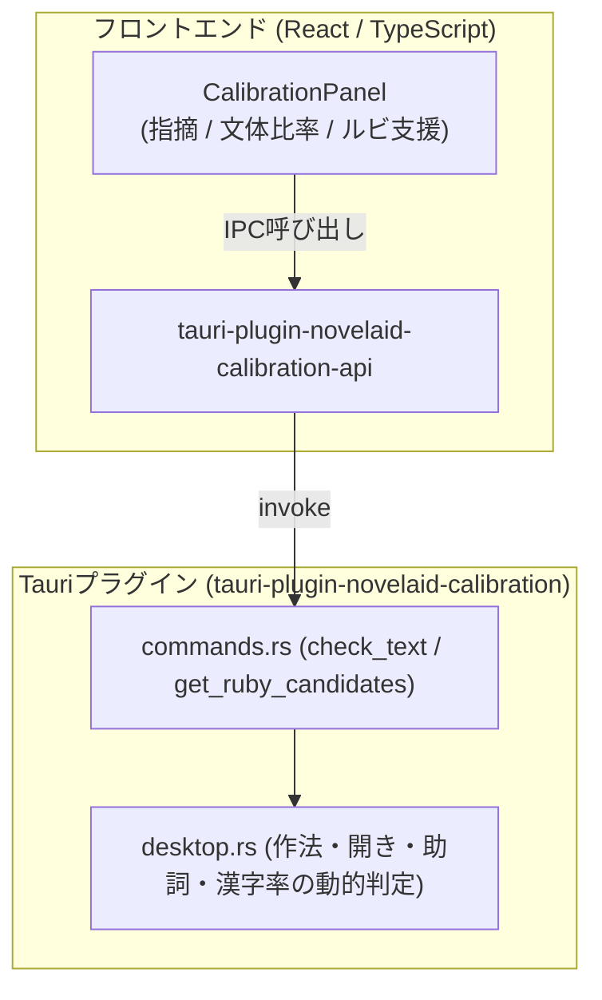

# 第24回：小説特化の文章校正プラグイン新設とモック先行UI開発

こんにちは！ 小説執筆用エディター **`novelaide`**（コードネーム: `novelaid-e`）の開発メイキング連載第24回です。

原稿を書き進めていると、どうしても気になるのが「誤字脱字」や「小説ならではの作法・文体ルール」です。
例えば、会話文末の閉じ括弧直前にうっかり句点「。」をつけてしまったり、三点リーダー「…」を単発の奇数マスで使ってしまったり、同じ行で助詞の「の」が何回も重なってリズムが悪くなったりすることがあります。

従来の Electron 版（`novelaid-editor`）では、Node.js 製の文章校正ツール `textlint` や形態素解析 `kuromoji` を使っていましたが、Tauri（Rust）環境にそのまま持ち込もうとすると、巨大なランタイムや複雑な依存関係が必要になり、動作速度や安定性に課題が生じます。

そこで今回、**完全ローカル・オフラインで超高速に動作する小説特化の文章校正基盤（`tauri-plugin-novelaid-calibration`）** を一から新設し、フロントエンドの校正パネル UI を構築しました。

今回は、大型ライブラリ導入によるトラブルを未然に防ぐ「モック先行アーキテクチャ」と、使い心地にこだわった校正・文体解析 UI の実装についてご紹介します！

---

## 1. なぜ新プラグインとして分離するのか？

`novelaide` では、これまでファイル操作を行う `novelaid-fs` や、LLM と対話する `novelaid-ai` など、機能ごとにプラグインを疎結合に分離してきました。

文章校正と形態素解析も、以下の理由から **`tauri-plugin-novelaid-calibration`** として独立したプラグインに切り出しています。

1. **ミリ秒単位の超高速・確実なローカル動作**:
   - 外部クラウドや LLM への通信を行わず、原稿数万文字であってもエディタの入力に合わせて瞬時に作法チェックを完結させます。
2. **AI 執筆パートナーとの相互連動（前処理・後処理）**:
   - AI に推敲を依頼する前の「前処理（機械的な指摘の注釈付け）」や、AI が出力したテキストの「後処理（小説作法への自動補正）」として呼び出せる共通基盤とします。
3. **ルビ候補推測と設定資料ユーザー辞書の連動**:
   - 形態素解析エンジンから「読み（カタカナ）」を取得して青空文庫形式のルビを提案したり、登場人物名や世界観設定を辞書登録したりする基盤を受け持ちます。

---

## 2. トラブルを未然に防ぐ「モック先行開発」の工夫

形態素解析エンジンには、純 Rust 製で IPADIC 辞書をバイナリ内蔵できる **`Lindera`** を採用する計画ですが、辞書データを含む大型クレートは依存解決やビルド設定でトラブルが起きやすい側面があります。

そこで本ステップでは、**あえて Lindera の導入を次フェーズに回し、まずはモックロジックによる Rust プラグインとフロントエンドの疎通を先行して確立する手法** を採用しました。

バックエンド（Rust 側）の `desktop.rs` では、渡された原稿テキストに対して、実際の行・列を走査する軽量なモック判定を実装しました。

* **会話文末の句点検出**: `「〜〜。」` となっている箇所を検出し、句点除去（`」`）を提案。
* **三点リーダー偶数マス作法**: 単独の `…` を検出し、`……` への修正を提案。
* **漢字の開き**: 形式名詞の `事` を検出し、平仮名の `こと` へ開くよう提案。
* **助詞連続**: 同一行内に `の` が3回以上出現した場合にリズム改善を促す警告。
* **漢字・ひらがな比率集計**: Unicode 範囲からリアルタイムに文字種比率を計算。
* **ルビ候補抽出**: 本文中の漢字語句に対してフリガナ候補を返却。

これにより、大型クレートのコンパイル待ちや依存エラーに悩まされることなく、プラグインのコマンド設計や型定義（ts-rs）、フロントエンド UI の使い勝手検証を素早く進めることができます。

---

## 3. 校正・文体解析パネル UI のデザイン

フロントエンドでは、エディタの右サイドパネルに常駐する **`CalibrationPanelPlugin`** を作成しました。

小説の推敲に必要な要素を、3つのタブに整理して配置しています。

### ①「指摘一覧」タブ（文章校正）
検出された作法違反や表現の重複をカード形式で一覧表示します。

* **カテゴリバッジ**: 「作法（青）」「開き（黄）」「助詞（紫）」など、種別ごとに色分けして視認性を向上。
* **行・列位置表示**: 指摘箇所の位置（例: `L12:5`）を表示。
* **[適用] ボタン**: 指摘箇所の修正案（例: 「事」→「こと」）をワンクリックでエディタ本文に即時反映。
* **[AI] ボタン**: 将来的な AI 連携を見据え、該当箇所の言い換えを AI パートナーに相談するアクションの導線を用意。

### ②「文体・比率」タブ（黄金比と頻出語）
原稿の読みやすさや文体の特徴を視覚的にチェックできるタブです。

* **漢字・ひらがな比率ゲージ**:
  - 一般的に読みやすいとされる「小説の黄金比（漢字 20%〜30%、ひらがな 70%前後）」を意識できるよう、全体の文字種比率をカラフルなプログレスバーで可視化します。
* **頻出語ランキング**:
  - 本文中で多く使われている単語と品詞、出現回数をランキング形式で表示し、表現の偏りを客観視できます。

### ③「ルビ支援」タブ（青空文庫形式）
本文中の人名や難読漢字を検出し、青空文庫形式（`｜漢字《ルビ》`）で瞬時に本文に挿入できる機能です。ワンクリックで正しいルビ記法へと変換できます。

---

## 4. 今回の成果とまとめ

今回の開発により、Tauri プラグインとしての文章校正基盤と、エディタと連動する美しい UI パネルが完成しました！

1. **`tauri-plugin-novelaid-calibration` の新設**:
   - IPC コマンド（`check_text`, `tokenize_text`, `get_ruby_candidates`）とモック判定ロジックを実装。
2. **安全な開発アプローチの確立**:
   - 外部ライブラリ導入前にモックで通信・UI 疎通を完了させ、ビルドリスクを最小化。
3. **推敲体験を高めるパネル UI**:
   - 指摘の即時適用、小説黄金比メーター、ルビ挿入ボタンなど、作家の作業を邪魔しないスムーズな操作性を実現。

基盤と UI の受け皿が完璧に整ったため、次のステップではいよいよ純 Rust 製の形態素解析エンジン **`Lindera`** を正式に組み込み、本格的な形態素解析と高度な校正ルールの本実装へと進んでいきます！

次回もお楽しみに！

---

### 関連リンク

* [第23回：執筆を邪魔しない外部ファイル同期と原稿保護オートセーブの実装](./23_執筆を邪魔しない外部ファイル同期と原稿保護オートセーブの実装.md)
* [開発仕様書: 日本語文章校正および形態素解析基盤設計計画](../../docs/dev/日本語文章校正および形態素解析基盤設計計画.md)
* [マニュアル: 文章校正と文体解析の使い方](../../docs/manual/文章校正と文体解析の使い方.md)
