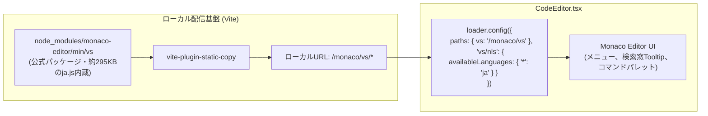

# 第26回：執筆を加速するエディター支援機能とMonaco完全日本語化

こんにちは！ 小説執筆用エディター **`novelaide`**（コードネーム: `novelaid-e`）の開発メイキング連載第26回です。

前回の第25回では、純Rust製の形態素解析エンジン「Lindera」をバックエンドに組み込み、漢字からミリ秒単位でふりがな（読み）を自動抽出する基盤を整えました。

今回は、その形態素解析基盤を活用した**小説特化のエディター支援機能（ルビダイアログ・記号入力・メタデータ補完）の実装**と、長年多くの開発者が頭を悩ませてきた**Monaco Editorの完全日本語ローカライズ（NLS）**を、正攻法のアセット配信アーキテクチャで美しく解決したプロセスをお届けします！

---

## 1. ユーザーからの要望：エディターを本格的な小説執筆仕様へ

現行のElectron版 `novelaid-editor` には、執筆時に頻出する「ルビ」「傍点」「台詞括弧」「ダッシュ」などを右クリックやショートカットキーで瞬時に挿入できる機能や、設定資料（登場人物・地名）の名前を自動補完するインテリセンス機能が備わっていました。

先行開発中の `novelaide` でも執筆体験を同等以上に引き上げるべく、以下のリクエストから作業がスタートしました。

```text
novelaid-editorで、エディター部分でルビや傍点の追加などのコンテキストメニューが実装されています。
また、インテリセンスの機能も実装されています。

まず、これらのnovelaid-editorの仕様を確認し、novelaideでの実装状況について比較してください。
```

さらに、執筆画面を確認する中で、もうひとつの重要な課題が浮き彫りになりました。

```text
MonacoEditorの標準のコンテキストメニュー部分が日本語化されていません。日本語化用の機能を追加可能ですか？
```

エディターの右クリックメニュー（Cut, Copy, Paste, Command Palette...）や、検索窓（`Ctrl+F`）の「Match Case」「Use Regular Expression」といったTooltipが英語のまま残っており、執筆時の没入感を削いでいたのです。

---

## 2. 執筆を加速するエディター支援機能の実装

まずは、小説特化の入力支援機能を一気に整えました。

### ① 漢字から読みを自動推測するルビダイアログ
テキストを選択して `Ctrl+R`（または右クリックメニュー）を押すと、ルビ入力ダイアログが表示されます。
第25回で実装したLindera形態素解析（`getRubyCandidates`）と連携し、**漢字を選択した瞬間にひらがなの読み候補が自動で初期入力**されます。ユーザーは誤りがなければそのまま `Enter` キーを押すだけで、`|漢字《かんじ》` のカクヨム/なろう記法が一瞬で挿入されます。

### ② 小説専用のクイックアクション＆ショートカット
執筆時に多用する記号の挿入や装飾を、直感的なキーバインドに割り当てました。

* **傍点付与**: `Ctrl+B`（選択範囲を `《《傍点》》` で囲む）
* **かぎ括弧挿入**: `Ctrl+[`（選択テキストを「」で囲む）
* **二重かぎ括弧挿入**: `Ctrl+Shift+[`（選択テキストを『』で囲む）
* **全角ダッシュ挿入**: `Alt+-`（小説作法の基本である2倍角ダッシュ `――` を挿入）
* **三点リーダー挿入**: `Alt+.`（小説作法の基本である2倍角三点リーダー `……` を挿入）

### ③ 登場人物・地名のインテリセンス補完
プロジェクト内のメタデータ（Frontmatter）に登録されているキャラクター名やロケーション名を自動走査し、エディター入力中に Monaco の自動補完候補（`User` / `Class` アイコン）としてサジェストする仕組みを導入しました。

---

## 3. Monaco Editor 日本語化の罠と「イタチごっこ」の教訓

続いて取り組んだのが、Monaco Editor 本体の日本語化（NLS: Native Language Support）です。ここにはフロントエンド開発における深い落とし穴がありました。

### 最初の試行錯誤：DOM監視による文字列置換（対症療法）
Monaco の公式日本語リソースをネット経由（jsDelivr CDN）で読み込もうとしたところ、WebView2のトラッキング防止機能（Tracking Prevention）に阻まれ、さらにCDN上に必要なパスのファイルが存在せず404エラーが発生しました。

そこで一時的に、「右クリックメニューが開かれたDOMイベントを検知し、英語ラベルを日本語に書き換える」というJavaScriptのDOM操作による対症療法を行いました。
しかし、これに対して開発者から極めて的確な指摘が入ります。

> 「コンテキストメニュー以外の場所、例えば、検索窓のToolTipなどの日本語化が抜けています。
> つまり、この修正方法は抜けが多く、イタチごっことなる方法でした。
> 正攻法として、動的にロードするライブラリの場合、どのように対処するべきか？」

まさにその通りでした。DOM置換では、コンテキストメニューは日本語化できても、検索ボックスのTooltip、コマンドパレット（F1）、エラー通知、ミニマップの文字など、Monaco が持つ無数のUIパーツをすべて網羅することは不可能です。

### なぜ旧アプリ（novelaid-editor）でも動いていなかったのか？
調査を進めると、既存のElectron版 `novelaid-editor` でも同様の日本語化を試みていたものの、実際には英語のまま動作していたことが判明しました。
原因は、旧アプリが採用していた `monaco-editor-nls` という拡張プラグインにありました。このプラグインはビルド時（Webpack）にAST（抽象構文木）を書き換えるローダーを挟む必要があるのですが、Webpackの設定ファイルにそのルールが記述されていなかったため、コード上の日本語化指定がすべて空振りしていたのです。

---

## 4. 正攻法アーキテクチャの確立：`vite-plugin-static-copy`

イタチごっこを完全に断ち切るため、npmパッケージとして既にローカル（`node_modules/monaco-editor/min/vs`）に同梱されている**公式の日本語翻訳ファイル群（約295KBの `nls/lang/ja.js` を含む）をローカル配信する正攻法**を採用しました。



### なぜ「開発モード」と「本番モード」で処理が異なるのか？
この仕組みを導入する際、重要な技術的背景があります。「開発時と本番ビルド時で、ファイル配信の仕組みが異なる」という点です。

* **開発モード（`npm run dev`）**:
  Vite はファイルを事前に1つにまとめず（事前バンドルを行わず）、必要なファイルだけをオンデマンドで高速に配信する仕組みをとっています。
  開発サーバー（Connect）のミドルウェアが `/monaco/vs/...` へのHTTPリクエストを検知すると、**`node_modules` から直接メモリ経由でストリーム配信**します。開発時にわざわざ物理ファイルをコピーする無駄な時間（起動の遅延）が一切発生しません。
* **本番モード（`npm run build`）**:
  Tauri で配布されるデスクトップアプリには Node.js 開発サーバーが存在しません。Webview はビルド成果物である静的フォルダ（`dist/`）を直接読み込みます。
  そのため、ビルド時に `node_modules` の言語パック群を**成果物ディレクトリ `dist/monaco/vs/` へ物理的にコピー**しておく必要があります。

`vite-plugin-static-copy` は、この「開発時のオンデマンド配信」と「本番ビルド時の物理ファイル配置」を透過的に自動処理してくれるため、開発者は設定を1箇所書くだけで安全かつ完全にローカル配信を実現できます。

#### `vite.config.ts` の設定
```typescript
import { viteStaticCopy } from "vite-plugin-static-copy";

export default defineConfig({
  plugins: [
    react(),
    viteStaticCopy({
      targets: [
        {
          src: "node_modules/monaco-editor/min/vs/**/*",
          dest: "monaco/vs",
          rename: { stripBase: 4 }, // ディレクトリ階層のネストを解消
        },
      ],
    }),
  ],
  // ...
});
```

#### `CodeEditor.tsx` での局所化ローダー設定
グローバル全体を汚染せず、エディターコンポーネント内だけでスコープを完結させます。

```typescript
import { loader } from "@monaco-editor/react";

// ローカル配信された公式Monacoリソースと日本語NLSを指定
loader.config({
  paths: {
    vs: "/monaco/vs",
  },
  "vs/nls": {
    availableLanguages: {
      "*": "ja",
    },
  },
});
```

---

## 5. 結果とまとめ

この正攻法の適用により、以下のすべてが達成されました。

1. **外部通信ゼロ・完全オフライン動作**:
   WebView2のトラッキング防止警告やCDNの404エラーが完全に解消し、機内モードや完全オフライン環境でもエディターが高速起動。
2. **すべてのUIパーツが完全日本語化**:
   右クリックメニューだけでなく、検索窓（`Ctrl+F`）の各種トグルボタンのTooltip（「大文字と小文字を区別する」「単語全体」「正規表現を使用」など）、コマンドパレット（`F1`）の数百におよぶコマンド群に至るまで、公式の完全な日本語訳が美しく適用されました。
3. **安全で保守性の高いアーキテクチャ**:
   DOMを直接いじる対症療法が不要になり、Monaco のバージョンアップ時にも設定変更なしで追従できる堅牢な構成となりました。

次回は、小説の執筆作業をさらに快適にする校正機能の強化や、プロジェクト管理機能の磨き込みを進めていきます。どうぞお楽しみに！
