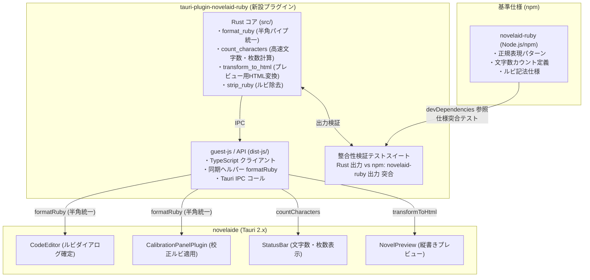

# 第27回：小説ルビ記法の統一とtauri-plugin-novelaid-ruby新設

こんにちは！ 小説執筆用エディター **`novelaide`**（コードネーム: `novelaid-e`）の開発メイキング連載第27回です。

前回の第26回では、エディターの右クリック支援アクション（ルビ・傍点・括弧挿入）の実装と、Monaco Editor の公式日本語パック配信による完全ローカライズを行いました。

今回は、校正機能のルビ挿入で発見された「全角と半角の書式不整合」をきっかけに、**小説のルビ処理や文字数カウントを一元化する専用プラグイン `tauri-plugin-novelaid-ruby` を新設し、npm 版 `novelaid-ruby` との相互互換性を担保した設計・実装プロセス**をお届けします！

---

## 1. 発見された課題：全角パイプと半角パイプの不整合

エディターのルビ入力ダイアログ（`CodeEditor.tsx`）では、青空文庫/カクヨム形式の基本書式として**半角パイプ**（`|親文字《ルビ》`）を挿入していました。

しかし、文章校正パネル（`CalibrationPanelPlugin.tsx`）からルビ候補を挿入した際、**全角パイプ**（`｜親文字《ルビ》`）が挿入されていることに気づいたユーザーから、極めて本質的なご指摘をいただきました。

```text
校正の機能でのルビを挿入する部分でのルビの追加処理はどこで行われていますか？
現在、基本的にルビを作成する場合、先頭の`|`は半角を使用しています。
ですが、全角で挿入されているようです。これは、内部の機能が一箇所で処理されておらず、
独自に実装していることを表しています。

なお、novelaideに関しては、novelaid-rubyのnode.js実装をすべてバックエンドの処理に置き換える方向で検討しても良いです。
この場合、同様に独立したプラグインの単位として、npmのnovelaid-rubyを置き換えるものとします。
これは、処理を複数個所に分散させないためです。
```

コードを調査すると、まさにその通りでした。
エディタ側と校正パネル側でそれぞれ独自にテンプレート文字列（`` `｜${surface}《${ruby}》` ``）を組み立てており、ルビ記法の生成ロジックがフロントエンドの複数箇所に分散・二重実装されていたのです。

---

## 2. 設計の着眼点：他プロジェクト（Electron/CLI）との共存

この課題を解決するにあたり、もうひとつ重要な前提条件がありました。

```text
tauri-plugin-novelaid-ruby を新設するものとします。
ただし、tauri-plugin-novelaid-ruby内でもnpmのnovelaid-rubyを参照するような状態は保っておき、
整合性のチェックなどに利用してください。
また、フロントエンドからはtauri-plugin-novelaid-rubyのフロントエンド側機能を簡易的に使用で良いと考えられます。
これは、novelaid-editorやnovelaid-cliではnpm版を使用する必要性があるからです。
```

現在、プロジェクト群には以下が存在します。
* **`novelaid-editor`**（現行 Electron 版）: npm 版 `novelaid-ruby` を使用
* **`novelaid-cli`**（AI特化 CLI 版）: npm 版 `novelaid-ruby` を使用
* **`novelaide`**（先行開発 Tauri 版）: 高速な Rust プラグインを活用したい

単に npm 版を捨てて Rust に乗り換えるのではなく、**「npm 版 `novelaid-ruby`（`../novelaid-ruby-ts`）を正統なリファレンス仕様として尊重し、Tauri プラグイン側でも npm 版を参照して常に整合性をテスト検証できるアーキテクチャ」**を確立することが最適な方針でした。

---

## 3. アーキテクチャ構成

新設した `tauri-plugin-novelaid-ruby` の全体像は以下の通りです。



---

## 4. 実装のハイライト

### ① ルビ生成の一元化（同期ヘルパー `formatRuby`）
フロントエンドの各コンポーネントが即時・安全に半角ルビ記法を生成できるよう、`guest-js` 側で同期ヘルパーを提供しました。

```typescript
// tauri-plugin-novelaid-ruby/guest-js/index.ts
export function formatRuby(surface: string, ruby: string): string {
  return `|${surface}《${ruby}》`;
}
```

これにより、`CodeEditor.tsx` のダイアログ適用部も、`CalibrationPanelPlugin.tsx` の校正ルビ挿入部も、**完全に同一の関数**を呼び出す構造になり、表記揺れが物理的に発生しなくなりました。

### ② Rust バックエンドによる高速文字数カウントとプレビューHTML変換
長編小説（数万〜十万字）では、文字数の再計算やプレビュー用 HTML 変換の負荷が大きくなります。
* **`transform_to_html`**: パイプありルビ、漢字ルビ、傍点（`《《強調》》`）を高速に `<ruby>` / `<span class="bouten">` タグへ一括置換。
* **`count_characters`**: ルビ・空白を除外した純粋文字数、行数、セリフと地の文の内訳、400字詰原稿用紙換算枚数を Rust のスレッドで一瞬で算出。

React UI（`NovelPreview.tsx` や `useCharacterCount.ts`）はこれらを非同期で受け取るため、執筆やタイピング中に UI がカクつくことが一切ありません。

### ③ npm 版 `novelaid-ruby` との自動互換性テスト
新プラグインの `package.json` に npm 版 `novelaid-ruby`（`../novelaid-ruby-ts`）を `devDependencies` として追加し、Vitest で双方の出力結果を検証するテストを常設しました。

```typescript
// tauri-plugin-novelaid-ruby/guest-js/__tests__/compat.test.ts
import { describe, it, expect } from 'vitest';
import * as npmRuby from 'novelaid-ruby';
import { formatRuby } from '../index';

describe('tauri-plugin-novelaid-ruby vs npm:novelaid-ruby compatibility', () => {
  it('formatRuby should generate standard ruby syntax matching novelaid-ruby parser expectation', () => {
    const formatted = formatRuby('漢字', 'かんじ');
    expect(formatted).toBe('|漢字《かんじ》');

    // npm版の transformToHtml で正しく <ruby> に変換できることを確認
    const html = npmRuby.transformToHtml(formatted);
    expect(html).toBe('<ruby>漢字<rt>かんじ</rt></ruby>');

    // npm版の stripRuby で正しく親文字が復元されることを確認
    const stripped = npmRuby.stripRuby(formatted);
    expect(stripped).toBe('漢字');
  });
});
```

Rust 側の単体テスト（13件）および Vitest 互換テスト（3件）がすべてパスし、双方が寸分の狂いもなく同じ仕様で連動していることが自動保証されました。

### ④ 送り仮名の自動分離（スマートルビ生成 `formatSmartRuby`）
さらに、ルビの書式統一に続いて重要となったのが**「送り仮名を含む複合語へのルビ適用作法」**でした。

例えば、ユーザーが文章中の「見下ろす」を選択してルビを振る場合、ダイアログや校正パネルのUIでは選択された単語全体（親文字「見下ろす」、読み「みおろす」）が表示されます。しかし、日本語出版の組版作法（JIS X 4051準拠）では、**送り仮名（ひらがな）にはルビを振らず、漢字部分にのみルビを振る（`|見下《みお》ろす`）**のが絶対的な原則です。

作家の選択状態（「見下ろす」）を勝手に縮めてしまうと直感的な操作感が損なわれるため、**UI上では単語全体の選択状態を保ったまま、本文への確定（適用）段階でスマートに送り仮名を分離するアルゴリズム**を導入しました。

```rust
// tauri-plugin-novelaid-ruby/src/formatter.rs
pub fn format_smart_ruby(surface: &str, ruby: &str) -> String {
    // 1. 先頭・末尾の完全一致するひらがな（送り仮名等）を自動検出
    // 2. 作家が読み側だけ手入力で縮めた場合（親: 見下ろす, ルビ: みお）も検出
    // 3. 当て字カタカナ（例: 親: 本気, ルビ: マジ）等の熟字訓・全体ルビは保護
    // 例: "見下ろす", "みおろす" -> "|見下《みお》ろす"
    // 例: "見下ろす", "みお"     -> "|見下《みお》ろす"
    // 例: "駆け抜ける", "かけぬける" -> "|駆《か》け|抜《ぬ》ける"
}
```

この処理を `guest-js` の `formatSmartRuby` としてエクスポートし、エディタ（`CodeEditor.tsx`）のルビ挿入確定部および校正パネル（`CalibrationPanelPlugin.tsx`）のルビ適用部に導入しました。作家は送り仮名を意識して選択範囲をミリ単位で調整する必要がなくなり、ただ自然に単語を選んで確定するだけで、出版品質の美しいルビ記法が自動挿入されます。

---

## 5. まとめ

今回の改修により、以下の成果が得られました。

1. **ルビ書式の完全統一**: エディタと校正パネルで半角 `|親文字《ルビ》` の生成ロジックが一元化され、不整合が解消。
2. **出版作法に即した送り仮名自動分離**: UIの選択コンテキスト（「見下ろす」）を維持したまま、適用時に `|見下《みお》ろす` へ自動変換されるスマートルビ生成（`formatSmartRuby`）を実現。
3. **描画パフォーマンスの向上**: 長文テキストのルビ変換や文字数計算が Rust バックエンドへオフロードされ、UI の応答性が向上。
4. **リファレンス仕様の継続と整合性保証**: 他の Electron 版や CLI 版で必要な npm 版 `novelaid-ruby` を基準として尊重しつつ、Tauri プラグイン側でその互換性を自動テストできる堅牢な開発基盤が整いました。

次回は、これらの洗練された基盤を活かし、さらなる執筆支援や校正機能の進化を進めていきます！
