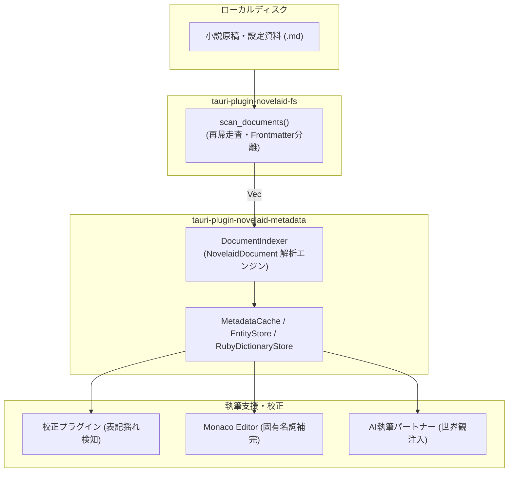

# 第29回：広義のメタデータ統合とナレッジハブプラグインの新設

執筆支援や文章校正が進化するにつれて、エディターには「ファイル単体のテキスト」だけでなく、「作品全体の登場人物」「世界設定用語」「過去に使った固有ルビの履歴」といった、**作品全体を俯瞰する知識コンテキスト（広義のメタデータ）**が求められるようになります。

今回は、小説執筆エディター `novelaide` において、作品知識を一元的に収集・インデックス化・提供するバックエンドプラグイン **`tauri-plugin-novelaid-metadata`** の設計と、物理ファイル操作を担当する **`tauri-plugin-novelaid-fs`** との美しい責務分離についてご紹介します。

---

## 1. なぜ「広義のメタデータ」プラグインが必要なのか？

### 単一ファイルの情報だけでは解けない問題
小説の校正や推敲では、次のような疑問が常に発生します。
* 「この登場人物の名前、第3章で『ソラ・アルスター』って書いたっけ？『空・アルスター』だっけ？」
* 「『魔剣』のルビは『ソウルイーター』で統一されているか？　別のエピソードで『魔剣《さだめ》』とブレていないか？」
* 「AIエージェントに次のシーンの相談をしたいが、世界観設定やキャラクター関係性をどう渡せばいいのか？」

これらを解決するためには、エディターがプロジェクト内の全ドキュメントを把握し、人名・地名・固有ルビ・Frontmatter属性を瞬時に引き出せる**ナレッジハブ（知識拠点）**が必要不可欠です。

---

## 2. 物理I/Oと知識プロセッサの美しい責務分離

プラグインを設計するにあたり、最も重視したのは**「責務の分離（Separation of Concerns）」**です。

当初は `novelaid-metadata` プラグイン自身がディレクトリを巡回（`walkdir`）し、YAMLを解析（`serde_yaml`）する構成も検討されましたが、次の原則に立ち返りました。

> **「物理ファイルに触る責任は `novelaid-fs` に一元化し、`novelaid-metadata` は渡されたデータ（`NovelaidDocument`）を知識化する純粋プロセッサとする」**



### 責務分担のポイント
1. **`tauri-plugin-novelaid-fs`**:
   - ディスク走査、ファイル読み書き、Frontmatterと本文の分離・結合（`NovelaidDocument`）を担当。
2. **`tauri-plugin-novelaid-metadata`**:
   - 物理ディスクアクセスや YAML パースの依存を持たず、受け取った `NovelaidDocument` からインメモリ知識ストア（登場人物・作品ルビ辞書・Frontmatter）を構築・提供。
3. **Rustのクレート間連携**:
   - `novelaid-metadata` の `scan_project` コマンドは、Tauriの `app.novelaid_fs().scan_documents()` を呼び出してドキュメントを取得し、自身の `DocumentIndexer` に流し込むオーケストレーションを行います。

---

## 3. インメモリ知識ストアの3本柱

`tauri-plugin-novelaid-metadata` では、以下の3つのストアを高速にインメモリ保持します。

### ① MetadataCache（属性キャッシュ）
全ファイルのFrontmatter（タイトル、執筆ステータス、タグ、文字数等）を保持し、ファイルツリーや検索パネルへ即時提供します。

### ② EntityStore（登場人物・世界設定）
`tags` に `character` や `location`、`term` を含む設定資料から、正式名称、読み、愛称・別名（エイリアス）、役割を抽出。
```typescript
export interface ProjectEntity {
  id: string;
  name: string;        // "ソラ・アルスター"
  reading?: string;    // "そら あるすたー"
  aliases: string[];   // ["ソラ", "アルスター", "ソラくん"]
  category: 'character' | 'location' | 'term' | 'item' | 'other';
  role?: string;       // "主人公"
}
```

### ③ RubyDictionaryStore（作品固有ルビ辞書）
本文中の `|親文字《ルビ》` や `漢字《ルビ》` を正規表現で高速走査。最頻出のルビを「代表ルビ（canonicalRuby）」として認定し、1つの親文字に異なるルビが使われている場合は `hasConflict = true` として表記揺れを即座に特定します。

---

## 4. TypeScript型定義の自動生成と整合性維持

Tauri 2 プラグインと React フロントエンドの通信には `ts-rs` を採用していますが、Rustの `u64` はデフォルトで TypeScript の `bigint` に変換されます。

フロントエンドの `Date.now()` やタイムスタンプ型（`number`）と整合させるため、モデル定義で `#[ts(type = "number")]` を指定し、安全かつ自然な JavaScript の `number` としてエクスポートされるよう調整しました。

```rust
#[derive(Debug, Clone, Serialize, Deserialize, TS)]
#[ts(export, export_to = "../guest-js/models.ts")]
#[serde(rename_all = "camelCase")]
pub struct NovelaidDocument {
    pub path: String,
    pub base_name: String,
    pub file_title: String,
    pub content: String,
    #[ts(type = "any")]
    pub metadata: serde_json::Value,
    pub document_type: NovelaidDocumentType,
    #[ts(type = "number")]
    pub mtime_ms: u64,
}
```

---

## 5. まとめ

物理I/Oを担当する `novelaid-fs` と、作品知識を司る `novelaid-metadata` の責務が美しく整理されたことで、以下のメリットが実現しました。

* **コードの重複排除**: Frontmatter の分離・結合ロジックが一箇所（`novelaid-fs`）に集約。
* **高いテスタビリティ**: `novelaid-metadata` のテストはモックの `NovelaidDocument` を渡すだけで完結し、ディスクI/Oなしでミリ秒単位で実行可能に。
* **校正・AI機能への強固な基盤**: 次のステップである「人名の表記揺れ検知」「ルビの統一性チェック」「AIへの世界観コンテキスト自動注入」がスムーズに実装可能に。

次回は、このメタデータ基盤を活用した「プロジェクト横断の文章校正エンジン」の深化についてお届けします！
