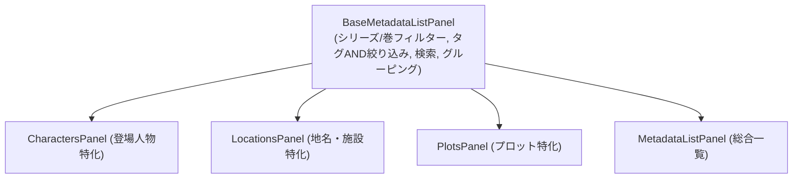

# 第30回：設定資料の階層化と登場人物・地名・プロット独立パネルの実装

前回のバックエンド「広義のメタデータ基盤」に続き、今回は執筆画面のUI/UXを大幅に強化しました。

長編小説や複数巻シリーズの執筆では、「この登場人物は1巻と2巻に登場する」「この地名は外伝シリーズの舞台である」といった**作品・巻・章の階層分類**が欠かせません。
また、頻繁に参照する「登場人物」「地名・施設」「プロット・構成」は、単一のパネルに押し込むのではなく、**アクティビティバー上に独立したトップレベルパネル**として配置することで、執筆中の思考を中断させない快適な操作性を実現しました。

さらに、Electron版（`novelaid-editor`）のメタデータ定義を徹底調査し、過去の作品資産との完全な互換性も確保しています。

---

## 1. なぜ地名が表示されなかったのか？ —— Electron版の互換性調査

当初、現行の Electron 版で作成されたプロジェクトを開いた際、地名ファイルが一覧に表示されないという課題が生じていました。
Electron 版のソースコードを調査したところ、以下の設計差異が判明しました。

1. **`tags` と `tag`（単数形）の両立**:
   - 執筆者によって Frontmatter に `tags: [location]` と書かれる場合もあれば、`tag: location` と単数形で書かれる場合もありました。
2. **語彙の網羅性**:
   - `location` だけではなく、`places`, `geo`, `geography`, `地名`, `施設`, `場所`, `舞台`, `拠点` など多彩なタグが使われていました。
3. **タイトル未指定時の自動フォールバック**:
   - 設定ファイルによっては `name:` や `title:` をあえて書かず、ファイル名自体（例: `王都ルクシア.md`）で管理されているケースがあり、名前が未定義でもファイル名から安全に復元する仕組みが必要でした。

Rust 側（`tauri-plugin-novelaid-metadata`）およびフロントエンドの正規化ロジックを刷新し、これらを完全に自動吸収できるように改修しました。

---

## 2. シリーズ・巻・章（階層メタデータ）の導入

小説を分類するにあたり、以下の階層構造メタデータをサポートしました。

```markdown
---
name: ソラ・アルスター
role: 主人公
tags:
  - character
  - 剣士
series: 本編
books:
  - 1巻
  - 2巻
chapters:
  - 第1章
---
```

Frontmatter の記述において、単数形（`book: "1巻"`, `series: "本編"`）でも複数形（`books: ["1巻", "2巻"]`）でも、すべて安全に配列として正規化されます。
右ペインの `MetadataPanel`（Frontmatter編集）にもシリーズおよび巻の入力欄が新設され、GUIから手軽に入力・編集できるようになりました。

---

## 3. 4つの独立パネルと共通基盤アーキテクチャ

使用頻度が高いカテゴリを左アクティビティバーに独立パネルとして展開しました。

* 👤 **登場人物パネル (`CharactersPanel`)**:
  - 主人公・主要人物、サブ、敵対者・ライバルなどの「役割（role）」別にアコーディオン自動分類。
* 📍 **地名・施設パネル (`LocationsPanel`)**:
  - 国・都市・ダンジョン・世界観設定ファイルに特化。
* 📜 **プロット・構成パネル (`PlotsPanel`)**:
  - 巻（Book）別や章別に構成ファイルを自動分類。
* 🔖 **設定資料・収集一覧パネル (`MetadataListPanel`)**:
  - プロジェクト内の全設定資料を横断的に閲覧できる総合パネル。

### コードの重複を防ぐ `BaseMetadataListPanel`
これら4つのパネルは、外見やフィルタリングの仕組みが共通しています。そこで基盤コンポーネント **`BaseMetadataListPanel`** を設計し、各特化パネルはこれをラップするだけの極めてシンプルな構造にしました。



---

## 4. 高機能フィルターバー（シリーズ・巻セレクタ＆タグAND絞り込み）

各パネルの上部には、探したい設定に瞬時にアクセスできるフィルターバーを搭載しました。

1. **シリーズ・巻セレクタ**:
   - プロジェクト内のファイルから収集されたシリーズや巻が自動でドロップダウンに列挙され、特定の巻に登場する人物だけをワンクリックで絞り込めます。
2. **タグチップスによる AND 絞り込み**:
   - 頻出タグチップを複数選択することで、「`#主人公` かつ `#魔法` を持つ人物」といった AND 絞り込みが可能です。
3. **インクリメンタル検索**:
   - 名前、フリガナ、概要メモ、タグをリアルタイムに検索します。

---

## 5. アクティビティバーアイコンの視認性改善

これまで、非選択時のアクティビティバーアイコンが `--text-muted`（暗い背景色と同化しやすいグレー）に指定されていたため、「アイコンが薄すぎて見づらい」という課題がありました。

ダーク・ライト・セピアの各テーマに合わせ、十分なコントラストを持つ `--activity-bar-inactive`（例: `#a0a0a5`）を新設し、ホバー・アクティブ時の `--activity-bar-active`（`#ffffff`）と合わせて、くっきりと直感的に認識できるように調整しました。

---

## 6. まとめ

今回の改善により、過去の `novelaid-editor` で作成された作品資産をそのまま読み込んでも、地名や登場人物、プロットが完璧に分類・表示されるようになりました。

また、シリーズや巻数に応じた設定の整理が可能になったことで、連作や長編ファンタジーの執筆環境として一段と使いやすくなりました。

次回は、このメタデータ基盤を活用した「文章校正エンジンでの登場人物表記揺れ・ルビ不整合検知」の本格実装に進みます！
