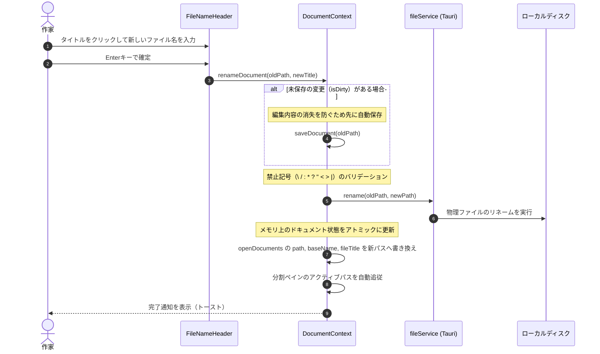

# 第31回：エディター上部でのインラインファイル名変更機能の実装

小説の執筆を進めていると、「やっぱりこのエピソードのタイトルを変えたい」「第1章をプロローグに改名したい」という場面が頻繁に訪れます。

しかし、そのたびにサイドバーのエクスプローラーを探し、ファイルを右クリックして「名前の変更」を選ぶのは、執筆のリズムを削ぐ原因になります。

今回は、現行の Electron 版（`novelaid-editor`）で非常に好評だった機能の1つ、**「エディター最上部のファイルタイトル（拡張子なし）をその場で直接編集してファイル名を変更できる機能」**を `novelaide`（Tauri版）に再実装したプロセスをご紹介します。

---

## 1. 執筆者の思考を止めないインラインタイトル編集

エディター上部のタブバーの直下に、現在開いている原稿のタイトルが大きく表示されます。

```text
┌────────────────────────────────────────────────────────┐
│ 📄 第1章 旅立ちの朝                            ✏️      │
├────────────────────────────────────────────────────────┤
│ 　冷たい朝の空気が、頬を撫でた。                       │
│ 　少年は荷物を背負い、振り返ることなく歩き出す。       │
```

- **通常時**:
  - タイトル部分（拡張子なし）が太字で読みやすく表示。
  - カーソルを乗せるとホバー色が変わり、右端にペンアイコンがふわりと現れます。
- **編集時（クリックまたは Enter / Space）**:
  - その場でインライン入力フィールド（`<input />`）に早変わりし、テキストが全選択されます。
  - 新しい名前を入力して **`Enter` キーまたは枠外クリック（Blur）** を押すだけで、物理ファイル名が瞬時にリネームされます。
  - やり直したいときは **`Escape` キー** でキャンセルできます。

---

## 2. データの安全性を守るリネームフロー

ファイルのリネームは単にOSのファイル名を変更するだけでなく、**エディターの未保存データや開いているタブの状態と安全に連動**させる必要があります。

`novelaide` の `DocumentContext` では、以下の安全フローを組み込みました。



### ポイント：タブを閉じずにパスだけを追従
多くのエディターでは、外部でファイル名が変わると「一旦タブを閉じて新しいパスで開き直す」処理を行うため、スクロール位置やカーソル位置、選択範囲がリセットされてしまいます。

`novelaide` では、メモリ上に保持されている開いているドキュメント（`DocumentState`）の `path` と `baseName`, `fileTitle` を**その場でアトミックに書き換える**ため、タブの再読み込みが発生せず、執筆の集中を一切途切れさせません。

---

## 3. まとめ

ちょっとした工夫ですが、「今書いている場所のタイトルをそのまま直感的に変更できる」という体験は、執筆中の快適さを大きく引き上げてくれます。

`novelaid-editor` にあった細やかな便利機能を、Tauri の高速なバックエンドと React の柔軟なUI基盤の上に丁寧に再構築していくことで、より洗練された理想の小説執筆環境へと進化を続けています。

次回も、執筆をさらに加速させる便利機能の移植・強化をお届けします！
