# ファイル保存の確定mtimeリトライ保証と未保存タブの視覚化

こんにちは！ 小説執筆用エディター **`novelaide`**（コードネーム: `novelaid-e`）の開発メイキング連載第33回です。

今回は、テキストエディターにとって最も重要であり、絶対にデータを失ってはならない核心部分——「**ファイル保存の整合性確保**」と「**外部ファイル変更の双方向同期**」、そして「**未保存状態の視覚化**」に取り組みました。

---

## 1. ユーザーからのリクエストと発生していた不整合

作業中、ユーザーより以下のようなクリティカルな不具合の報告と検証結果が寄せられました。

```text
/plan ファイル内容が再読み込みによってクリアされてしまいます。この調査、検証を計画してください。

症状としては以下となります。
1. ファイルを変更して保存(Ctrl-S)
2. 別なソフトを開き、ロストフォーカス
3. novelaideにフォーカスを戻す
4. 自動での再読み込みが走る。
5. ファイルが保存前の状態に戻る。

また、追加で検証したところ、
1. 文字列として、`AA` 状態
2. 入力して、`AABB`で保存(Ctrl-S)
3. 外部でファイルを確認すると、`AABB`となっている。
    + また、たまに、`AABBC`など、アプリで入力、消したはずの値(C)が書き込まれていることもある
4. 外部でファイルを`AABBDD`に変更。
5. アプリ上では変更が見られず、`AABB`から変化しない
```

さらに、ユーザーより以下の具体的な改善・解決アプローチのご提案をいただきました。

```text
保存時は以下の方法で正確なファイルの更新日時を取得可能と考えられます。
1. 現在時刻の取得(A)
2. ファイルの保存
3. ファイルの更新日時の取得(B)
4. AとBを比較
    + Bの方が新しい場合、保存日時はBで確定
    + Bの方が古い場合(未反映)、ファイルの更新日時取得をリトライ

なお、ファイル保存、読み込み時のログ出力、および、ステータスバーへのメッセージ出力も追加してください
現在、未保存状態であることのUIでの表示はどうなっていますか？ もし実装済みの場合でも現状判別がつかないため、タブのヘッダーの文字を赤にするなど視覚的にもよく分かる方法で表してください
```

---

## 2. 3大不整合の根本原因

調査と旧 Electron 版（`novelaid-editor`）のコード追跡を行った結果、3つの異なる問題が重なり合って発生していることが判明しました。

```mermaid
flowchart TD
    subgraph Problem1["① ゴミ混入問題（AABBC）"]
        P1A["入力して消去（Backspace）"] --> P1B["React state は非同期更新"]
        P1B --> P1C["Ctrl+S / 自動保存タイマーが<br/>消去前の古いクロージャを参照"]
        P1C --> P1D["古い内容（AABBC）が保存される"]
    end

    subgraph Problem2["② 保存直後のクリア問題"]
        P2A["ファイル保存完了"] --> P2B["Windows NTFS の遅延タイムスタンプ反映"]
        P2B --> P2C["フォーカス復帰時に外部変更と誤認判定"]
        P2C --> P2D["古いディスク内容で再読み込みされてしまう"]
    end

    subgraph Problem3["③ 外部変更が画面に映らない問題"]
        P3A["外部エディタで AABBDD に変更"] --> P3B["novelaide がディスクから最新取得"]
        P3B --> P3C["Monaco Editor のバッファに setValue されない"]
        P3C --> P3D["画面上は AABB のまま固定される"]
    end
```



1. **ゴミ混入（消したはずの文字が保存される）**:
   - 文字入力や削除時、React の `state` 更新は非同期に行われます。その最中に保存やオートセーブのタイマーが動くと、更新前の古いテキスト状態をキャプチャ（クロージャ捕捉）してしまい、消去前の文字がファイルに書き込まれていました。
2. **保存直後のフォーカス復帰でクリア（保存前の状態に戻る）**:
   - Windows（NTFS等）ではファイル書き込み完了後、メタデータの更新日時（`mtime`）がOSキャッシュからディスクに完全に反映されるまでに数ミリ秒のタイムラグが生じることがあります。
   - アプリが保持するタイムスタンプと不一致になり、ウィンドウフォーカス復帰時に「外部で更新された」と誤認され、古い内容が再読み込みされてしまっていました。
3. **外部エディタでの変更が反映されない**:
   - ドキュメント状態としては最新テキストを取得していたものの、Monaco Editor に対する明示的な `editor.setValue()` の発行が抜けており、エディター画面のバッファが更新されていませんでした。

---

## 3. 実装のポイント

### 3.1. Rust バックエンド: A/B 比較リトライによる確定 mtime 保証

ユーザーから提案されたアルゴリズムを Rust バックエンド（`tauri-plugin-novelaid-fs/src/desktop.rs`）の `write_document` に実装しました。

```rust
// 保存直前のシステム時刻 (A) をミリ秒精度で取得
let before_write_ms = SystemTime::now()
    .duration_since(UNIX_EPOCH)
    .unwrap_or_default()
    .as_millis() as u64;

// ファイルにデータを安全に書き込み
std::fs::write(&path, &content)?;

// 確定 mtime 取得（B < A の場合は OS のメタデータ遅延とみなしリトライ）
let mut confirmed_mtime_ms = 0u64;
for attempt in 0..10 {
    if let Ok(meta) = std::fs::metadata(&path) {
        if let Ok(mod_time) = meta.modified() {
            let mtime_ms = mod_time
                .duration_since(UNIX_EPOCH)
                .unwrap_or_default()
                .as_millis() as u64;
            confirmed_mtime_ms = mtime_ms;
            if mtime_ms >= before_write_ms {
                break; // 新しいタイムスタンプが確実に反映された
            }
        }
    }
    std::thread::sleep(std::time::Duration::from_millis(10));
}
```

この処理により、OS側のタイムスタンプ遅延を完全に吸収し、ミリ秒単位で確実に整合した最新タイムスタンプがフロントエンドに返却されるようになりました。

### 3.2. フロントエンド: 同期 Ref によるゴミ混入遮断と自己保存ガード

`DocumentContext.tsx` では、React state だけでなく `openDocumentsRef.current` を同期的・即座に更新する構造に改修しました。

```typescript
// 文字入力・削除時に同期参照を即座に更新（古いクロージャの参照を防止）
const updateContent = useCallback((path: string, content: string) => {
  const currentDoc = openDocumentsRef.current.get(path);
  if (currentDoc) {
    const updated = { ...currentDoc, content, isDirty: true };
    openDocumentsRef.current.set(path, updated);
  }
  setOpenDocuments((prev) => {
    // React state の更新...
  });
}, []);
```

さらに、アプリ自身の保存直後に発生するフォーカス変更での誤検知を防ぐため、**自己保存ガード（`savingPathsRef`）**を導入しました。保存完了後 800ms の間は該当ファイルの外部変更チェックを除外することで、自己保存のエコーによる巻き戻りを完全に防止しています。

### 3.3. 外部変更検知時の Monaco Editor 同期

フォーカス復帰時に外部での変更が正しく検知された際、カスタムイベント `novelaide:document-reloaded` を発火します。`CodeEditor.tsx` はこのイベントを購読し、Monaco Editor に対して直接最新内容を反映します。

```typescript
// CodeEditor.tsx
const handleReloaded = (e: CustomEvent<{ path: string; content: string }>) => {
  if (e.detail.path === documentPath && editorRef.current) {
    const model = editorRef.current.getModel();
    if (model && model.getValue() !== e.detail.content) {
      editorRef.current.setValue(e.detail.content);
    }
  }
};
window.addEventListener('novelaide:document-reloaded', handleReloaded as EventListener);
```

### 3.4. 未保存タブの視覚的強調とステータス表示

「今、変更が保存されているのかどうか」が一目でわかるよう、タブの未保存表示を大幅に強化しました。

- **タブタイトル**: 未保存時は文字色を鮮やかな赤（`#f87171`）に変更し、太字（`font-weight: 600`）で強調。
- **インジケーター**: 丸印（`●`）を赤色（`#ef4444`）に拡大し、保存が必要な状態であることを直感的に伝達。
- **ステータスバー・ログ出力**: 保存完了時には `保存完了: ファイル名`、読み込み時には `再読み込み完了: ファイル名`、外部変更検知時には `外部変更を反映: ファイル名` をステータスバーとコンソールに明瞭に出力。

---

## 4. まとめと次回予告

エディター開発において、ファイル入出力と競合・タイムスタンプ同期は最も泥臭く、しかし最も妥協してはならない領域です。

ユーザーからの鋭い問題指摘とアルゴリズムの提案により、以下が完全に実現されました。

- 外部エディタでの追記・変更が即座に画面に同期される。
- バックスペース直後の急な保存でも、消去したはずのゴミ文字が混入しない。
- フォーカスを切り替えてもファイル内容が巻き戻らない。
- 赤色表示とステータスバーで、保存状態が常に手にとるようにわかる。

次回は、より快適で安全になった執筆基盤の上に、更なる創作支援機能のブラッシュアップを進めていきます。お楽しみに！
