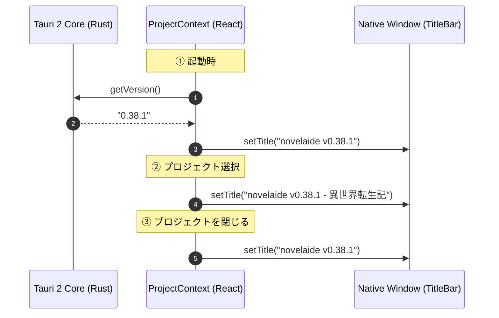

# アプリウィンドウタイトルへのバージョンとプロジェクト名表示

こんにちは！ 小説執筆用エディター **`novelaide`**（コードネーム: `novelaid-e`）の開発メイキング連載第34回です。

前回の第33回では、ファイル保存時のミリ秒確定 mtime リトライや未保存タブの赤色表示といったエディターのコア基盤を強化しました。
今回は、旧 Electron 版（`novelaid-editor`）で親しまれていた「ウィンドウタイトルバーへのアプリバージョンおよびプロジェクト名のリアルタイム表示」を Tauri 2 上で再実装しました。

---

## 1. ユーザーからのリクエスト

ユーザーより、以下のご要望をいただきました。

```text
/plan `novelaid-editor`では、アプリのタイトル部分に、アプリのバージョン、および、プロジェクト名を表示しています。

novealid-editor v0.53.5 - プロジェクト名

のように表示しています。
同じように、タイトル部分にバージョン情報とプロジェクト名を表示するようにしてください。
```

### 設計上の要件
1. **表示形式の統一**:
   - プロジェクトを開いているとき: `novelaide v<version> - <プロジェクト名>`（例: `novelaide v0.38.1 - 勇者の冒険譚`）
   - ランチャー画面（未選択時）やプロジェクトを閉じたとき: `novelaide v<version>`（例: `novelaide v0.38.1`）
2. **安全なライフサイクル連動**:
   - アプリ起動時のバージョン取得完了時、プロジェクト開始時（`openProject`）、終了時（`closeProject`）に即座かつ滑らかにタイトルバーが切り替わること。

---

## 2. Tauri 2 での技術的課題と解決

### 2.1. セキュリティ設計と `allow-set-title` 権限

Tauri 2 ではセキュリティ強化（ケーパビリティシステム）のため、フロントエンドからネイティブ API を呼び出す際にきめ細かな権限管理が行われます。

調査したところ、デフォルトの権限セットである `core:default` には、ウィンドウ情報を読み取る `allow-title` は含まれているものの、**タイトルを書き換える `allow-set-title` は意図的に除外されている**ことが判明しました。

そのため、フロントエンドから単に `getCurrentWindow().setTitle(...)` を呼び出すだけでは権限エラーとなってしまいます。そこで、`src-tauri/capabilities/default.json` に明示的なパーミッションを追加しました。

```json
{
  "permissions": [
    "core:default",
    "core:window:allow-set-title",
    ...
  ]
}
```

### 2.2. バージョン取得とタイトル動的更新の連携

フロントエンドの `ProjectContext.tsx` において、`@tauri-apps/api/app` の `getVersion()` と `@tauri-apps/api/window` の `getCurrentWindow().setTitle()` を統合しました。

```typescript
// src/contexts/ProjectContext.tsx
const [appVersion, setAppVersion] = useState<string>("");

const updateTitle = useCallback(async (pName: string | null, version: string) => {
  const base = "novelaide";
  const versionStr = version ? ` v${version}` : "";
  const projectStr = pName ? ` - ${pName}` : "";
  const title = `${base}${versionStr}${projectStr}`;

  document.title = title;
  try {
    await getCurrentWindow().setTitle(title);
    bootLog("Window title updated:", title);
  } catch (error) {
    console.warn("Failed to set window title via Tauri API:", error);
  }
}, []);

// 起動時にバージョン番号を取得
useEffect(() => {
  const initVersion = async () => {
    try {
      const ver = await getVersion();
      setAppVersion(ver);
      updateTitle(projectName, ver);
    } catch (error) {
      console.warn("Failed to get app version from Tauri API:", error);
    }
  };
  initVersion();
}, []);

// projectName または appVersion の変更を監視して自動更新
useEffect(() => {
  if (appVersion) {
    updateTitle(projectName, appVersion);
  }
}, [projectName, appVersion, updateTitle]);
```

- **Web環境・プレビューへの配慮**: ネイティブウィンドウ API だけでなく `document.title` にも同タイトルを設定。さらに Tauri API 呼び出し失敗時も例外でアプリが停止しないよう安全にフォールバックしています。

---

## 3. 動作の確認



- **ランチャー画面**: `novelaide v0.38.1` とすっきり表示。
- **プロジェクト作業中**: `novelaide v0.38.1 - 異世界転生記` のように、どの作品のどのバージョンで執筆しているかがOSのタスクバーやウィンドウ最上部で一目瞭然に。
- **ランチャーへの復帰**: プロジェクトを閉じると、余計なゴミを残さずバージョン表示のみへと綺麗に戻ります。

---

## 4. まとめと次回予告

アプリのタイトルバーは、執筆者が常に視界の隅で認識する「アプリの顔」です。現在どのバージョンを使っていて、どの作品を開いているのかが常に把握できる安心感は、作業効率や愛着にも直結します。

次回も引き続き、小説執筆の体験をさらに研ぎ澄ます機能改善を進めていきます。どうぞご期待ください！
