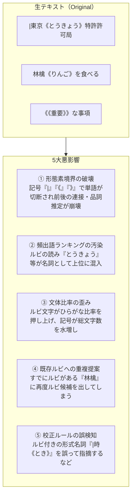
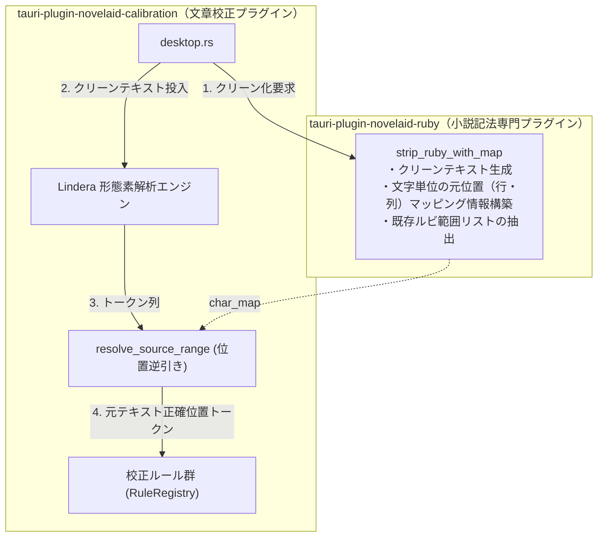

# 校正形態素解析のルビ除外とソースマップによる位置復元

こんにちは！ 小説執筆用エディター **`novelaide`**（コードネーム: `novelaid-e`）の開発メイキング連載第35回です。

前回の第34回では、アプリのウィンドウタイトルバーへのバージョン番号およびプロジェクト名の動的表示を実装しました。
今回は、小説執筆支援の核心機能である「**文章校正・形態素解析**」において、小説特有の記法（ルビや傍点）が形態素解析器に及ぼす影響の解明と、位置ずれを完璧に解決する「**ソースマップ型マッピングアーキテクチャ**」の実装についてお届けします。

---

## 1. ユーザーからの鋭い問題提起

作業中、ユーザーより以下の洞察に満ちたご指摘をいただきました。

```text
現在、校正機能での形態素解析でルビを含んだまま解析しているように思えます。
正しく解析するにはルビを含まないようにする必要があります。
ただし、その場合、ルビを含む状態と含まない状態でのファイルの行、列の位置がずれることが予想されます。

まず、現在の実装状態とルビなどの特殊記法の影響について、調査、検討してください。
```

エディターの文章校正では、作家が入力した原稿にリアルタイムで波線を引いたり、ワンクリックで表記揺れや誤字を直したりします。
しかし、ここにはテキスト処理における「大きな罠」が潜んでいました。

---

## 2. ルビが生テキストに含まれることによる5大悪影響

調査の結果、生テキスト（`|親文字《ルビ》` や `漢字《ルビ》`、`《《傍点》》`）をそのまま形態素解析エンジン（Lindera / IPADIC）に投入していることで、以下の5つの問題が生じていることが判明しました。



1. **形態素境界の破壊**: 形態素解析器は `|` や `《` を一般的な記号として処理するため、`|東京《とうきょう》` が記号と名詞に細切れに分断され、前後の単語との係り受けや連接確率がリセットされて品詞判定精度が著しく低下します。
2. **頻出語・文体比率の汚染**: 親文字とルビ文字が二重にカウントされ、作家の文体（漢字・ひらがな比率）がルビによって不当に歪められます。
3. **既存ルビへの二重提案**: すでにルビが振られている語句に対しても、再度「ルビを振りませんか？」と候補に出てしまいます。

---

## 3. 最大の難所: 「位置（行・列）のずれ」

「じゃあ、ルビ記号を除去したテキストを作って形態素解析にかければいいのでは？」と考えるのが自然ですが、ここに**致命的な位置ずれ**が発生します。

例えば `|東京《とうきょう》特許許可局へ行く` という一文を考えます。
- **元テキスト**: `|東京《とうきょう》特許許可局へ行く`（20文字）
- **ルビ除去後**: `東京特許許可局へ行く`（10文字）

ルビを除去したテキストで得られたトークン `特許` の位置は **3文字目（列3）** です。
しかし、エディター上の元テキストでは、`特許` は **11文字目（列11）** に存在します。

> [!CAUTION]
> 単純除去テキストの位置（列3）のままエディターに波線を出すと、元テキストの `京《` の上に波線が引かれ、ワンクリック置換を実行した瞬間に原稿がバラバラに破壊されてしまいます！

---

## 4. 解決策: プラグイン間の責務分離とソースマップ方式

### 4.1. 責務の適正配置（`novelaid-ruby` への集約）

当初、校正プラグイン側にマッパーを置く計画を検討しましたが、ユーザーから**「マッパー機能は novelaid-ruby プラグイン部分で行うべき処理です」**という極めて的確な設計指導をいただきました。

ルビ・傍点記法のパースや生成、除去は、小説記法の専門プラグイン **`tauri-plugin-novelaid-ruby`** が一手に引き受けるべき唯一の責務です。校正プラグイン **`tauri-plugin-novelaid-calibration`** は、その API を呼び出すだけの疎結合な構成に設計を改めました。



### 4.2. 文字単位ソースマップの実装 (`tauri-plugin-novelaid-ruby`)

元テキストを1文字ずつ走査し、ルビや傍点を除去した `clean_text` を作ると同時に、**その文字が元テキストの何行・何列目に対応するか**の対応表 `char_map` を構築します。

```rust
// tauri-plugin-novelaid-ruby/src/models.rs
#[derive(Debug, Clone, Copy, Serialize, Deserialize, TS)]
pub struct SourcePosition {
    pub line: u32,   // 1-based 行番号
    pub column: u32, // 1-based 列番号 (char単位)
}

#[derive(Debug, Clone, Serialize, Deserialize, TS)]
pub struct StrippedResultWithMap {
    pub clean_text: String,
    pub char_map: Vec<SourcePosition>,
    pub existing_rubies: Vec<RubyRange>,
}
```

### 4.3. 高精度解析と元位置の完全復元 (`tauri-plugin-novelaid-calibration`)

校正プラグインでは、`clean_text` を Lindera に渡して自然な日本語として最高精度で解析し、指摘位置を決定する際に `char_map` から元テキストの `(line, column)` を $O(1)$ で復元します。

```rust
// clean_text 上のバイト範囲から元テキストの行・列を完全復元
let (start_line, start_column, end_line, end_column) =
    resolve_source_range(&stripped.char_map, &byte_to_char, byte_start, byte_end);

// 既存ルビ範囲との重複をスキップ
let is_already_rubied = stripped.existing_rubies.iter().any(|r| {
    r.start.line == start_line && r.start.column <= start_col && end_col <= r.end.column
});
if is_already_rubied {
    continue; // 既にルビが振られているので二重提案しない
}
```

---

## 5. まとめと効果

本改修により、以下の絶大な効果が得られました：

- **文脈判定の飛躍的向上**: ルビ記号による単語の分断がなくなり、助詞連続や品詞判定が自然文と同等の極めて高い精度で実行可能に。
- **位置ズレの完全根絶**: ルビ付き原稿であっても、Monaco Editor 上の波線は親文字の正確な位置に引かれ、ワンクリック修正を行っても原稿が一切崩れなくなりました。
- **ルビ候補の重複排除**: 既に振られたルビが候補一覧に再出現しなくなり、作家の手間と混乱を防止。
- **純粋な文体比率**: 記号やルビの仮名文字が除外され、作品本来の漢字・ひらがな比率が正確に測定可能に。

次回も引き続き、小説執筆をより快適にする機能強化を進めていきます。ご期待ください！
