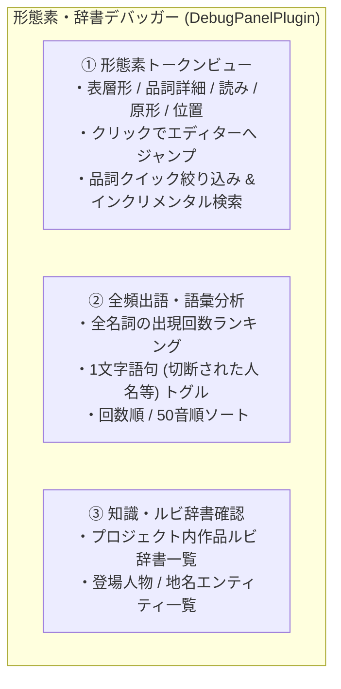

# 形態素解析デバッガーの新設と全頻出語・辞書可視化

こんにちは！ 小説執筆用エディター **`novelaide`**（コードネーム: `novelaid-e`）の開発メイキング連載第36回です。

前回の第35回では、校正・形態素解析におけるルビ除外と文字単位ソースマップによるエディター位置完全復元を実装しました。
今回は、今後のユーザー辞書（カスタム辞書・登場人物名辞書）導入に向けた重要な基盤として、小説原稿がどのように形態素分割・品詞判定されているかをリアルタイムに検査できる専用パネル「**形態素・辞書デバッガー（DebugPanelPlugin）**」を新設しました。

---

## 1. ユーザーからのリクエストと開発動機

作業中、ユーザーより以下のご要望と課題提起をいただきました。

```text
/plan 形態素解析のデバッグ用の表示機能の追加を検討してください。
今後のユーザー辞書の適用などを想定した場合、現在の形態素解析情報を閲覧できる部分が必要です。
現在、小説内の固有の名称、人名などが複数回使用されているにも関わらず、頻出語に含まれていなかったりします。
簡易的には頻出語の表示を上位だけでなく、すべて出すオプションがあるだけでも良いかもしれません。
専用のパネルを追加した方がサポート有無の切り替えが可能かもしれません。
また、同様に現在のメタデータや読み仮名辞書の内容確認用のパネルもあった方がよいかも。

これらの、デバッグ用途の各種パネルの表示を計画してください。
```

小説の執筆現場では、架空のキャラクター名（例: 「天霧」「玲央」）や特殊な世界観用語が頻繁に登場します。
しかし、一般的な日本語辞書（IPADIC）をベースにした形態素解析器では、これらの固有名詞が見出し語にないため、**「1文字ずつにバラバラに切断されてしまう」「未知語や別の品詞と誤認される」**といった現象が起き、結果として頻出語ランキングからすり抜けてしまうという課題がありました。

---

## 2. 形態素・辞書デバッガーパネルの3大機能

通常の執筆作業の邪魔にならないよう、本パネルは**右側サイドペイン（右アクティビティバー）**に配置し、用途に応じた3つのタブを備えています。



### 2.1. ① 形態素トークンビュー（Token Viewer）
開いている原稿テキストを Lindera でトークナイズし、すべての形態素をテーブルに一覧表示します。
- **詳細品詞と読みの確認**: 表層形だけでなく、品詞詳細（例: `名詞,固有名詞,人名,姓`）や読み仮名、原形（見出し語）を確認できます。
- **エディタージャンプ**: トークン行をクリックすると、エディター本文の該当位置にカーソルが移動してテキストがハイライトされます。
- **クイック品詞フィルタ**: 「名詞」「動詞」「形容詞」「助詞」など、目的の品詞だけをワンクリックで絞り込めます。

### 2.2. ② 全頻出語・語彙分析（Vocabulary & Frequency）
文章校正パネルでは上位15件に限定されていた頻出語を、文書内の全名詞を対象に一覧表示します。
- **1文字語句トグルの威力**: 「1文字語句を含める」チェックボックスをONにすることで、例えば「天霧」が「天」「霧」と1文字に切断されて頻出語から漏れていた現象などを即座に可視化・特定できます。
- **ソートと検索**: 出現回数順（降順）と50音順のソート、キーワード検索をサポートしています。

### 2.3. ③ 知識・ルビ辞書確認（Knowledge & Dictionaries）
`tauri-plugin-novelaid-metadata` プラグインと連携し、プロジェクト全体で認識されている辞書・設定資料データを一覧表示します。
- **作品ルビ辞書**: プロジェクト内で使用されているルビの親文字、代表ルビ、出現回数を一覧化。
- **登場人物・地名一覧**: 登録されているキャラクターや世界設定の名称、読み仮名、別名（alias）を確認できます。

---

## 3. 通常作業を邪魔しない設計（サポート有無の切り替え）

一般の執筆者にとってはデバッグパネルが常に表示されていると情報過多になるため、**環境設定（「外観・テーマ」画面）**にトグルを用意しました。

```typescript
// AppearanceSettingsPlugin.tsx
<div className="setting-row">
  <div className="setting-info">
    <label className="setting-label">形態素・辞書デバッガーパネル</label>
    <div className="setting-desc">
      右側アクティビティバーに形態素解析や作品辞書のデバッグ確認パネルを表示します。
    </div>
  </div>
  <div className="setting-control">
    <label>
      <input
        type="checkbox"
        checked={settings.showDebugPanel !== false}
        onChange={(e) => updateSetting('showDebugPanel', e.target.checked)}
      />
      <span>デバッグパネルを有効にする</span>
    </label>
  </div>
</div>
```

この設定のON/OFFに応じて、アクティビティバーからアイコンが動的に出し入れされます。

また、文章校正パネル（`CalibrationPanelPlugin`）の頻出語セクションにも **「全件表示」** ボタンと **「1文字を含む」** チェックボックスを新設し、校正パネル内でも手軽に全語彙をチェックできるよう配慮しました。

---

## 4. まとめと次回予告

エディターの知性（校正やルビ推測、AI連携）を支えているのは、テキストの根底にある「形態素解析」です。
その中身を開発者・執筆者が自らの目で確かめられるようになったことで、人名や造語の辞書登録（ユーザー辞書機能）に向けた準備が万全に整いました。

次回は、これらの辞書データを Lindera のユーザー辞書エンジンと直結させ、作品固有の人名や世界観用語を完璧に認識させる機能へとステップを進めていきます。お楽しみに！
