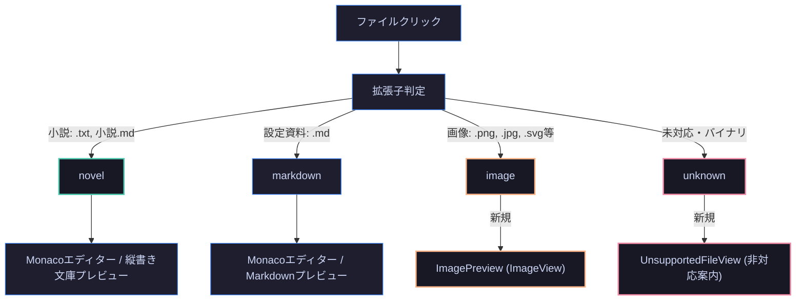

# 第42回：DocumentTypeの再整理とImageViewおよび非対応ファイルビューの実装

こんにちは！小説執筆用エディター **`novelaide`** 開発チームです。

長編小説の執筆を進めていると、原稿のテキストファイルだけでなく、世界観マップやキャラクターイラストなどの画像素材、あるいは一時的な資料ファイルなど、多様なファイルを作品フォルダーに保存することがあります。

しかし、エクスプローラーから画像や非対応ファイルをクリックした際に、**「なぜか関係のない小説プロローグのモックデータが表示され、クリックするたびにタブが無限に増殖してしまう」** という奇妙な不具合が発生していました。

今回は、この不具合の根本原因を解明・根絶するとともに、**マウスホイールズーム＆ドラッグ移動に対応した本格的な画像プレビュー機能（ImageView）**、そして非対応ファイルを安全に案内する専用画面の実装についてお届けします！

---

## 1. 奇妙な不具合の謎：なぜ「01_プロローグ」に化けて増殖したのか？

問題の発端は、ファイルエクスプローラーで画像ファイル（`.png` や `.jpg`）や未知の拡張子のファイルをクリックした時の挙動でした。

```text
【これまでの挙動（不具合）】
1. エクスプローラーで「大陸地図.png」をクリック
2. なぜかタブが「01_プロローグ」という名前で新しく開く！
3. 中身も「青い空の彼方から、一羽の鳥が……」という小説本文が表示される！
4. もう一度「大陸地図.png」をクリックすると、また「01_プロローグ」タブが増える！
```

調査の結果、バックエンド（Rust）とフロントエンドの連携部分に潜んでいた意外な落とし穴が判明しました。

1. **Rustのテキスト読み込み失敗**:
   - `tauri-plugin-novelaid-fs` の `read_document` は、すべてのファイルを `std::fs::read_to_string` でテキストとして読み込もうとしていました。
   - 画像やバイナリファイルはUTF-8として解釈できないため、Rust側で読み込みエラー（`Err`）が発生します。
2. **フロントエンドの開発用モックへのフォールバック**:
   - フロントエンドの `fileService.readFile` は、Tauri IPCがエラーを返した際にブラウザ単体デバッグ用のモックデータを返す `catch` 節を持っていました。
   - その `catch` 節が、**どんなファイル名であっても無条件に `baseName: "01_プロローグ.md"`, `fileTitle: "01_プロローグ"` の固定オブジェクトを返していた**のです！
3. **タブの重複判定の崩壊**:
   - `openDocument` はクリックされた「`assets/大陸地図.png`」を開こうとしますが、返ってきたドキュメントオブジェクトの名前と内容が「`01_プロローグ`」になっているため、タブの同一性判定と表示が狂い、クリックするたびに新しいタブとして認識されて増殖していました。

---

## 2. 解決策：DocumentTypeの再整理と安全なアーキテクチャ

この問題を解決するため、ファイル種別（`DocumentType`）ごとの責務を明確に再定義しました。



### ① Rustバックエンドの安全化
画像ファイル（`Image`）はテキスト読み込みをスキップして空本文で正常返却。またバイナリファイル等でUTF-8デコードが失敗した場合も、エラーを投げるのではなく `document_type: NovelaidDocumentType::Unknown`, `content: ""` で安全に返却するように修正しました。

### ② 固定モックの完全撤廃
フロントエンドの `fileService.readFile` から固定モックを削除。万が一の例外時でも指定パスのファイル名を正確に維持して `documentType: "unknown"` を返却することで、タブ名化けやタブ増殖を根絶しました。

---

## 3. 画像プレビュー（ImageView / `ImagePreview`）の実装

小説の設定資料として不可欠な地図やキャラクター立ち絵、装丁ラフなどを快適に閲覧できるよう、専用の画像ビューコンポーネントを開発しました。

### ① Tauri 2 `convertFileSrc` による爆速描画
ローカルファイルをBase64変換することなく、Tauri 2 のカスタムアセットプロトコル（`asset://`）経由で直接 `` 要素へ渡すことで、高解像度の地図画像でも瞬時に表示されます。

### ② マウスホイールズームとドラッグ移動（パン）
作家が細部までイラストや設定図を確認できるよう、直感的なインタラクションを組み込みました。

* **マウスホイール回転**: 10%（0.1x）〜 1000%（10x）までシームレスに拡大・縮小。
* **マウスドラッグ**: 左クリックしながらマウスを動かすと、拡大した画像を自由自在にスクロール移動（カーソルは `grab` / `grabbing`）。
* **チェッカーボード背景**: 透過PNGや透過SVGでも輪郭がくっきり浮き上がるCSSグラデーション背景を採用。

```tsx
// ImagePreview.tsx のドラッグ＆ズーム処理
const handleWheel = useCallback((e: React.WheelEvent) => {
  e.preventDefault();
  const zoomFactor = e.deltaY < 0 ? 1.15 : 0.85;
  setScale((prev) => Math.max(0.1, Math.min(10, Math.round(prev * zoomFactor * 100) / 100)));
}, []);

const handleMouseDown = useCallback((e: React.MouseEvent) => {
  if (e.button !== 0) return;
  setIsDragging(true);
  setDragStart({ x: e.clientX - position.x, y: e.clientY - position.y });
}, [position]);
```

### ③ 下部フローティングツールバー
画面下部に半透明ブラーの美しいツールバーを配置。
現在の倍率表示（クリックで等倍100%に復帰）、拡大・縮小ボタン、ウィンドウ枠に画像をフィットさせる「全体表示（Fit）」ボタン、原寸・位置リセットボタンをワンタッチで呼び出せます。

---

## 4. 非対応ファイル案内画面（`UnsupportedFileView`）の実装

圧縮ファイル（`.zip`）やPDF、実行可能ファイルなど、本アプリで直接編集・プレビューできない形式が開かれた際には、Monacoエディタの真っ白な画面が出る代わりに、専用の `UnsupportedFileView` が表示されます。

* **クリーンな案内表示**: ファイル種別のアイコン、拡張子バッジ、ファイル名、絶対パスを整理して表示。
* **「エクスプローラーで表示」ボタン**: クリックすると、Tauriの `revealItemInDir` を通じてOSのファイル管理ウィンドウが開き、対象ファイルの保管場所へ瞬時にアクセスできます。
* **タブの正常表示**: タブヘッダーには正しく `backup.zip` などのファイル名が表示され、何度クリックしてもタブが増殖することはありません。

---

## 5. まとめ

今回の改修により、フォルダー内の様々なファイルに対する堅牢性と操作性が劇的に向上しました。

1. **モック化け・タブ増殖バグの完全根絶**: ファイル読み込みの例外処理を安全化し、本来のファイル名で正確に管理。
2. **画像素材のスムーズな閲覧**: 拡大縮小・ドラッグパンに対応したImageViewにより、執筆中に設定資料のイラストや地図を快適に参照可能に。
3. **親切な非対応ファイル案内**: 未対応ファイルを開いてしまっても安心・明確なUIで迷わせない。

次回も、執筆環境をさらに便利にする改善をお届けします。どうぞお楽しみに！
