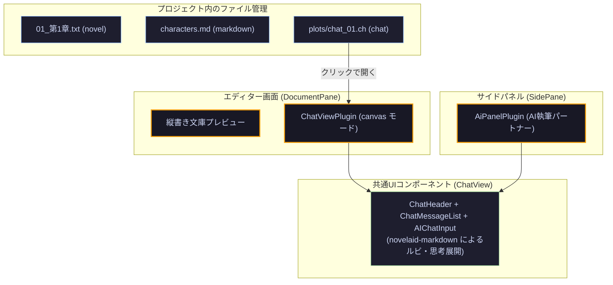

# 第45回：AIチャットのドキュメント化と共通UI構造化

こんにちは！小説執筆用エディター **`novelaide`** 開発チームです。

AIを小説執筆のパートナーとして活用するとき、**「プロットの壁打ち」「キャラクターの口調の試行錯誤」「設定の掘り下げ」** など、チャット欄には作品の核となるアイデアがたくさん生まれます。

しかし、多くのAIツールではチャット履歴が一時的なサイドパネルに閉じ込められており、**「あのときのプロット相談をもう一度見直したい」「第1章用の相談ログと第2章用の相談ログを分けて整理したい」** といった作家のニーズに応えきれていませんでした。

そこで今回は、`novelaid-editor`（Electron版）で培われた設計思想をさらに洗練させ、**「AIチャットを作品内の独立したドキュメント（`.ch` ファイル）として扱う」** 新機能と、エディタータブ・サイドパネル間でUIを共通化するアーキテクチャ刷新をお届けします！

---

## 1. チャットを「作品の資産」としてファイル化する

`novelaide` では、AIチャットの履歴を独立したドキュメント（拡張子: **`.ch`**）としてプロジェクト内に保存できます。



* **見直しと対話の再開**:
  - ファイルツリーから `.ch` ファイルをクリックするだけで、エディタータブとして展開され、過去の対話をいつでも見直したり、そのまま続きのメッセージを送信できます。
* **通常のドキュメントと同じ安心感**:
  - `novelaide` の自動保存（オートセーブ）、未保存バッジ、手動保存（`Ctrl+S`）、Git差分管理がそのまま連動します。
* **Monaco Editor による生JSON閲覧**:
  - 表示モードを「キャンバス」から「エディター」に切り替えることで、Monaco Editor を使って生の JSON テキストとして直接編集することも可能です。

---

## 2. novelaid-markdown によるルビ・装飾の完全対応

小説特化エディターである `novelaide` だからこそ、チャット内のメッセージ表示にも一切妥協しません。

メッセージ描画のコアとして、自社製の **`novelaid-markdown`** を採用しました。

```text
【AIからの回答例】
主人公の｜紫苑《しおん》が、古の魔法《アルス・マグナ》を発動するシーンですね！
以下のような描写の言い換えはいかがでしょうか？

> 彼女の指先から、青白い燐光が溢れ出す。
```

* **小説ルビ記法のレンダリング**:
  - `｜漢字《かんじ》`、青空文庫形式、カクヨム・なろう記法のルビが、チャット吹き出し（ユーザー・AI回答・思考プロセス）の中で正しく美しいルビ（`<ruby><rt>`）として描画されます。
* **豊かなMarkdown表現**:
  - 引用（blockquote）、リスト、太字、コードブロックなども統一されたタイポグラフィで美しく表示されます。

---

## 3. エディターとサイドパネルの内部UI共通化

今回の改修の大きなハイライトは、**「サイドパネルのAIチャット」と「エディターで開くチャットファイル」の内部構造を完全に共通化したこと** です。

1. **データ構造の一元化 (`ChFileStructure`)**:
   - `novelaid-editor` と完全な互換性を持つ JSON スキーマを採用。
   - メタデータ（`title`, `createdAt`, `defaultPersonaId`）、メッセージ（`role`, `content`, `parts`, `timestamp`）を標準化。
2. **パーツ構造 (`parts`) による思考・ツールの可視化**:
   - メッセージの中に `thought`（思考プロセス）や `tool_call`（ツール実行）を構造化して保持。
   - 思考プロセスは `<details>` によるアコーディオン開閉として表示され、AIがどのような推論を経て回答を出したかが一目でわかります。
3. **サイドパネルの自動永続化とエクスポート**:
   - サイドパネルでの壁打ち内容は、プロジェクト内の `.novelaid/ai-chat.ch` に自動保存されるため、次回起動時にも会話が途切れません。
   - さらに、パネル上部に設けた **「ファイルとして保存」ボタン** を押せば、相談ログを作品フォルダ内の `.ch` ファイルとして即座に独立ファイル化できます。

---

## 4. 4つの固定ペルソナによる執筆支援

今回は第1段階として、執筆の目的に応じた **4つの固定ペルソナ** をヘッダーからワンタップで切り替えられるようにしました。

| ペルソナ | 役割 | 活用シーン |
| :--- | :--- | :--- |
| **執筆パートナー** | 共創・アイデア出し | プロット展開の相談、情景描写の言い換え、ネタ出し |
| **担当編集者** | 講評・構成チェック | 読者視点でのテンポ確認、伏線配置、ストーリー全体の講評 |
| **校正係** | 文体・ルビ・誤字脱字 | 助詞の重なり、文末の連続、ルビ記法、表記ゆれの厳格チェック |
| **作中人物** | キャラクター対話 | 登場人物になりきって会話。台詞の口調や感情反応の検証 |

（※ 今後のステップとして、作品内のキャラクター設定ファイル（Frontmatter）から動的に登場人物ペルソナを生成する機能へと発展させていきます）

---

## 5. まとめと次回予告

* **チャットのドキュメント化**: AIとの対話を `.ch` ファイルとして管理し、思考の軌跡を作品資産として保存。
* **ルビ・Markdown完全対応**: `novelaid-markdown` により、チャット欄でも美しい小説ルビや引用を表示。
* **共通UIコンポーネント**: エディターペインとサイドパネルの二重実装を解消し、高い保守性と `novelaid-editor` との相互フィードバックを実現。

AIを「ただの外部ツール」ではなく、**「小説の制作環境に溶け込んだ本物の共創パートナー」** へ。`novelaide` の進化はまだまだ続きます！
