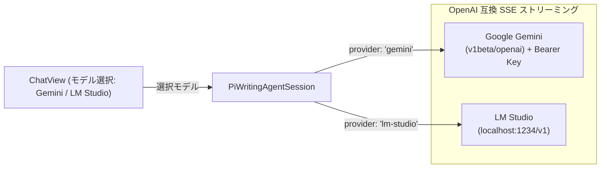

# 第47回：LM StudioとGeminiを自在に行き来する！pi SDK動的モデル取得とプロバイダー切り替えの実装

Tauri 2 を活用した小説執筆エディター **`novelaide`** の開発連載第47回です。

AI執筆パートナーは、プロットのブレスト、文章の推敲、キャラクター対話など、シーンに応じて最適なAIモデルを使い分けることで真価を発揮します。
今回は、作家が日常的に活用する **ローカルLLM（LM Studio）** と **クラウドAPI（Google Gemini）** の両プロバイダーを対等にサポートし、**pi SDK（`@earendil-works/pi-ai`）の動的モデルカタログ機能** を用いて、常に最新のモデル一覧を取得・切り替えられるシステムを構築した過程をお届けします。

---

## 1. 課題：固定モデルからの脱却とプロバイダー併用の需要

### 1.1 背景
これまでの `novelaide` では、AIモデルがデフォルトのローカルモデル（`lm-studio/qwen2.5-7b-instruct`）に固定されており、ユーザーが画面上からモデルを指定・切り替える手段がありませんでした。

しかし、実際の小説執筆の現場では以下のような強い需要があります：
- **長大なプロット相談・世界観構築**: 100万トークン級の長大コンテキストと圧倒的な論理的構成力を持つ **Google Gemini 2.5 Pro / Flash** を使いたい。
- **オフラインでの集中執筆・推敲**: API料金や通信環境を気にせず、ローカルGPUで高速動作する **LM Studio (Qwen 2.5 7B / Llama 3.1 等)** を使いたい。

### 1.2 モデル一覧をハードコードしない！pi SDK による動的解決
一般的なアプリではモデル名（`gemini-1.5-flash` など）をフロントエンド側に文字列配列でハードコードしがちですが、新モデルが登場するたびにアプリ改修が必要になります。
そこで本プロジェクトでは、`novelaide` の基盤である **pi SDK（`@earendil-works/pi-ai`）が内蔵するモデルカタログおよび動的リフレッシュ機能** を直接活用することにしました。

---

## 2. pi SDK による動的モデルカタログ取得の仕組み

`@earendil-works/pi-ai` は `GOOGLE_MODELS` カタログを標準提供しており、さらに Google REST API (`/v1beta/models`) と組み合わせることで、最新モデルを動的解決できます。

```typescript
// tauri-plugin-novelaid-ai/guest-js/client/modelManager.ts
import { GOOGLE_MODELS } from '@earendil-works/pi-ai/providers/google.models';

/**
 * Google Gemini のモデル一覧を動的取得
 */
export async function fetchGeminiModels(apiKey?: string): Promise<AiModelInfo[]> {
  // 1. API キーがある場合: Google 公式 API からリアルタイムに最新モデルを取得
  if (apiKey && apiKey.trim().length > 0) {
    try {
      const url = `https://generativelanguage.googleapis.com/v1beta/models?key=${apiKey.trim()}`;
      const res = await fetch(url, { signal: AbortSignal.timeout(3000) });
      if (res.ok) {
        const data = await res.json();
        // generateContent 対応の gemini モデルをマッピングして返却...
      }
    } catch (e) {
      console.warn('Live models fetch failed, fallback to pi SDK catalog');
    }
  }

  // 2. 未設定時またはフォールバック: pi SDK カタログから動的生成
  return Object.values(GOOGLE_MODELS)
    .filter((m: any) => m.id && m.id.startsWith('gemini'))
    .map((m: any) => ({
      id: m.id,
      name: m.name || m.id,
      provider: 'gemini',
      contextWindow: m.contextWindow || 1048576,
    }));
}
```

LM Studio についても、ローカルサーバーの `GET /v1/models` をリアルタイムに叩くことで、**「今ロードされているモデル」** を即座にリストアップできるようにしました。

---

## 3. 設定画面での「Scoped Models（普段使いモデル）」絞り込み

モデルが数十〜数百個存在する場合、チャット画面のドロップダウンが長大になって操作性が落ちます。
そこで、pi 本体の設計思想である **`scopedModels`（候補の絞り込み）** を採用しました。

### 3.1 AI設定プラグイン (`AiSettingsPlugin.tsx`)
設定モーダル（`restar-app-settings`）に新設された「AI執筆アシスタント」タブでは：
1. **Gemini API キー** と **LM Studio 接続URL** を入力・保存。
2. 設定タブを開いた瞬間、および「最新情報に更新」ボタン押下時に、バックグラウンドで両プロバイダーから最新モデル一覧を動的フェッチ。
3. チェックボックスで、チャット画面に表示したい「お気に入りモデル（2〜4個推奨）」を選択。
4. 新規チャット作成時のデフォルトモデルを指定。

---

## 4. チャットヘッダーでのプロバイダー別グループ化切り替え

チャット画面（`ChatHeader.tsx`）の右側には、設定された Scoped Models を `<optgroup>` でプロバイダー別にグループ化したドロップダウンセレクターを配置しました。

```tsx
<select
  className="chat-header-model-select"
  value={selectedModelKey}
  onChange={(e) => onModelChange(e.target.value)}
>
  <optgroup label="Google Gemini">
    <option value="gemini:gemini-2.5-flash">Gemini 2.5 Flash</option>
    <option value="gemini:gemini-2.5-pro">Gemini 2.5 Pro</option>
  </optgroup>
  <optgroup label="LM Studio (ローカル)">
    <option value="lm-studio:qwen2.5-7b-instruct">qwen2.5-7b-instruct</option>
  </optgroup>
</select>
```

### ドキュメント単位の完全永続化
切り替えたモデル情報は、チャットドキュメント（`.ch`）の `metadata.parameters` に即座に自動保存されます。
```json
{
  "version": "1.0",
  "metadata": {
    "title": "第3章プロット相談",
    "parameters": {
      "provider": "gemini",
      "model": "gemini-2.5-pro",
      "useTools": true
    }
  }
}
```
これにより、「このチャットは Gemini 2.5 Pro でじっくり相談」「こちらの校正チャットは LM Studio の Qwen 7B で高速チェック」といった使い分けがファイル単位で完全に保持されます。

---

## 5. 通信層の統一：同一パイプラインで動くマルチプロバイダー

Google Gemini は OpenAI 互換の `/chat/completions` エンドポイント（`https://generativelanguage.googleapis.com/v1beta/openai`）を公式提供しています。
そのため、通信層（`tauri-plugin-novelaid-ai` の `chatSession.ts`）では、プロバイダーが Gemini であっても LM Studio であっても、**同一のストリーミング処理パイプライン** で透過的にメッセージ送受信を行えるように設計しました。



---

## 6. まとめ

ハードコードされた固定モデルを撤廃し、pi SDK による動的解決と設定画面連携を実現したことで、作家はマシンスペックや利用シーンに合わせて **Gemini と LM Studio を自由自在に切り替えて執筆に没頭できる** ようになりました。

次回も、さらなるエディター機能の充実と執筆支援の高度化を進めていきます！
