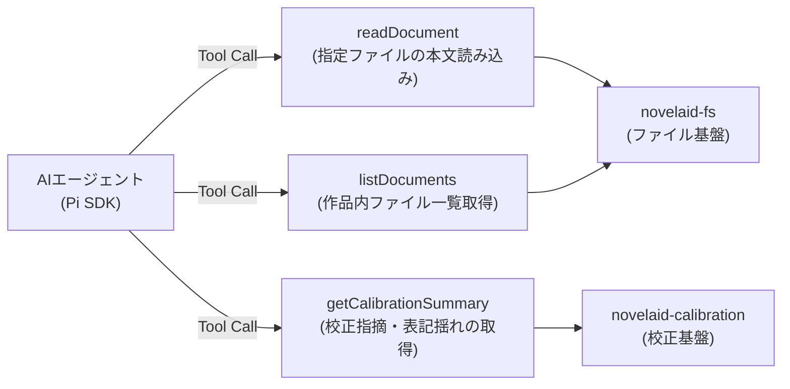

# 第49回：AIが思考している瞬間を魅せる！リアルタイム思考プレビューと小説コンテキストツールの実装

こんにちは！ 小説執筆用エディター **`novelaide`**（コードネーム: `novelaid-e`）の開発メイキング連載第49回です。

前回（第48回）は、ローカルLLM（LM Studio / Qwen 2.5/3.5）の思考トークン（Reasoning / Thinking）をリアルタイムにストリーミング受信し、体感待ち時間を大幅に削減する基盤を構築しました。

思考トークンが届くようにはなったものの、実際に使ってみるとUI面で新たな課題が浮かび上がってきました。
思考プロセスのアコーディオン（`<details>`）が閉じたままだと「今、AIが本当に考えているのか、それとも止まっているのか」が直感的に伝わらず、作家の集中を削いでしまうのです。

今回は、**「AIが今まさに思考しているライブ感」を伝える洗練されたUI演出**と、AIが小説の設定や本文を自律的に読み込むための**「小説コンテキストツール連携」**の実装ドラマをお届けします！

---

## 1. 「AIが考えていること」を直感的に伝えたい！

思考ストリーミングが実装された直後、ユーザー（開発者）から次のようなプロンプトが投げられました。

```markdown
> UI的に、思考プロセスが動作中がわかるようにできる？
```

### 従来の課題
- `<details className="chat-thought">` は静的なアコーディオンでした。
- クリックして開かない限り、内部で思考トークンがどれだけ生成されているのかが外から見えません。
- 「送信したのに画面が止まっている？」と不安を与えてしまっていました。

### 実装した演出アプローチ
AIが思考中（`isThinkingNow`：思考トークンを受信中かつ本文の生成がまだ始まっていない状態）であることを判定し、以下の動きを組み込みました。

1. **自動オープン**: 思考が始まると自動的に `<details open>` に遷移。
2. **回転スピナーとパルスドット**: ヘッダー（`<summary>`）で紫色のスピナーアイコンが回転し、光るパルスドットが鼓動します。
3. **タイピングカーソル（点滅バー）**: 思考テキストの末尾に `|`（点滅カーソル）を表示し、次々と文字が紡ぎ出されるリアルタイム感を表現。

さらに、これを見た開発者からもう一歩進んだリクエストが届きます。

```markdown
> 思考中の内容を一行の先頭部分などを現在の「思考中……」の横に一部表示して思考が進んでいることを更にわかりやすくできたりする？
```

そこで新設したのが **`thinking-live-snippet`（リアルタイム思考スニペット）** です！

```tsx
// 思考テキストから最新のフレーズを抽出して整形
const getLatestThoughtSnippet = (text: string): string => {
  const lines = text.trim().split('\n').filter(Boolean);
  if (lines.length === 0) return '';
  const lastLine = lines[lines.length - 1].replace(/^[\s*#-]+/, '').trim();
  return lastLine.length > 28 ? `${lastLine.slice(0, 28)}…` : lastLine;
};
```

`<summary>` 内の「思考中...」ラベルの横に、最新の思考行（例: `「設定資料の登場人物を確認中…」` など）がバッジ風にリアルタイムでアニメーション表示されるようになりました。
これにより、アコーディオンを閉じた状態でも、AIが今何を考えているのかが一目で伝わるようになり、待機ストレスが完全に解消されました。

---

## 2. 小説本文や登場人物をAIが「読む」ためのツール連携

思考が可視化された次のステップは、AIが小説執筆の真のパートナーとなるための**「プロジェクト内の情報参照ツール」**の拡充です。

AIエージェントに以下の機能を持たせるため、`tauri-plugin-novelaid-ai` にツール群を実装しました。



### Pi SDK（`pi-agent-core`）のツール呼び出し仕様との格闘
ツールを組み込んだ際、ブラウザのコンソールに予期せぬエラーが発生しました。

```
TypeError: prepared.tool.execute is not a function
```

Pi SDK の内部コードを調査したところ、`Tool.execute` に渡される引数のシグネチャに特徴がありました。

- 通常の関数呼び出し: `execute(args)`
- Pi SDK のエージェント実行時: `execute(toolCall.id, args, signal, onUpdate)`

第1引数にツール呼び出しID（文字列）、第2引数に本来の引数オブジェクトが渡されていたのです。
そこで、どちらの形式で呼び出されても確実に引数を抽出できる**正規化ラッパー**を実装しました。

```typescript
function resolveToolArgs(first: any, second: any): any {
  // 第1引数が文字列（toolCallId）で第2引数が存在する場合は第2引数を採用
  if (typeof first === 'string' && second !== undefined) {
    return second;
  }
  return first;
}
```

この正規化により、AIは自由自在に `readDocument` で登場人物シートを読み込み、執筆中のエピソードの文脈を理解して返答できるようになりました。

---

## 3. チャット会話履歴の継続保持（`.ch` との双方向同期）

novelaide では、AIとのやり取りをプロジェクト内の `.ch` ファイル（JSONフォーマット）として保存しています。
しかし、エディターを再起動したりタブを切り替えたりした際、AIエージェント側のメモリがリセットされてしまい、直前の会話文脈が途切れてしまう問題がありました。

そこで、`.ch` のメッセージ構造と Pi SDK の内部メッセージ形式を忠実に相互変換する `convertChMessagesToPiMessages` を実装しました。

```typescript
export function convertChMessagesToPiMessages(messages: ChatMessage[]): any[] {
  return messages.map((msg) => {
    if (msg.role === 'assistant') {
      return {
        role: 'assistant',
        content: msg.content,
        // 過去の思考プロセスやツール呼び出し履歴も忠実に復元
        thought: msg.thought,
        toolCalls: msg.toolCalls,
      };
    }
    return {
      role: msg.role,
      content: msg.content,
    };
  });
}
```

これにより、過去にAIが何を考え、どのツールを使って調べたのかという文脈を維持したまま、違和感なく続きの執筆相談を行えるようになりました。

---

## 4. まとめと次回予告

今回は、AIチャットの「待機体験」を劇的に変えるUI演出と、小説執筆に欠かせないコンテキストツールの連携を実現しました。

* **思考中演出**: スピナー、パルス、点滅カーソル、最新1行リアルタイムスニペットの導入。
* **小説ツール連携**: 小説ファイルや校正結果をAI自身が自律的に読み込むツール群の整備。
* **履歴復元**: `.ch` ファイルと Pi SDK のメッセージ構造を相互変換し、文脈を維持。

しかし、AIチャット機能のブラッシュアップを進める中で、もう一つの大きな壁が立ちはだかります。  
**「LM Studio から Google Gemini（クラウドAPI）にモデルを切り替えたはずなのに、なぜかエラーが出る……」**

次回は、マルチプロバイダー切り替え時に潜んでいた落とし穴の解明と、APIキーをOS環境変数から安全に取得するセキュリティ設計をお届けします。お楽しみに！
