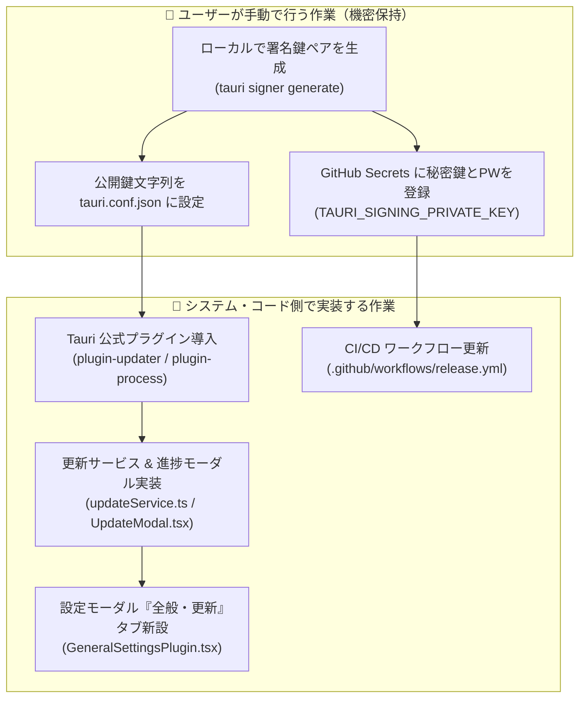
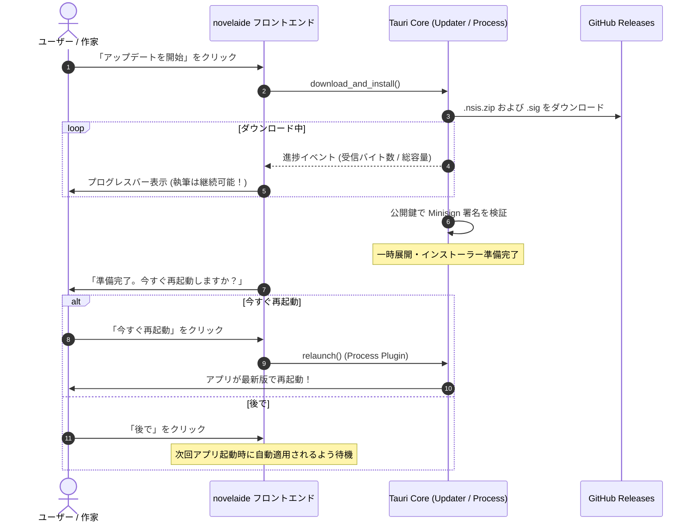

# 第52回：改ざんを防ぐ暗号署名と執筆に寄り添うUI！Tauri v2 自動更新（Updater）の完全実装

こんにちは！ 小説執筆用エディター **`novelaide`**（コードネーム: `novelaid-e`）の開発メイキング連載第52回です。

デスクトップアプリを運用する上で欠かせないのが**「自動更新機能（Auto Updater）」**です。
旧 `novelaid-editor`（Electron版）では `electron-updater` を利用していましたが、Tauri v2 ではアーキテクチャが一新され、セキュリティ面で極めて堅牢な**「暗号署名（Minisign/Ed25519）の必須化」**が導入されています。

今回は、手作業による危険な鍵管理を排除しつつ、**「執筆を絶対に妨げない控えめな通知」と「ワンクリックで最新版へ安全に更新できる仕組み」**を実装した全プロセスをお届けします！

---

## 1. ユーザー手動作業とシステム実装の役割分担

自動更新の実装を計画するにあたり、開発者から次のリクエストがありました。

```markdown
> /plan 自動更新関連の実装を計画します。手動で行うべき作業などを含めてまとめてください
```

暗号署名の「秘密鍵（Private Key）」は、アプリのバイナリが本物であることを証明する最高レベルの機密情報です。
AIやリポジトリに預けることは絶対に許されないため、**「ユーザーが手動で行う作業」**と**「システム・コード側で実装する作業」**の境界線を明確に設計しました。



1. **ローカル環境で署名鍵を生成**:
   ```bash
   npx @tauri-apps/cli signer generate -w $HOME/.tauri/novelaide.key
   ```
2. **GitHub Secrets への登録**:
   リポジトリの `Settings -> Secrets -> Actions` に、秘密鍵の内容（`TAURI_SIGNING_PRIVATE_KEY`）と暗号化パスワード（`TAURI_SIGNING_PRIVATE_KEY_PASSWORD`）を安全に登録。
3. **公開鍵（Public Key）の共有**:
   公開鍵文字列（`dW50cnVzdGVk...`）のみを `src-tauri/tauri.conf.json` の `plugins.updater.pubkey` に記述。

---

## 2. 執筆に寄り添うUI/UX設計（勝手に邪魔しない！）

小説の執筆中に、突然「アップデートがあります！」と全画面モーダルが割り込んできたり、勝手に再起動されてしまっては、せっかくのインスピレーションが台無しになってしまいます。

novelaide では、**「執筆最優先のサイレント設計」**を徹底しました。

### ① 起動後10秒ディレイのバックグラウンド確認
アプリ起動直後はファイル読み込みやUI初期化でCPU・I/O負荷が高いため、10秒間の待機タイマーを設けてから非同期で静かに `latest.json` を取得します。
- **最新版の場合**: 何も表示しない（完全サイレント）。
- **オフラインや通信エラー時**: コンソールにログを残すのみで、エラーダイアログは一切出さない。
- **更新がある場合**: 画面右下に控えめなトーストを1回だけ表示。
  > **novelaide vX.X.X が公開されました** `[詳細を確認 / 更新]`

### ② 設定モーダルに「全般・更新」タブを新設
`restar-app-settings` のプラグインアーキテクチャを活用し、設定画面の一番左に「全般・更新」タブを追加しました。
- アプリケーションバージョン（例: `novelaide v0.55.1`）の表示。
- 「起動時に自動で更新を確認する」チェックボックス（無効化も可能）。
- 「更新を確認」ボタン（手動で即座にチェック可能）。

---

## 3. ダウンロード進捗と安全な再起動モーダル

トーストまたは設定画面から「更新」を選択した際は、専用の軽量モーダル（`UpdateModal`）が立ち上がります。



進捗バーが表示されている間も、モーダル裏のエディターで小説の執筆をそのまま続けられます。
また、ダウンロード完了後も即座に強制終了するのではなく、「今すぐ再起動」か「後で」をユーザー自身が選択できるようにしています。

---

## 4. CI/CD リリースパイプラインとの完全統合

タグを作成してプッシュするだけで、GitHub Actions（`.github/workflows/release.yml`）が自動で走り、インストーラーのビルド・署名・アセット添付・本公開（`releaseDraft: false`）までが一気通貫で完了します。

```yaml
      - name: Build Tauri app and create GitHub Release
        uses: tauri-apps/tauri-action@v0
        env:
          GITHUB_TOKEN: ${{ secrets.GITHUB_TOKEN }}
          TAURI_SIGNING_PRIVATE_KEY: ${{ secrets.TAURI_SIGNING_PRIVATE_KEY }}
          TAURI_SIGNING_PRIVATE_KEY_PASSWORD: ${{ secrets.TAURI_SIGNING_PRIVATE_KEY_PASSWORD }}
        with:
          tagName: v__VERSION__
          releaseName: 'novelaide v__VERSION__'
          releaseDraft: false
          prerelease: false
```

`tauri-action` は secrets の秘密鍵を検知すると、通常のインストーラーに加えて Updater 用の `novelaide_<version>_x64-setup.nsis.zip`、その署名ファイル `.sig`、そしてマニフェスト `latest.json` を自動生成して Release に公開してくれます。

---

## 5. まとめ

今回は、Tauri v2 の先進的なセキュリティ機構に完全準拠した自動更新システムを構築しました。

* **暗号署名と機密保護**: Minisign によるバイナリ改ざん防止と GitHub Secrets での安全な鍵管理。
* **執筆優先のサイレント設計**: 起動後10秒ディレイ、控えめなトースト通知、エラー非表示。
* **手動更新と設定連動**: 設定画面での「全般・更新」タブ新設と手動確認ボタン。
* **安心の適用フロー**: 執筆を止めない進捗バーと、再起動タイミングの自由選択。

これで、`novelaide` はインストーラーによるスマートな導入から、継続的なワンクリック自動更新まで、**商用デスクトップアプリに匹敵する配布・更新基盤**を手に入れました。

次回以降も、小説執筆をより快適で刺激的なものにする新機能の開発経過をどんどんお届けしていきます。どうぞご期待ください！
