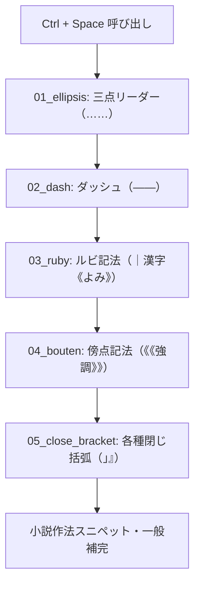

# 第53回：思考を止めない！小説特化のMonaco補完制御と三点リーダー・ルビサジェストの実装

こんにちは！ 小説執筆用エディター **`novelaide`**（コードネーム: `novelaid-e`）の開発メイキング連載第53回です。

前々回・前回では、Windowsインストーラーの完全日本語化や、Tauri v2 公式 Updater による安全な自動更新パイプラインを構築しました。
今回は再び「執筆の核心」である **Monaco Editor** に立ち戻り、作家がキーボードを叩き続ける中で絶対に邪魔にならず、それでいて必要なときには瞬時に呼び出せる **小説特化の補完・インテリセンス制御** の実現に挑みます。

---

## 1. 執筆中の「勝手なサジェストポップアップ」問題

プログラムのコーディングであれば、一文字打つごとに候補がポップアップする「クイックサジェスチョン（IntelliSense）」は非常に頼もしい存在です。
しかし、**日本語の小説執筆** においては、思考の真っ最中に突然単語の補完ポップアップが視界を遮り、IMEの変換確定と競合して誤入力の原因になるなど、激しいストレスを生んでいました。

### ユーザーからのリクエスト（作業ログより）

```text
小説執筆中は余計なサジェスチョン選択表示は邪魔となるため、明示的な指示(Ctrl+Spaceなど)以外での自動表示は抑制したいです。
```

さらに、小説執筆で頻繁に使われる記法（三点リーダー `……`、ダッシュ `――`、ルビ `｜漢字《かんじ》`、傍点 `《《強調》》`、各種閉じ括弧）をスマートに補完したいという要望がありました。

---

## 2. 設計：自動サジェストの抑制と明示的トリガー

Monaco Editor のオプションを調査し、キー入力時の自動ポップアップを停止しつつ、作家が意図して `Ctrl + Space` を押した時だけ確実に出現するよう設定を見直しました。

```typescript
// src/components/Editor/CodeEditor.tsx
const editorOptions: monaco.editor.IStandaloneEditorConstructionOptions = {
  // 文字入力時の自動サジェスチョンを無効化
  quickSuggestions: {
    strings: false,
    comments: false,
    other: false,
  },
  // トリガー文字による自動表示も停止
  suggestOnTriggerCharacters: false,
  // 明示的にCtrl+Spaceで呼び出した候補は直感的にEnterで確定可能にする
  acceptSuggestionOnEnter: 'on',
  // 小説Markdownでは小説補完を最優先
  wordBasedSuggestions: 'currentDocument',
  ...
};
```

これにより、普段のタイピング中はエディターが完全に静謐を保ち、思考を一切中断させない執筆環境が整いました。

---

## 3. 直面した技術的罠：単語選択時にサジェストが全滅する？！

「テキストを選択した状態でルビや傍点を振りたい」という作家の定番操作を実現しようとした際、Monaco Editor の深層仕様による2つの大きな壁に直面しました。

### 罠①：`CompletionItemRanges` の開始カラム不一致による全破棄

当初、「プレフィックス判定用カーソル（幅0）」と「置換範囲（選択テキスト全体）」を分離するため、Monaco の `CompletionItemRanges` を導入しました。
しかし、テストすると選択時に候補が1件も表示されなくなりました。

```typescript
// 失敗した実装案
range: {
  insert: { startLineNumber, startColumn: cursorCol, endLineNumber, endColumn: cursorCol },
  replace: { startLineNumber, startColumn: selStartCol, endLineNumber, endColumn: selEndCol },
}
```

Monaco Editor の内部ソースコードを追跡したところ、以下の検証ロジックが存在していました：

> `CompletionItemRanges.insert.startColumn !== replace.startColumn` である場合、アイテムは内部的に `isInvalid = true` と判定され、候補リストから**完全に除外**される。

### 罠②：選択テキストが入力中プレフィックスとしてファジー除外される

単一 `IRange`（選択範囲全体）にすると、今度は Monaco の補完エンジンが「選択中の単語（例：『神代』）」を入力中プレフィックスとみなし、補完候補のラベル（例：『ルビ: ｜漢字《かんじ》』）と前方・ファジー照合を行ってしまいます。
その結果、「一致スコアがゼロ」と判定されてリストから消え去ってしまっていたのです。

---

## 4. 解決策：動的 `filterText` と使用頻度優先ソート

この仕様を逆手に取り、選択テキストが存在する場合にのみ、補完アイテムの `filterText` の先頭に **選択テキストそのものを動的に付与** するアルゴリズムを考案しました。

```typescript
// src/services/EditorSupport.ts
const selectedText = model.getValueInRange(range);

// 選択テキストを filterText の先頭に付与することで、
// Monaco のプレフィックス照合で常に「最高スコアの前方完全一致」と判定させる
const prefixFilter = selectedText ? `${selectedText} ` : '';

items.push({
  label: 'ルビ: ｜漢字《かんじ》',
  kind: monaco.languages.CompletionItemKind.Snippet,
  // 使用頻度に応じた厳密ソート順
  sortText: '03_ruby',
  filterText: `${prefixFilter}ルビ るび ruby 漢字 かんじ`,
  insertText: selectedText ? `｜${selectedText}《\${1:よみ}》` : `｜\${1:漢字}《\${2:かんじ}》`,
  insertTextRules: monaco.languages.CompletionItemInsertTextRule.InsertAsSnippet,
  range: targetRange,
});
```

### 使用頻度に応じたソート順の再設計

小説執筆で最も連打される記号を最上位に配置するため、`sortText` の階層を次のように整理しました：



これにより、単語を選択して `Ctrl + Space` を押せば、即座に選択文字列を包み込むルビや傍点の候補が最上位グループに現れ、Enter一発で適用できるようになりました。

---

## 5. まとめと次回予告

執筆の邪魔を一切しない「静けさ」と、作家が求めるときに瞬時に応える「高精度なインテリセンス」の両立に成功しました。
Monaco Editor の内部挙動に合わせた繊細なチューニングにより、ストレスのない心地よい執筆フィーリングを実現しています。

次回は、フォルダ単位で目次やカタログを自動構築する **`index.md` 自動生成機能** を見据えた、YAML Frontmatter メタデータ仕様の調整と編集パネルの最適化をお届けします！
