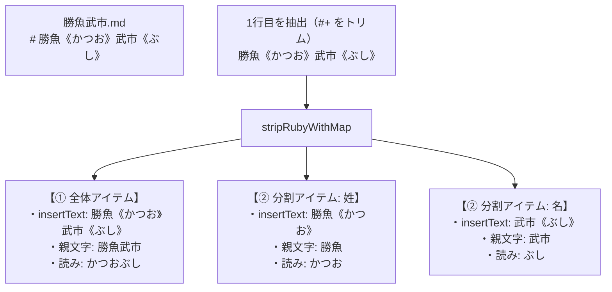

# 第55回：設定ファイルの1行目からルビを自動収集！登場人物サジェストと一発ルビ置換の実装

こんにちは！ 小説執筆用エディター **`novelaide`**（コードネーム: `novelaid-e`）の開発メイキング連載第55回です。

長編小説を執筆していると、登場人物の名前や特殊な地名には、初出時や強調したい場面で必ず「ルビ」を振る必要があります。
しかし、これまでのエディター補完では、設定資料から拾えるのはプレーンな名前テキスト（例: `勝魚武市`）だけで、ルビ（`勝魚《かつお》武市《ぶし》`）は作家がいちいち手入力するか、後からルビダイアログを開いて付与しなければなりませんでした。

今回は、小説設定資料の1行目（見出し行）に書かれたルビ付きの名前から **「全体（フルネーム）」** と **「分割（姓・名等のパーツ）」** の両方を自動収集し、エディターのサジェスチョンからルビ付き表記を一発で挿入・置換できる仕組みを構築しました！

---

## 1. 作家のリアルな執筆スタイルと課題

小説の登場人物設定ファイル（例: `勝魚武市.md`）では、1行目にルビ付きの見出しが記載されるのが自然な執筆スタイルです。

```markdown
# 勝魚《かつお》武市《ぶし》
```

### ユーザーからのリクエスト（作業ログより）

```text
想定として、勝魚武市.mdと登場人物のファイルがあった場合、
# 勝魚《かつお》武市《ぶし》
のように、基本的に一行目にルビ付きの名前が記載されます。
この一行目から変換用のルビ付きの値や、ルビの値を収集可能です。
なお、収集する場合、勝魚《かつお》武市《ぶし》と全体で扱う場合と、
勝魚《かつお》と武市《ぶし》の分けて扱う場合の両方を収集してください
また、サジェスチョンで表示する登場人物や地名などはこのルビ付きの値を挿入してください。
```

### 既存基盤の活用：`strip_ruby_with_map`

調査の結果、以下の既存基盤が既に揃っていることが分かりました：
- **`novelaid-fs`**: ドキュメント読み込み時に Frontmatter と本文（`content`）が綺麗に分離されている。
- **`novelaid-ruby`**: ルビ除去・位置復元・既存ルビ抽出を行うネイティブ関数 **`strip_ruby_with_map`** が既に実装されている。

この `strip_ruby_with_map` を本文の最初の非空行に適用すれば、
- `clean_text`: 親文字全体（`"勝魚武市"`）
- `existing_rubies`: 個別ルビペア一覧（`[ { surface: "勝魚", ruby: "かつお" }, { surface: "武市", ruby: "ぶし" } ]`）
が瞬時に取り出せるため、余計な自作パーサーを作ることなく、堅牢かつ安全に情報を取り出せます。

---

## 2. 抽出ロジック：全体と分割の二重生成

抽出した1行目から、以下の2種類の補完アイテムを自動生成します。



```typescript
// src/utils/entityRubyParser.ts より抜粋
export async function parseFirstLineRubies(content: string): Promise<ExtractedEntityRubies | null> {
  const firstLine = extractFirstNonEmptyLine(content);
  if (!firstLine) return null;

  // 既存の stripRubyWithMap を呼び出し
  const result = await stripRubyWithMap(firstLine);
  const parts = (result.existingRubies || []).map((r) => ({
    surface: r.surface,
    ruby: r.ruby,
    rubyText: `${r.surface}《${r.ruby}》`,
  }));

  return {
    hasRuby: parts.length > 0,
    surfaceFull: result.cleanText,
    rubyTextFull: firstLine, // 1行目のルビ表記そのまま
    readingFull: parts.map((p) => p.ruby).join(''),
    parts,
  };
}
```

---

## 3. エディター補完（Monaco Editor）での活用

Monaco Editor の補完プロバイダ（`EditorSupport.ts`）に以下の工夫を施しました。

### ① ルビ付き表記をそのまま挿入
補完確定時、`insertText` に `勝魚《かつお》武市《ぶし》` や `勝魚《かつお》` が指定されているため、ワンタップでカクヨム・なろう標準のルビ記法が展開されます。

### ② 親文字でも読みでもヒットする柔軟な絞り込み
`filterText` に「選択テキスト + 親文字（勝魚武市） + 読み（かつおぶし） + ルビ表記」を結合して渡しているため、
- 「かつお」と入力して `Ctrl + Space`
- 「勝魚」と入力して `Ctrl + Space`
のどちらからでも即座に候補に現れます。

### ③ 選択テキストの一括ルビ置換
すでにエディター上に「勝魚武市」と入力されている場合、そのテキストを選択して `Ctrl + Space` を押すと、`filterText` 先頭に選択文字列が動的付与されるため最高スコアでマッチ。
**Enterキー一発で `勝魚《かつお》武市《ぶし》` に置換** されます！

---

## 4. まとめと次回予告

小説作家の実際の執筆手順（設定資料の1行目にルビを書くスタイル）にシステムが寄り添うことで、面倒なルビ入力の手間を大幅に削減することができました。
既存の `novelaid-ruby` の形態素・校正用基盤を再利用することで、コードの重複を防ぎ、高速かつ安全な動作を実現しています。

次回は、このナレッジを活用したさらなる校正・執筆支援の深化へと進みます。お楽しみに！
