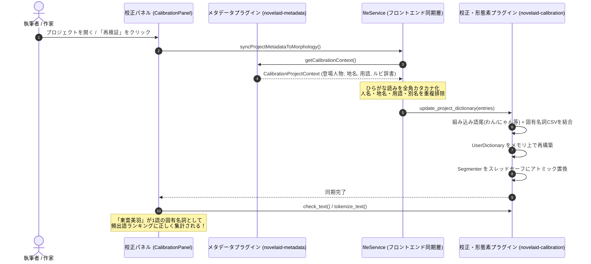

# 第56回：登場人物や地名を形態素解析に即座に教える！メタデータ動的辞書同期とキャラクター語尾の統一

こんにちは！ 小説執筆用エディター **`novelaide`**（コードネーム: `novelaid-e`）の開発メイキング連載第56回です。

小説執筆において、登場人物名（「ソラ・アルスター」「東雲美羽」）や舞台となる地名（「アルテリア帝国」）、架空の魔導用語・アイテム名などは、物語の根幹を支える極めて重要な要素です。
しかし、一般的な日本語形態素解析エンジン（IPADIC等）を通すと、これらは既知語として登録されていないため、「東雲」「美」「羽」や「アル」「テリア」「帝国」のように細切れに分断されてしまいます。その結果、執筆中のキーワード出現頻度を可視化する「頻出語ランキング」に主要キャラクター名が正しく載らなかったり、校正エンジンの品詞判定が乱れてしまうという大きな課題がありました。

今回は、設定資料から収集されているメタデータ（登場人物・地名・用語・ルビ辞書）を、純Rust製形態素解析エンジン **Lindera** のユーザー辞書へ動的に同期・ホットリロードする仕組みを構築しました。また、前段階として導入したラノベ特有のキャラクター語尾（「わん」「にゃん」「のじゃ」等）の品詞統一とあわせて、その設計と実装の全貌をお届けします！

---

## 1. ユーザーからの要望と直面した課題

今回の開発は、ユーザーからの以下のリクエストからスタートしました。

### ユーザープロンプト
> /plan 形態素解析の単語の動的な登録について検討します。  
> まず、機能として動作するかを確認するため、ラノベのキャラクターの語尾「わん」「にゃん」「ぱう」などの固定登録を検討してください  
> （中略）  
> /plan メタデータで収集している、人名、地名などを形態素解析に追加する計画を立てて  
> 進めて  

### 解決すべき技術的課題
1. **キャラクター語尾の品詞分類**:
   - 当初暫定的に「カスタム語尾」として扱っていましたが、Lindera（IPADIC）の文法体系と整合させるため、「終助詞（`助詞,終助詞`）」として統一する必要がありました。
2. **固有名詞の分断と頻出語集計の歪み**:
   - 本文中に頻繁に登場する「東雲美羽」や「アルテリア帝国」が断片化され、作者が把握したい「誰が何回登場したか」という執筆傾向が正しく可視化されませんでした。
3. **Rustバックエンドでの動的辞書ホットリロード**:
   - アプリを再起動することなく、設定資料の追加・編集やプロジェクト切り替えに合わせて、メモリ上でスレッドセーフに辞書を再構築する必要がありました。
4. **ユーザー辞書とIPADICの内部構造の違い（大発見の罠）**:
   - Lindera のユーザー辞書 CSV で登録したエントリは、第2列の品詞文字列（例: `"名詞,固有名詞,人名,一般"`）がそのまま1つの要素として格納されるため、標準IPADICのように各階層が別要素になっている前提の集計コード（`pos_main == "名詞"`）ではマッチしないというトラップが存在しました。

---

## 2. アーキテクチャとデータ同期フロー

メタデータ収集プラグイン（`tauri-plugin-novelaid-metadata`）と、形態素解析・校正プラグイン（`tauri-plugin-novelaid-calibration`）の間を、フロントエンドの `fileService` が仲介して動的同期するアーキテクチャを採用しました。



---

## 3. 実装のハイライト

### ① 語尾とメタデータの品詞マッピング体系
IPADIC の品詞体系に従い、以下のように厳密にマッピングしました。

* **キャラクター語尾**: `"助詞,終助詞"`（読み: ワン, ニャン, パウ, ノジャ 等）
* **登場人物名 / 愛称・別名**: `"名詞,固有名詞,人名,一般"`（読み: 全角カタカナ）
* **地名・国名**: `"名詞,固有名詞,地域,一般"`（読み: 全角カタカナ）
* **用語・アイテム / ルビ代表語**: `"名詞,固有名詞,一般,*"`（読み: 全角カタカナ）

### ② バックエンドでのスレッドセーフなホットリロード（Rust）
`tauri-plugin-novelaid-calibration` 内部で `Segmenter` を `Arc<RwLock<Segmenter>>` で保持し、組み込み語尾定数と動的エントリを結合した CSV から `UserDictionary` をメモリ上で一瞬で構築・置換します。

```rust
pub fn reload_user_dictionary(&self, additional_csv: Option<&str>) -> Result<()> {
    let combined_csv = if let Some(extra) = additional_csv {
        format!("{}\n{}", DEFAULT_NOVEL_USER_DICT_CSV.trim(), extra.trim())
    } else {
        DEFAULT_NOVEL_USER_DICT_CSV.to_string()
    };

    let user_dict = build_user_dictionary(&self.dictionary.metadata, &combined_csv)?;
    let new_segmenter = Segmenter::new(Mode::Normal, (*self.dictionary).clone(), Some(user_dict));

    let mut segmenter_lock = self.segmenter.write().map_err(|e| Error::Other(e.to_string()))?;
    *segmenter_lock = new_segmenter;
    Ok(())
}
```

### ③ トラップ解決：品詞・読みの正規化抽出ヘルパー
単体テストの実行中に発覚した「ユーザー辞書エントリの details がカンマ区切り1文字列になる」挙動を吸収するため、共通抽出ヘルパー `extract_token_details` を導入しました。

```rust
pub fn extract_token_details(details: &[&str]) -> (String, String, String, Option<String>) {
    let raw_pos = details.get(0).copied().unwrap_or("*");
    let (pos_main, pos_sub1, pos_full) = if raw_pos.contains(',') {
        let parts: Vec<&str> = raw_pos.split(',').filter(|s| *s != "*").collect();
        let main = parts.first().copied().unwrap_or("*").to_string();
        let sub1 = parts.get(1).copied().unwrap_or("*").to_string();
        (main, sub1, raw_pos.to_string())
    } else {
        let parts: Vec<&str> = details.iter().take(4).copied().filter(|s| *s != "*").collect();
        let main = parts.first().copied().unwrap_or("*").to_string();
        let sub1 = parts.get(1).copied().unwrap_or("*").to_string();
        let full = if parts.is_empty() { "*".to_string() } else { parts.join(",") };
        (main, sub1, full)
    };

    let reading = details.get(7)
        .or_else(|| details.get(2))
        .and_then(|&s| if s == "*" { None } else { Some(s.to_string()) });

    (pos_main, pos_sub1, pos_full, reading)
}
```
これにより、`check_text` 内の頻出語集計条件 `pos_main == "名詞"` に確実に合致し、登録された人名・地名が美しいランキングとして表示されるようになりました。

### ④ フロントエンドとの連携（TypeScript / React）
`fileService.ts` に `syncProjectMetadataToMorphology()` を実装し、設定資料スキャン時や校正パネルの初回マウント・「再検証」ボタン押下時に自動で呼び出されるように連動させました。

---

## 4. 動作検証とテスト結果

以下のテストケースを作成し、厳密に動作を検証しました。

1. **登録前のトークナイズ確認**:
   - `東雲美羽はアルテリア帝国に向かったにゃん。` というテキストを解析すると、`["東雲", "美", "羽", "は", "アル", "テリア", "帝国", ...]` のように細切れに分断されることを確認。
2. **動的辞書登録後のトークナイズ確認**:
   - 人名「東雲美羽」、地名「アルテリア帝国」を動的同期後、`["東雲美羽", "は", "アルテリア帝国", "に", "向かっ", "た", "にゃん", "。"]` のように、それぞれ1語の固有名詞として正しくトークナイズされることを確認。
   - 組み込み語尾「にゃん」も助詞・終助詞として共存して抽出されることを確認。
3. **頻出語ランキング集計確認**:
   - `check_text` を実行した結果、頻出語ランキングの最上位に「東雲美羽（出現数: 2）」および「アルテリア帝国（出現数: 1）」が正しくランクインすることを確認。

プラグインの全37件の単体テスト（`cargo test`）およびアプリ全体のビルド（`npm run build`）がすべてノーエラーで通過しました！

---

## 5. まとめと次回予告

今回の機能改善により、設定資料に登場人物や地名、世界観用語を書けば書くほど、校正エンジンがそれを学習し、執筆中の本文をより深く、正確に理解・サポートしてくれるようになりました。まさに「設定資料とエディターが一体化した小説執筆環境」の真骨頂です。

次回は、これら形態素解析とメタデータの連携をさらに活かし、作品全体の表現力や執筆体験を高める新機能・UI改善を進めていきます。どうぞお楽しみに！
