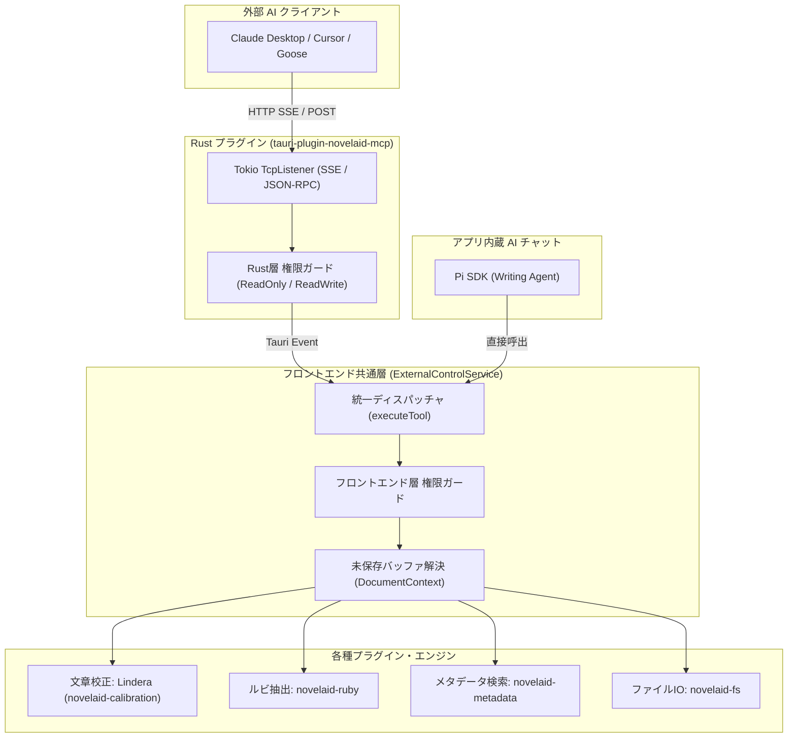

# 57. 外部AIエージェント連携MCPサーバー新設と内蔵AIツール実行の一元化

こんにちは！ 小説執筆用エディター **`novelaide`**（コードネーム: `novelaid-e`）の開発メイキング連載第57回です。

今回は、小説執筆エディター `novelaide` を外部の最新 AI エージェント（Claude Desktop、Cursor、Goose、Cline など）から直接操作できるようにするための **MCP (Model Context Protocol) サーバー機能**の新設と、アプリ内部の AI アシスタント（Pi SDK）と外部連携をひとつに束ねる **「外部制御（External Control）」統合アーキテクチャ**の実現についてお届けします！

---

## 1. 今回の課題とユーザープロンプト

### ユーザーからのリクエスト
エディター内で動作する既存の AI 執筆チャット機能（Pi SDK）に加えて、外部の高度な AI エージェントからもエディターのファイルを安全に読み書き・校正したいという要望が寄せられました。

```markdown
> /plan novelaideを外部からAIで操作できるようにするための、mcp(サーバー)機能の追加を検討します。
>
> * 機能は設定でON/OFFできるものとします
>     + 権限として、読み込み、書き込みで分類して書き込み制限が可能としてください
>
> 対応する機能を考えた場合、現在のAI機能としてのPi SDKからのアクセス方法とほぼ同等になると考えられます。
>
> Pi SDK => フロントエンド => 各種処理
> MCP => フロントエンド => 各種処理
>
> これらの統合も含めて検討してください。
> また、プラグイン名称的にはmcpですが、Pi SDKからのアクセス部分も含めて外部制御とみなしてまとめてください。
```

### 設計上の3つのポイント
1. **未保存バッファとの完全同期**:
   外部の AI がファイルを読み書きする際、ディスク上のファイルだけを見てしまうと、エディターで執筆中の「未保存バッファ」と食い違い、原稿が先祖返りしてしまいます。そのため、**「未保存バッファを最優先で参照・更新する」フロントエンドパイプライン**を経由する必要があります。
2. **二層の権限ガード（Read / Write）**:
   誤って外部 AI が原稿を破壊しないよう、「読み込み専用（`read`）」と「読み書き可能（`write`）」の書き込み制限モードを設け、Rust 側とフロントエンド側の二重で不正な書き込み要求を遮断します。
3. **Pi SDK と MCP の完全一元化**:
   これまでは内蔵 AI チャット（`ChatView.tsx`）の中に約400行の局所的なファイル検索・置換・校正ハンドラーがベタ書きされていました。これを独立したサービス `externalControlService.ts` へ抽出し、内蔵 AI も外部 MCP も全く同一のツールセット・権限ロジックで動作するように統合します。

---

## 2. 外部制御の統合アーキテクチャ

設計したアーキテクチャは以下の通りです。



### 提供される公式ツール一覧

| ツール名 | 権限 | 説明 |
| :--- | :--- | :--- |
| `read_file` (`read`) | Read | エディターで開かれている未保存バッファを最優先で参照（オフセット・行数指定対応） |
| `list_files` | Read | プロジェクト内ファイル一覧および開いているタブ一覧を取得 |
| `scan_proofread` | Read | 純Rust製 Lindera による形態素解析文章校正（重複助詞、ら抜き言葉等）を実行 |
| `extract_ruby` | Read | 青空文庫形式ルビの抽出と解析を実行 |
| `search_metadata` | Read | 人名・地名・組織等の作品ナレッジを前方一致検索 |
| `write_file` (`write`) | Write | ファイルの新規作成・上書き保存（エディターバッファを即時同期） |
| `edit_file` (`edit`) | Write | テキストの完全一致部分置換（エディターバッファを即時同期） |

---

## 3. 実装のステップとポイント

### ① 新プラグイン `tauri-plugin-novelaid-mcp` の新設
Tauri v2 プラグインとして `tauri-plugin-novelaid-mcp` を新設しました。
外部ライブラリへの過度な依存を避け、Tauri 内蔵の `tokio::net::TcpListener` を用いて、公式 MCP SSE 仕様（`GET /sse` によるセッション初期化とイベントストリーム購読、`POST /message?sessionId=...` による JSON-RPC 2.0 リクエスト受信）をコンパクトかつ堅牢に実装しました。

ツール呼び出しリクエストを受信すると、Tauri の `app.emit("mcp://tool-call", ...)` イベントを通じてフロントエンドへ中継され、フロントエンドから `respond_tool_call` IPC コマンドで結果が返されると SSE 経由で AI クライアントへプッシュされます。

### ② 共通外部制御サービス `externalControlService.ts`
内蔵 AI チャットと外部 MCP の双方から呼び出される統括サービス `src/services/externalControlService.ts` を新設しました。

```typescript
// 統一ディスパッチャーによる安全なツール実行
const res = await externalControlService.executeTool(toolName, args, {
  allowWrite: mcpPermission === 'write',
  source: 'external-mcp',
});
```

`DocumentContext.tsx` と連動させることで、エディターが現在開いているタブ一覧（`openDocuments`）やアクティブな原稿（`activeDocument`）が常にサービスへバインドされます。AI が原稿を修正すると、エディター画面のバッファが即座に書き換わり、ユーザーの画面にリアルタイムで反映されます。

### ③ 内蔵 AI チャット（`ChatView.tsx`）の劇的スリム化
これまで `ChatView.tsx` の中にベタ書きされていた約400行のツール実行コードをすべて撤廃し、`externalControlService.executeTool` を呼ぶだけのシンプルな構造にリファクタリングしました。これにより、内蔵 AI と外部 AI が全く同じ賢いファイル名ファジーマッチングや校正エンジンを共有できるようになりました。

### ④ 設定画面（`AiSettingsPlugin.tsx`）への MCP 管理 UI 追加
設定画面の「AI執筆アシスタント」タブ内に「外部制御 / MCP サーバー連携」セクションを新設しました。

- **MCP サーバー有効化スイッチ**: ON にするとバックエンドで即座にサーバーが起動し、ポート番号（デフォルト: 3000）で待ち受けを開始します。
- **外部アクセス権限選択**:
  - `読み込み専用 (read)`: 推奨・安全モード。原稿の変更は一切行わず、資料参照や校正チェックのみを AI に許可します。
  - `読み書き可能 (write)`: ファイルの保存・差分置換まで AI に委ねるフルオート執筆モードです。
- **接続 URL 案内**: `http://127.0.0.1:3000/sse` をそのまま Claude Desktop や Cursor の MCP 設定ファイル（`claude_desktop_config.json` 等）に貼り付けて利用できます。

---

## 4. まとめと次回予告

今回の改修により、`novelaide` はエディター内部での AI 執筆支援にとどまらず、**「外部のあらゆる AI エージェントから安全に操作できる小説執筆環境」**へと大きな進化を遂げました！

- **プラグイン新設**: `tauri-plugin-novelaid-mcp`（公式 SSE トランスポート）
- **内部統合**: `externalControlService.ts` により内蔵 AI と外部 MCP を一元化
- **安全設計**: Rust とフロントエンドの二重書き込み制限ガード
- **バージョン更新**: `v0.62.0` → **`v0.63.0`**（minor アップデート）

外部の Claude や Cursor に「第1章を校正して」「登場人物の美羽の設定を確認して」と指示を出すだけで、`novelaide` がバックグラウンドでスムーズに応答する快適な執筆環境をぜひお楽しみください。

次回もさらなる執筆体験の向上を目指して機能改善を進めていきます。お楽しみに！
